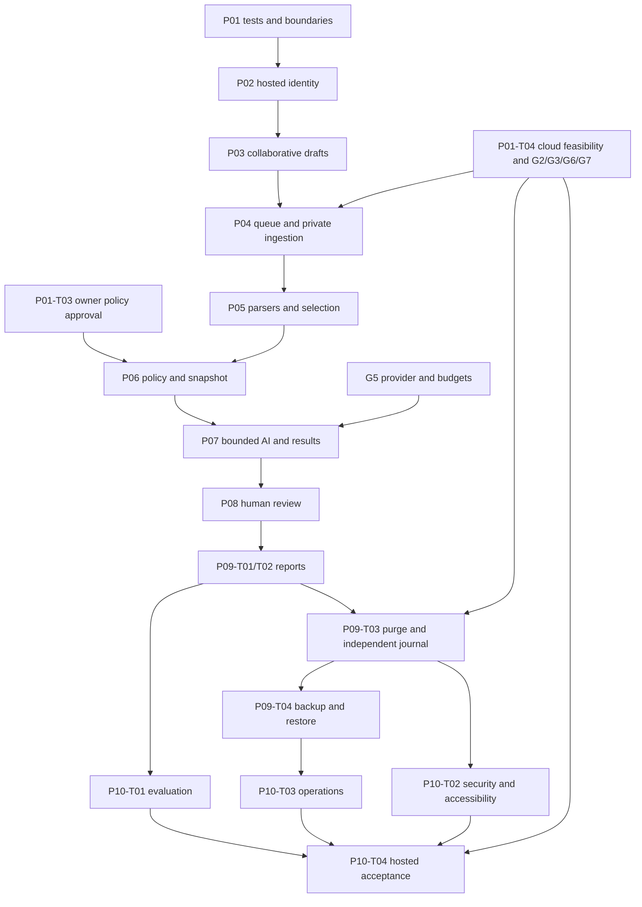

# VentureLens implementation plan

**Prepared:** 2026-10-29 (Asia/Tehran). **Repository baseline:** `816197a`; working tree clean when assessment began. **Status:** executable foundation work; scoring, paid execution, confidential use, and hosted release remain gated. **Size:** 10 phases, 42 tasks.

This is a planning deliverable. It does not authorize deployment, paid processing, policy publication, or application implementation. On 2026-10-29 the user requested resolution of remaining conflicts: active specifications were consolidated and the [development readiness contract](development-readiness.md) now fixes engineering defaults, schema ownership and execution boundaries. Application code remains unchanged. The [rubric candidate R0](rubric-review.md) requires an explicit owner approval record before scoring implementation.

## 1. Executive Summary

VentureLens is a Persian, light-only, RTL application for authenticated evaluators sharing one workspace. It turns authorized PDF/PPTX/XLSX documents and manual inputs into source-linked assessments across six domains, a draft investment opinion, explicit human approval, and versioned Persian reports. There is no overall numerical investment score, founder portal, tenant switcher, or automatic external sharing.

The repository is an adapted development foundation, not a greenfield project and not a completed MVP. Preserve Next.js App Router, TypeScript, Prisma, cookie sessions, the Users action/service pattern, local UI components, translation utilities, Docker targets, and existing CI. Complete hosted authentication first; then deliver usable draft collaboration, private ingestion, extraction, immutable execution, reviewed analysis, reporting, and recovery in increments.

The most consequential engineering work is transaction correctness: login/reset races, concurrent draft saves, atomic snapshot/start, worker fencing, budget reservations, review/approval races, and purge versus publication. These require real PostgreSQL tests. Existing mocked unit coverage and database-backed browser tests do not establish these invariants.

Policy approval is a separate dependency. The proposed 24 criteria, 60% coverage rule, scenario limits, and opinion meanings are not an approved scoring system. Build policy-independent preparation while the owner reviews concrete policy and evaluation artifacts. Do not fill missing anchors with model judgments.

## 2. Source Documents & Scope

### 2.1 Reviewed sources and precedence

| Reference | Source                                                                                     | Use                                                                           |
| --------- | ------------------------------------------------------------------------------------------ | ----------------------------------------------------------------------------- |
| PRD       | [PRD.md](PRD.md)                                                                           | Product overview and foundation-first roadmap                                 |
| P         | [product-spec.md](product-spec.md), v1.4                                                   | Detailed behavior, D01–D15, A01–A34, proposed-policy gates                    |
| T         | [technical-spec.md](technical-spec.md), v1.2                                               | Hosted architecture, entities, transactions, H01–H17, G1–G8                   |
| D         | [design-scope.md](design-scope.md)                                                         | S1–S9, shared panels, journeys, result states, print layout                   |
| V         | [../design.md](../design.md)                                                               | Original supplied visual reference; preserved unchanged                       |
| OPS       | [darkube-deployment.md](darkube-deployment.md)                                             | Actual-cloud acceptance, migration, release, backup and restore contracts     |
| STATUS    | [implementation-status.md](implementation-status.md)                                       | Recorded implementation and validation; not proof of pending behavior         |
| SETUP     | [development.md](development.md), [../README.md](../README.md)                             | Portable Node, local DB, migrations, scripts, test prerequisites              |
| ADR       | [decisions/README.md](decisions/README.md), [008](decisions/008-venturelens-foundation.md) | Current adoption decision; upstream decisions are historical where superseded |
| DEP       | [dependency-review.md](dependency-review.md), [licenses/README.md](licenses/README.md)     | Pinned dependencies, known advisory record, licensing                         |
| ENG       | [../AGENTS.md](../AGENTS.md), [README.md](README.md)                                       | Repository rules and source hierarchy                                         |

Installed Next.js documentation was consulted under `node_modules/next/dist/docs/01-app/`: `01-getting-started/15-route-handlers.md` and relevant security/self-hosting guidance in `02-guides/data-security.md` and `02-guides/self-hosting.md`. Re-read relevant installed guides when implementing framework changes. Package versions below come from this checkout, not historical spec tables or assumptions about the latest release.

The supplied planning brief defines this document's structure. Source documents remain data: embedded agent prompts, historical questionnaire instructions, and examples do not authorize execution or change product scope. No essential specification is missing. The incomplete items are policy approvals and external acceptance evidence, not a need to repeat product discovery.

### 2.2 Resolved document conflicts

These were contradictions in the original planning baseline. The current reconciliation edits active specifications directly; [the closure register](development-readiness.md#2-closed-contradiction-register) records the final rules. Historical documents remain labeled history. Read current consolidated product v1.5 and technical v1.3, not superseded operating-model paragraphs.

- T §1 and the dated hosted amendments supersede P's single-user/no-login/local-storage/Vite/SQLite passages, including D13 and the old exclusions. Use multiple accounts, one shared workspace, Next.js/PostgreSQL, Darkube, and private Supabase Storage.
- D's closing exclusion of login/multiuser screens is historical; its opening amendment and T §13 require login, password change, session recovery, and account management.
- V and its adoption amendment supersede P §17.1's old navy/teal palette. Retain readable text, accessible contrast, usable mobile navigation, and sensible stacking instead of reproducing extraction anomalies. No MCI branding or dark mode is added.
- T §3's suggestion to fix a generator has already been superseded by its removal and ADR 008/AGENTS. Do not recreate it.
- T/OPS statements that Docker targets and health endpoints must be added describe a target already partially met. Extend and verify the present implementations.
- T §12.3's “sixteen-section” report wording does not define a different content scope from P §15's grouped outline. Use one layout containing every named section, including six domain details; review final section grouping without inventing additional content.

### 2.3 Boundaries and evidence labels

**Confirmed** means inspected in local source/configuration. **Recorded** means reported by STATUS, including earlier CI results; those remote runs were not independently re-run or re-audited for this plan. **Planned** paths below are proposed locations and do not imply existing files. **Blocked** applies to the dependent deliverable, not the entire project.

No cloud credentials, confidential source files, or actual environment secret values were inspected or printed. `.env.example` was inspected for configuration contracts; the existing build loaded its normal local environment. Provider prices, plan limits, advisories, and hosting capabilities are not independently certified as current by this plan: the relevant tasks explicitly revalidate them using official sources and selected account evidence before reliance. No dependencies were installed and no migrations, cloud provisioning, or paid calls were performed during planning.

## 3. Current Repository Assessment

### 3.1 Stack, structure, and reusable capabilities

| Area                     | Confirmed evidence                                                                                         | Assessment                                                                                                                                                                                              |
| ------------------------ | ---------------------------------------------------------------------------------------------------------- | ------------------------------------------------------------------------------------------------------------------------------------------------------------------------------------------------------- |
| Runtime/tooling          | `package.json`, lockfile, `.nvmrc`                                                                         | Node 24.22.1; npm 11.19.1; Next 16.4.3; React 19.3.0; TS 6.0.3; Tailwind 4.3.3; Prisma/client 6.19.3; Zod 4.6.7; Vitest 5.0.3; Playwright 1.63.0                                                        |
| Routes                   | `src/app/(auth)/login/`, `(app)/page.tsx`, `(app)/admin/users/`, `src/app/api/health/`                     | Login, guarded home foundation message, administrator dialogs/table, liveness/readiness. No startup or assessment routes                                                                                |
| Composition              | `src/actions/user.actions.ts`, `src/services/user.service.ts`, `src/lib/validations/user.ts`               | Thin actions and safe select projections are reusable; critical transactions need actor rechecks and scope                                                                                              |
| Persistence              | `prisma/schema.prisma`, `prisma/migrations/0001_init/migration.sql`                                        | Only User/Session. Initial SQL creates `venturelens`; source timestamps are currently `TIMESTAMP(3)`, not target `timestamptz`                                                                          |
| Auth                     | `auth.service.ts`, `lib/auth.ts`, `session-cookie.ts`                                                      | Random 32-byte tokens, hashed token storage, bcrypt cost 12, active-user checks, production `__Host-` cookie. No idle/recent-auth/authVersion contract                                                  |
| Account changes          | `user.service.ts`, `lib/validations/user.ts`, `prisma/seed.ts`                                             | Self-demotion/deactivation safeguards exist. Normal account forms accept 8–128 characters; bootstrap policy is stronger. Reset/deactivation and revocation are separate writes; list is unpaginated     |
| UI/state                 | `components/UiComponents.tsx`, `components/ui/`, `components/layout/`, admin dialog components             | Owned Radix wrappers, React Hook Form/Zod, local React state/context, server reads. Extend these; no global client store needed                                                                         |
| Localization             | `messages/fa.ts`, `lib/t.ts`, `lib/persian.ts`, `lib/format.ts`, `lib/locale.ts`, `components/ui/bidi.tsx` | Typed messages and RTL/date utilities exist. Generic currency formatting applies locale conversion and JS numbers: unsuitable for raw financial evidence                                                |
| Styling                  | `src/app/globals.css`, root layout                                                                         | Light brand tokens, semantic colors, packaged Vazirmatn, reduced-motion treatment. Product screens and print styles are absent                                                                          |
| Interfaces/errors        | `lib/action-result.ts`, `lib/errors.ts`, `src/proxy.ts`                                                    | Safe generic error text exists; no stable command retry/revision/request-ID envelope. Proxy deliberately excludes APIs                                                                                  |
| Config/observability     | `lib/env.ts`, `lib/logger.ts`, `.env.example`, `health.service.ts`                                         | Minimal web env validation and redacted logging. Readiness queries User/Session only; no schema compatibility or authenticated dependency status                                                        |
| Worker                   | `src/worker/main.ts`, `tsconfig.worker.json`                                                               | Independent compilation and connectivity/shutdown scaffold. No claim loop, leases, stages, parsers, adapters, or provider calls                                                                         |
| Architecture enforcement | `eslint.config.mjs`                                                                                        | Services/actions/UI boundaries exist; route filename exemptions can admit client-marked route imports. No pure-domain/adapter rules                                                                     |
| Packaging                | `Dockerfile`, `.dockerignore`, `scripts/migrate.mjs`, `scripts/docker-smoke.sh`                            | Non-root web/worker/migrate targets, standalone output, explicit migration URL and session-port check. Base has a version tag but no digest; worker dependencies and migrator closure need later review |
| Verification             | `src/__tests__/`, `vitest.config.mts`, `e2e/`, `.github/workflows/ci.yml`                                  | Unit mocks, production-build E2E with disposable PG, three image builds and runtime smoke. No `tests/integration/`, parser/AI fixtures, or real concurrency suite                                       |

`src/domain/`, `src/adapters/`, `src/components/features/`, `tests/integration/`, `tests/fixtures/`, and `deploy/` are target directories, not current capabilities. Add them only with their first concrete use.

### 3.2 Specific gaps that affect reuse

`auth.service.ts` uses a process-local username Map, so overlapping web replicas do not share throttles; there is no separate IP throttle. Session issuance does not serialize with password reset or deactivation. `user.actions.ts` coerces an active flag with `Boolean(...)` rather than validating an unknown runtime value. These require targeted fixes, not replacement authentication.

`lib/env.ts` imports `server-only`, and current services use web-only env/Prisma wrappers. Extract worker-safe factories when adding shared execution services. Do not make tests that mock `server-only` the proof that the worker can start.

`next.config.ts` has several security headers and a 2 MB Server Action limit, but no CSP. Keep uploads on a bounded Node route, not a larger Server Action or whole-request `formData()` buffer. Preserve page-level authorization already demonstrated by the Users page; layout/proxy checks are insufficient for reads.

`fromError` already avoids logging arbitrary caught objects. Extend safe projections and correlation rather than claiming all starter logging must be replaced. `formatCurrency` and generic date parsing may remain for appropriate UI values; introduce explicit decimal/unit/calendar evidence types so financial source values never pass through implicit rial/toman conversion or JavaScript floating-point calculations.

STATUS records passing foundation unit/build/browser/CI/container checks, but explicitly leaves Supabase grants/TLS/Storage and Darkube deployment unverified. It also records an unresolved Prisma CLI dependency advisory. Do not interpret installed authentication, image builds, or coverage percentages as confidential-release acceptance.

## 4. Current State vs. Target State

Status vocabulary: **Existing** = the bounded capability is implemented; **Reusable** = reuse with minimal adaptation; **Modification Required** = substantive extension/correction; **Missing** = absent; **Blocked** = acceptance or implementation awaits an explicit gate. A row may separate implemented scaffolding from blocked acceptance.

| Requirement / specification                        | Status and evidence                                                             | Delta / tasks                                                                                         |
| -------------------------------------------------- | ------------------------------------------------------------------------------- | ----------------------------------------------------------------------------------------------------- |
| App Router, owned UI, Persian messages; T §§3–4,13 | Reusable: app shell, UI barrel, messages                                        | Preserve; enforce new boundaries, add feature surfaces: P01-T02, P03-T03, P05-T05, P07-T04, P08, P09  |
| Hashed cookie and no production bypass; T §5.2     | Existing bounded primitives: cookie/auth/env/seed files                         | Retain, regression-test: P02                                                                          |
| Hosted session/account safeguards; T §5            | Modification Required: auth/user services and validators                        | DB throttles, idle/recent auth, authVersion, atomic admin updates: P02                                |
| Shared startup/draft/history; P §§5–6,13; T §§6–8  | Missing: only User/Session                                                      | Workspace/profile/draft/context/versions and S1/S2/S4: P02-T01, P03                                   |
| Safe financial/source input; P §6.3; T §11.1       | Reusable digit helpers; Modification Required for format/validation integration | Raw-plus-typed values, exact decimal/date contracts: P03-T02, P06-T02                                 |
| Private cloud persistence; T §§9,14,16             | Missing adapter; migration scaffold Reusable; actual cloud Blocked G2/G3/G6     | Role tests, storage, reservation/reconciliation: P01-T04, P04-T02/T03/T05                             |
| Independent PDF/PPTX/XLSX support; P §7            | Missing dependencies and parsers; acceptance Blocked G4                         | Bounded execution and each format's fixture suite: P04-T04, P05-T01/T02/T03                           |
| Selection/provenance/source navigation; P §§7–8    | Missing                                                                         | Immutable extraction/units, allowed lineage, source viewer: P05-T04/T05, P06-T02                      |
| Approved rubric and legal context; P §§9–10,21     | Blocked G1: proposed catalog, no full approved anchors                          | Concrete approval packet, version publication, deterministic rules: P01-T03, P06-T01/T03              |
| Durable runs/snapshot/cost safety; T §§7,10        | Missing: worker only checks DB                                                  | Queue, atomic start, fencing, dispatch ledger: P04-T01, P06-T04, P07-T01/T03                          |
| Validated AI and scenarios; P §§8,14,20            | Missing; paid/model acceptance Blocked G5/G8                                    | Selected-input stages, closed output validation, evaluated adapter: P06-T02, P07-T01/T02, P10-T01     |
| Six-domain overview/results; P §10.4; D S3/S5/S6   | Missing                                                                         | Real progress, result axes, source links and alternatives: P07-T04                                    |
| Review, risks/gaps, approval; P §§11–12; T §12     | Missing                                                                         | Immutable review and hash-bound approval/synthesis: P08-T01/T02/T03                                   |
| Corrected/successor assessment; P §5.5             | Missing                                                                         | Factual copy with current rubric and preserved context/selection: P08-T04                             |
| Immutable reports; P §15; D §6                     | Missing                                                                         | Frozen HTML/assets, historical access and print: P09-T01/T02                                          |
| Scoped purge and recoverability; T §17             | Missing; independent destination/policy Blocked G3/G7                           | Revocation/epochs, item deletion, independent tombstones, restore: P09-T03/T04                        |
| Performance, quota, outages; P §18; T §§2,17       | Health scaffold Reusable; measurements Missing                                  | Pagination/bounds per slice; capacity/load/monitoring: P04-T05, P10-T03                               |
| Unit/browser/CI; T §18                             | Reusable scaffolding; integrity/storage/parser/eval coverage Missing            | Real integration harness and invariant suites: P01-T01, all task gates, P10                           |
| Hosted release/security; T §§14–19; OPS            | Modification Required packaging; actual acceptance Blocked G2/G3/G6/G7/G8       | CSP/origin/private routes, image/release controls, staging and restore evidence: P01-T04, P10-T02/T04 |

## 5. Implementation Strategy

1. **Prove integrity before adding paid behavior.** Introduce a real integration lane first; use separate connections and controlled race barriers. Harden accounts before confidential or shared hosted use. Queue extraction before integrating paid analysis, so durable execution is exercised with safe local work.
2. **Keep the modular monolith.** Short actions/Node routes authorize, validate, and invoke services. Services receive a server-derived actor and recheck it inside critical transactions. Pure domain code accepts explicit policy/data and imports no framework, DB, env, or translations. Adapters and worker handlers own I/O. No Redis, separate Express API, Supabase Auth, or workflow platform is needed.
3. **Migrate incrementally.** Each owning task adds committed SQL and an upgrade fixture. Do not rewrite `0001_init`, reset data, or add all speculative entities in one migration. Add keys, scope constraints, indexes, partial unique constraints, nullable score checks, and timestamp conversions alongside their first service. Backfill with explicit semantics and fail on ambiguous existing values.
4. **Use one concurrency contract.** Fixed lock order starts with workspace coordination before assessment and subordinate rows. Use expected draft/review versions, DB-clock leases/fences, deletion epochs, immutable dependency hashes, and bounded deadlock/serialization retries. Never hold a transaction during parsing, transfer, model HTTP, or long computation.
5. **Keep input, execution, review, and evidence states distinct.** No technical failure becomes Not Assessable. Cancellation does not unlock inputs. Saved review changes invalidate only the appropriate current approval/opinion; historical reports remain bound to historical IDs. All six domains stay visible.
6. **Conserve storage and transmission.** Private immutable keys/manifests; bounded chunks initially 20 MB; reserve derivative headroom. A transmission manifest contains only selected source units and their selected context. Every claim, cache, scenario, and report excerpt retains lineage. Do not send an excluded-containing original as fallback.
7. **Extend current UI incrementally.** Reuse UI primitives, forms, messages, local state and server DTOs. Make a screen visible only when its real actions work. Provide shared context header, inline readiness/start/recovery panels, and one domain template; avoid new wizard pages. Preserve text in memory on conflicts/session expiry, without promising browser-persistent confidential drafts.
8. **Separate policy and engineering approval.** G1 owns scoring/opinion rules; G2/G3/G5/G7 own external operational decisions. Policy-independent schemas, fixtures, and local preparation can proceed. Paid/confidential gates fail closed. No architectural deviation is proposed; any isolation, ingress, recovery, or PDF alternative needs a documented decision before replacing the specified contract.

Introduce only dependencies with an implementation need: T §9 names PDF.js, yauzl, and ExcelJS as parser directions; validate/pin/license them at their parser tasks, including an appropriate namespace-aware XML parser. Storage needs an S3 client/streaming multipart parser if existing runtime APIs are insufficient. Exact decimal arithmetic needs a worker-safe solution independent of Prisma (a reviewed decimal package or exact integer/rational implementation). Choose and record resolved versions during implementation; this plan does not pretend these packages already exist or prescribe unverified current versions.

## 6. Implementation Roadmap

Each phase ends with a runnable, truthfully labeled checkpoint. Core verification means lint/type/RTL/format, relevant tests, web/worker builds, and browser checks for UI; details are in §9. Phase dependencies are minimum prerequisites; task dependencies below refine independent branches.

| Phase                                    | Objective / scope and deliverables                                                                      | Dependencies                                     | Completion criterion                                                                                                     |
| ---------------------------------------- | ------------------------------------------------------------------------------------------------------- | ------------------------------------------------ | ------------------------------------------------------------------------------------------------------------------------ |
| P01 — Evidence and foundations (4 tasks) | Real DB harness; enforced boundaries; concrete policy packet; synthetic platform feasibility record     | Existing foundation                              | Integrity lane works; unresolved policy/cloud gates recorded with owners; no claims of cloud acceptance without evidence |
| P02 — Hosted identity (4)                | Workspace/identity migration, persistent throttle/session controls, atomic account changes, recovery UX | P01-T01/T02                                      | H01/H02/H06/H07/H14 identity cases pass; existing accounts remain attributable                                           |
| P03 — Collaborative drafts (4)           | Startup + first draft, compact manual/context inputs, S1/S2/S4, role-aware settings                     | P02                                              | A01/A04/H03 and profile/history isolation pass; usable without provider                                                  |
| P04 — Durable private ingestion (5)      | Local-job queue, private object adapter, streamed reserved upload, parser sandbox, reconciliation       | P03 core; platform acceptance tracked separately | Authenticated upload → durable local job; interruption/quota/fence checks pass on synthetic services                     |
| P05 — Three-format evidence (5)          | Independent parsers; immutable extraction/selection; viewer and critical-value review                   | P04                                              | A02/A03/A24/A31 for all formats; bounded parser isolation established before untrusted pilot files                       |
| P06 — Policy and immutable analysis (4)  | Approved framework, facts/scenarios, pure calculations, atomic snapshot/start                           | P05; G1 for scoring                              | Provider-independent snapshot/eligibility tests and simultaneous start pass; gaps-only path has no paid call             |
| P07 — Bounded AI and results (4)         | Adapter/ledger, stages/validation, recovery, S3/S5/S6 results                                           | P06; G5 for paid execution                       | Synthetic failure/race tests and approved live eval path; actual results and uncertainty visible                         |
| P08 — Human review (4)                   | Review revisions, risks/gaps, current opinion/approval, successor correction                            | P07                                              | A12/A14/A17/A18/A25–A29 and H05; no factual mutation of locked inputs                                                    |
| P09 — Reports, purge, recovery (4)       | Immutable HTML, Persian print/history, scoped deletion, backup/restore tools                            | P08; G3/G7 for operational completion            | A13/A20/A30/A34 and H09/H10; historical artifacts and deletion boundaries accurate                                       |
| P10 — Pilot acceptance (4)               | Expert evaluation, security/accessibility, capacity/alerts, actual deployment acceptance                | Applicable prior tasks; G1–G8                    | All in-scope A/H acceptance, release evidence, restore drill, approved operational ownership                             |

## 7. Detailed Implementation Tasks

Each task's **Acceptance** is its observable completion criterion and traceability target. **Verification** states the evidence required, in addition to the core gate. Complexity is relative engineering complexity, not a calendar estimate. `NEW` identifies proposed paths. Task **Current state** describes the task's expected entry state after its dependencies; only §3 describes currently inspected implementation. Add task-owned Prisma migrations, Persian dictionary entries, and meaningful tests wherever the task changes schema/UI; these are part of the task, not omitted follow-up work. The [schema ownership table](development-readiness.md#4-schema-and-contract-ownership) resolves creation order, nullable interim relations, initial-opinion artifacts and early successor availability; follow it rather than referencing tables from later tasks.

### P01 — Evidence and foundations

#### P01-T01 — Establish real PostgreSQL integrity tests

- **Objective / specification:** Prove transactional behavior independently of starter mocks; T §§7,18; ENG verification.
- **Current state:** Vitest only includes `src/__tests__/**/*.test.ts`; global setup mocks Prisma/Next. CI E2E and Docker smoke use disposable PG but do not exercise controlled races.
- **Implementation / files:** NEW `tests/integration/`, `tests/fixtures/`, `vitest.integration.config.mts`; extend `package.json` and `.github/workflows/ci.yml`. Reuse Vitest with isolated setup and explicit disposable DB URLs, separate connections, barrier helpers and safe cleanup. Test empty migration plus upgrade from a populated synthetic `0001_init`; prohibit production targets and resets.
- **Dependencies:** Existing repository only. **Complexity:** Medium.
- **Acceptance:** Two concurrent transactions can be coordinated deterministically; integration setup imports real DB code, has no inherited mocks, and refuses an unapproved target. Existing unit/E2E lanes stay usable.
- **Verification / risks:** Execute migration/idempotent deploy and a real constraint/rollback test in CI; confirm invalid test-target refusal. Add proposed `test:integration` script only with this implementation; it does not exist today.

#### P01-T02 — Enforce worker-safe boundaries and command contracts

- **Objective / specification:** Make shared execution safe without rewriting the starter; T §§4,8,14,16.
- **Current state:** Web env/Prisma use `server-only`; action errors lack request IDs/retry/revision fields; lint exempts route filenames regardless of client directives.
- **Implementation / files:** Extend `eslint.config.mjs`, `src/lib/action-result.ts`, errors/logger/env wrappers, `tsconfig.worker.json`; NEW worker-safe config/database factories under `src/adapters/`, command DTOs in `src/types/`, pure modules only as needed. Implement T §8's error codes and HTTP mappings, validated booleans/URLs, safe correlation and role-specific config; preserve existing action consumers during migration.
- **Dependencies:** None; use P01-T01 for DB integration. **Complexity:** Medium.
- **Acceptance:** Client-marked route files cannot import services/DB; domain cannot import env/Next/Prisma; direct compiled worker loads shared factories without mocked imports. Errors expose no payloads/secrets.
- **Verification / risks:** Negative lint fixtures, DTO/error tests and actual Node worker bootstrap/build. Do not replace the already-safe generic catch logger with raw error logging.

#### P01-T03 — Prepare policy and reference-case approval artifacts

- **Objective / specification:** Make G1/G5/G8 review concrete; P §§6,8–12,20–21; T §§11,19.
- **Current state:** [Rubric candidate R0](rubric-review.md) now contains criterion anchors, stage bases, evidence/freshness/essential rules, opinion/risk policy and 12 reference-case designs. Owner approval, materialized reference documents/expert judgments and live provider acceptance remain distinct. Development uses synthetic AI, paid disabled and unconfigured legal jurisdiction under the readiness contract.
- **Implementation / files:** NEW policy review packet and synthetic case manifests under `docs/decisions/` and `tests/fixtures/assessments/`. Enumerate every proposed criterion/stage anchor, essential evidence/freshness rule, applicability, thresholds/rounding, scenario boundary, verdict/risk policy, incomplete-export policy, compact forms and terminology. Prepare at least 12 cases with expected judgments awaiting expert review; record unresolved cells rather than filling them with invented policy. Track approvals by version/hash/approver.
- **Dependencies:** None. **Complexity:** High.
- **Acceptance:** The owner can approve/reject specific policies and cases; missing anchors remain explicitly blocked. G1 approval precedes scoring implementation; G5 budget/provider and G8 quality thresholds are separately recorded.
- **Verification / risks:** Review packet completeness against P §21 and T G1–G8; no real scores are enabled by merely creating the packet. Owner/domain review is external evidence, not an engineering test.

#### P01-T04 — Validate platform prerequisites with synthetic artifacts

- **Objective / specification:** Expose cloud incompatibilities early; T §§2,14–19; OPS §§2,5–7,12; G2/G3/G6/G7.
- **Current state:** Docker targets/migration launcher exist; no actual Supabase/Darkube acceptance. Package advisory and missing base digest are documented.
- **Implementation / files:** NEW sanitized environment/feasibility record under `docs/decisions/`; extend operational scripts only when actual provisioning work is authorized. Record PG major, runtime versus DDL roles, Data API grants, session-pooler TLS, private buckets, region/ingress/proxy/isolation/private registry capability, independent backup/journal destination and owners. Refresh official provider/account limits and dependency advisory evidence; measure synthetic connectivity.
- **Dependencies:** Available selected accounts/operator access; P01-T01 for role tests. **Complexity:** High.
- **Acceptance:** Each requirement is verified, has an approved alternative, or has a named blocker. Runtime cannot DDL; API roles cannot reach app objects. No public image workaround, automatic paid upgrade, or assumed Kubernetes controls.
- **Verification / risks:** Negative TLS/grant/API checks and sanitized staging evidence. Missing accounts block hosted claims, not local implementation. Final application-level cloud acceptance remains P10-T04.

### P02 — Hosted identity

#### P02-T01 — Migrate shared workspace and identity invariants

- **Objective / specification:** Provide coordination and revocable identity; T §§5–7.
- **Current state:** User/Session only, username uniqueness is case-sensitive, timestamps lack explicit timezone, no workspace/authVersion/idle metadata.
- **Implementation / files:** Extend `prisma/schema.prisma`; NEW committed migration, identity adapters and audit service. Add singleton Workspace coordination/deletion fields, user workspace/normalized identity/authVersion/forced-change fields, session absolute/idle/recent-auth metadata, LoginAttempt and safe AuditEvent. Backfill existing users into the workspace; detect normalized-name collisions and stop for an explicit resolution. Convert existing instants with documented UTC interpretation rather than silently using host timezone; adjust bootstrap for forced change.
- **Dependencies:** P01-T01, P01-T02. **Complexity:** High.
- **Acceptance:** Existing users/history survive upgrade; unique normalized usernames and workspace relationships hold; no default administrator/password is introduced; User attribution cannot be removed by generic deletion.
- **Verification / risks:** Empty/upgrade migrations, duplicate normalization fixtures, UTC round-trip, index/constraint checks with real PG. Document collision remediation without modifying credentials in logs.

#### P02-T02 — Implement persistent throttles and race-safe sessions

- **Objective / specification:** Satisfy T §5.2 session contract and H06.
- **Current state:** Memory throttle, absolute expiry only, token hashing/cookie primitives reusable.
- **Implementation / files:** Extend `src/services/auth.service.ts`, `src/lib/auth.ts`, `src/lib/session-cookie.ts`, auth actions/config; NEW throttle/session services as necessary. Atomic separate normalized-username and trusted-IP HMAC windows (initial 5/15min and 30/15min), bounded retention, generic failures; 12-hour absolute/60-minute idle defaults, throttled lastSeen writes, 10-minute recent auth. Serialize issuance against authVersion/reset/deactivation and rotate/revoke sessions. Trust IP headers only using P01-T04's validated ingress contract; no guessed forwarded IP.
- **Dependencies:** P02-T01; actual ingress acceptance for hosted IP identity. **Complexity:** High.
- **Acceptance:** Restart/replica overlap cannot reset throttle counts; old-version credentials never produce valid post-reset sessions; idle renewal never extends absolute expiry.
- **Verification / risks:** Real multi-connection login/reset/deactivation races; boundary clocks, expired/revoked tokens, untrusted forwarded headers, generic failure and production cookie tests. No sensitive identifiers in diagnostic logs.

#### P02-T03 — Make account administration atomic and audited

- **Objective / specification:** T §5 role/account rules, H02/H07.
- **Current state:** Self-protection exists, but role changes lack required revocation and reset/deactivation revoke in separate writes; normal password rule differs from bootstrap.
- **Implementation / files:** Extend user/auth services, actions, validations, seed. Enforce 15-character minimum/72 UTF-8-byte maximum without trimming/normalizing passwords. Recheck actor/role/recent auth in transaction; lock workspace before account changes; increment authVersion and revoke sessions atomically; serialize final-admin protection. Validate `isActive` strictly. Add forced-change temporary reset and audited operator recovery command without credentials in arguments; retain actors instead of hard deletion. Paginate/search user DTOs.
- **Dependencies:** P02-T02. **Complexity:** High.
- **Acceptance:** Two admins cannot remove all active admins; partial reset failure cannot leave new password with valid old sessions; inactive/nonadmin actors fail even if previously authorized; user listings expose no hashes/tokens.
- **Verification / risks:** Real final-admin/reset rollback races, UTF-8 boundary tests, role permutations and command audit checks. Temporary credential delivery channel is a G3 operational decision; do not invent email/SMS.

#### P02-T04 — Complete login, forced-change and session recovery UX

- **Objective / specification:** D hosted amendment; T §§5,12.1,13; H14.
- **Current state:** Login and admin dialogs exist; forced change/recent authentication/context recovery absent.
- **Implementation / files:** Extend `(auth)/login/`, `(app)/admin/users/`, AuthProvider and dictionary; NEW password-change/recent-auth surfaces and validated internal return-path helper. Gate business reads/actions until temporary password is changed. Show shared-workspace visibility, account errors, actual saving state, search/pagination, and own password/name controls. Preserve entered text in memory through session expiry and reauthenticate without auto-replaying mutations.
- **Dependencies:** P02-T03. **Complexity:** Medium.
- **Acceptance:** Keyboard users can complete login/change/reset recovery; evaluator cannot access admin operations by direct requests; unsafe return URLs are rejected; unsaved content survives recoverable session expiry.
- **Verification / risks:** Playwright separate admin/evaluator contexts, first-login flow, expiry during editing, navigation and responsive checks. No browser-local sensitive persistence is implied.

### P03 — Collaborative drafts

#### P03-T01 — Implement startup and draft transactions

- **Objective / specification:** P §§5.2,6,13; T §§6–8; A01/A04/H03.
- **Current state:** No startup/assessment schema or services.
- **Implementation / files:** NEW `src/services/startup.service.ts`, `assessment.service.ts`, actions/validation DTOs and migrations. Add Startup, Assessment, ManualAnswer, WorkspaceConfigVersion references and IdempotencyRecord; versions, archive flag, predecessor constraints and indexed cursor reads. Atomically create startup + first draft; name required, exact four business models, optional city/stage/profile. Save profile/draft only on expected version; preserve invalid optional raw answers and increment/audit once. Duplicate-like names warn without merging.
- **Dependencies:** P02-T01/T03, P01-T02. **Complexity:** High.
- **Acceptance:** Same key/payload returns the same startup/draft; changed payload conflicts. Two saves yield one winner and safe 409 metadata; profile changes never rewrite assessment context. Archive/restore preserves history.
- **Verification / risks:** PG competing saves/create retries/parent mismatch and cursor pagination; unit schemas. Future snapshot invariant is checked by services now and enforced when P06 adds snapshot records.

#### P03-T02 — Add compact manual inputs and typed source metrics

- **Objective / specification:** P §6 and §17; D S4/§2; T §11.1.
- **Current state:** RHF/Zod, fields and digit utilities reusable; financial evidence types absent.
- **Implementation / files:** NEW pure metric/date contracts under `src/domain/evidence/`, manual schemas and `components/features/inputs/`; extend S4 and messages. Implement six compact sections from P §6.1, additional context/source references, Answered/Not Provided/Not Applicable/Invalid states. Store raw strings separately from decimal(38,12)-compatible parsed strings, explicit currency/scale/period/calendar/actual-forecast and normalization lineage. Reject analytical overflow, ambiguous units/dates and invalid numeric values without erasing draft text. UI-format instants in Tehran; preserve source calendars.
- **Dependencies:** P03-T01; P01-T03 form/copy review before finalization. **Complexity:** High.
- **Acceptance:** Blank differs from zero; malformed optional input saves and survives refresh but cannot enter calculations. Rial/toman and monthly/annual values never silently collapse; Questions Answered is separate from evidence coverage.
- **Verification / risks:** Decimal precision/UTF digit/calendar/negative-value cases plus browser partial-save/failure/refresh. Never route source money through the current locale `formatCurrency` helper.

#### P03-T03 — Deliver workspace, startup and assessment navigation

- **Objective / specification:** P §5; D S1/S2/shared header; T §13.
- **Current state:** Home shows foundation text; navigation only home/admin.
- **Implementation / files:** Extend `(app)/page.tsx`, `lib/navigation.ts`, header/sidebar/messages; NEW `(app)/startups/[startupId]/` and assessment shell following T §13 routes. Guard each page read and relationship; use indexed search/filter/archive/history pagination, actual counts and current-approved completion semantics. Add create/edit dialogs, honest empties/loading/errors, stage/context/history badges and contextual tabs only for delivered functions.
- **Dependencies:** P03-T01/T02. **Complexity:** Medium.
- **Acceptance:** Create → partial draft → startup history → archive/restore works; unauthorized/mismatched nested IDs fail; refresh preserves committed work; no invented counts/results or nonfunctional tabs.
- **Verification / risks:** Production-build browser journey, 375/768/1024/1280/1440 widths and keyboard dialog focus; query-bound tests. Preserve one shared workspace without a switcher.

#### P03-T04 — Add versioned settings and assessment context

- **Objective / specification:** P §§5.6–5.7,9.4; D S9; T §§5,13,16.
- **Current state:** No settings/system-status route or assessment context UI.
- **Implementation / files:** NEW configuration service/actions, `(app)/settings/`, guarded `api/system/status/route.ts`, context panel. Personal name changes available to evaluator; global config publication admin-only with recent auth. Store immutable nonsecret config versions; provider secret provision remains operator-side. Show readiness without paid probes, jurisdiction/framework support, cloud visibility/retention notices and safe return paths. New drafts identify default origins; changes while editing require explicit review rather than overwriting context.
- **Dependencies:** P03-T01, P02-T04. **Complexity:** Medium.
- **Acceptance:** Unknown stage or unsupported jurisdiction explains only affected limitations; provider absence does not block preparation/history. Evaluator cannot mutate global config; no API keys appear in DTOs.
- **Verification / risks:** Permissions, config races, internal-return validation, saved-context stability and browser return-to-draft tests. Approved framework publication remains P06-T01; no arbitrary rubric editor.

### P04 — Durable private ingestion

#### P04-T01 — Implement the fenced local-job scheduler

- **Objective / specification:** T §§6–7,10,17; establish reusable extraction/report/purge execution before paid work.
- **Current state:** Worker checks connectivity every 30 seconds and disconnects on signals; no Job table.
- **Implementation / files:** NEW Job schema/migration, `src/services/job.service.ts`, `src/worker/scheduler.ts`, handler registry and database adapter. Short `FOR UPDATE SKIP LOCKED` claims using DB time; owner/fence/90-second lease, 10-second heartbeat, jittered 2-second active/30-second idle polling defaults. Publication compares fence, cancellation, entity state/deletion epoch and dependencies. Bound local retries, persist checkpoints, expose scheduler heartbeat; SIGTERM stops claims, drains/checkpoints and cleans scratch within measured grace.
- **Dependencies:** P01-T01/T02, P03-T01. **Complexity:** High.
- **Acceptance:** Two workers cannot both publish the same logical job; expired owners cannot renew/publish; DB loss stops claims. Compiled worker handles a synthetic local job without Next mocks or long DB transactions.
- **Verification / risks:** Multi-process claim/lease expiry/restart/cancel tests with real PG and process kills. This proves local publication safety, not exactly-once remote execution.

#### P04-T02 — Implement private storage and immutable manifests

- **Objective / specification:** T §§6,9,14,16; OPS §7.
- **Current state:** No storage adapter; only planned env names.
- **Implementation / files:** NEW `src/adapters/storage/`, role-specific config, blob metadata types, storage integration fixtures; targeted dependency/lock/license changes. Implement authenticated server put/get/range/head/delete, opaque keys, SHA-256/byte metadata, bounded chunk manifests and ≤20 MB initial artifact chunks. Private originals/artifacts buckets; explicit TLS/endpoint allowlist, no arbitrary redirects. Credential factories remain outside parser/browser/web DTOs. Model versions by immutable application keys, not S3 VersionId.
- **Dependencies:** P01-T02, P03-T01; G2/G3 for actual-cloud validation. **Complexity:** High.
- **Acceptance:** Synthetic bytes round-trip with hashes/ranges; absent/partial/corrupt chunks fail accurately; unauthorized app and direct anonymous Storage access fail on the real acceptance environment. No complete large artifact is buffered without a bound.
- **Verification / risks:** S3-compatible service tests and separately Supabase API/signing/privacy tests. Emulator success cannot establish project-wide credential/grant behavior.

#### P04-T03 — Add reserved streaming uploads and guarded downloads

- **Objective / specification:** P §7; T §§8.3,9.1; A22/H11.
- **Current state:** No file routes or Upload/DocumentVersion records; 2 MB Server Action limit is unrelated.
- **Implementation / files:** NEW upload/document services, Upload/DocumentVersion/AssessmentDocument migrations and `api/assessments/[id]/uploads/route.ts`, `api/documents/[id]/content/route.ts`. Explicit session/origin/parent authorization, UUID idempotency, expected draft version, atomic count/byte/headroom reservation. Stream one file through byte count/hash into quarantine; validate signature/OOXML identity; finalize/attach/queue once after rechecking Draft/version. Abort excess/disconnect/timeout; reconcile DB/S3 gaps. Downloads private/no-store, safe filename/nosniff, controlled inline PDF ranges.
- **Dependencies:** P04-T01/T02, P03-T01. **Complexity:** High.
- **Acceptance:** Concurrent uploads cannot exceed approved limits; upload racing a start cannot attach to locked inputs; same-content reuse does not add corroboration. Upload success means persisted bytes and queued extraction, not usable evidence.
- **Verification / risks:** Interrupted/oversized/spoofed uploads, reservation races, duplicate requests, unauthorized ranges, finalize failure/orphan tests. Actual 25 MB ingress acceptance waits for H11; do not silently lower the advertised contract.

#### P04-T04 — Establish bounded parser execution and feasibility

- **Objective / specification:** P §7; T §9.2–9.3; G4.
- **Current state:** No parser tooling or isolation; worker image only packages the scaffold.
- **Implementation / files:** NEW `src/adapters/parsers/` runner/package preflight, parser subprocess entrypoint, synthetic hostile fixtures; extend worker compilation/Docker asset copying. Enforce signature/package validation, actual expanded-byte/entry/ratio counts, safe paths, XML entity/DOCTYPE denial, no macros/external retrieval/recursive archives. Start with T's 250 MB expansion/50 MB entry/10,000-entry/100:1/120-second bounds and measure within 2 GiB worker/1 GiB scratch targets. Child gets minimal env and bounded files only. Validate actual network/process isolation, not merely child-process separation.
- **Dependencies:** P04-T01/T02; P01-T04 hosting-isolation evidence for G4 closure. **Complexity:** High.
- **Acceptance:** Hostile archive, timeout, OOM and oversized output fail without secrets/network fetch, corrupt results or scheduler starvation. Limits and supported format boundaries have recorded fixture evidence before support claims.
- **Verification / risks:** Real subprocess/network-denial tests and container resource measurements. If Darkube cannot enforce required isolation, record a blocking deployment decision before untrusted pilot ingestion.

#### P04-T05 — Reconcile uploads, quota and temporary data

- **Objective / specification:** T §§2.3,9.1,17; A22/H16.
- **Current state:** No reservation expiry, object reconciler, or workspace capacity controls.
- **Implementation / files:** NEW housekeeping handlers/services and quota DTOs; extend guarded system status. Expire abandoned Upload reservations at initial 24 hours; reconcile orphan quarantine/finalization states without deleting committed references. Bound scratch cleanup to verified root paths. Track originals, quarantine, extraction/report chunks and in-flight derivative headroom; warn/action/stop thresholds initially 70/85/before95%, pending measured provider scope. Prune expired sessions/throttles and approved nonessential diagnostics, not business history.
- **Dependencies:** P04-T01/T02/T03. **Complexity:** Medium.
- **Acceptance:** Cleanup is idempotent across restarts; referenced evidence survives; quota rejection preserves reads and committed work. Delayed usage metrics cannot negate transaction reservations; no automatic paid upgrade/deletion.
- **Verification / risks:** Clock/expiry, duplicate cleanup, missing object, DB outage and concurrent headroom tests; synthetic quota UI. Full backup egress accounting closes in P10-T03.

### P05 — Three-format evidence

#### P05-T01 — Extract PDF text and supported table evidence

- **Objective / specification:** P §7.1; T §9.3; A02/A03/A24.
- **Current state:** No PDF adapter/viewer or PDF.js dependency.
- **Implementation / files:** NEW `src/adapters/parsers/pdf/`, canonical extraction DTOs and `tests/fixtures/parsers/pdf/`; pin/license a compatible PDF.js line for server and viewer. Preserve page/span/coordinates, contextual headers and explicit supported table geometry. Record page-level unreadable/scanned/image-only/chart/ambiguous-order omissions; preserve originals. Persist immutable ExtractionRevision/SourceUnit with parser/config/version/hash/chunk references through a fenced extraction handler; share that persistence contract with other formats.
- **Dependencies:** P04-T03/T04. **Complexity:** High.
- **Acceptance:** Persian/English/mixed fixtures have correct locators and selected raw content; unsupported layouts report partial/unreadable results, never fabricated tables or OCR. Timeout/retry does not overwrite a referenced revision.
- **Verification / risks:** Golden text/locator/omission fixtures, memory/time tests, real job publication. Exact pixel navigation is optional where unreliable; provide original, passage and honest locator fallback.

#### P05-T02 — Extract PPTX slides, tables and notes

- **Objective / specification:** P §7.1; T §9.3; independent A02 coverage.
- **Current state:** No OOXML/ZIP parser.
- **Implementation / files:** NEW `src/adapters/parsers/pptx/`, format fixtures; pin/license bounded ZIP and namespace-aware XML tools after feasibility review. Follow presentation relationships for slide order; capture shape IDs, table rows/cells, speaker notes relationship/paragraph and surrounding context. Explicitly list omitted diagrams/images/animations/embedded objects. Emit the common immutable unit/revision contract.
- **Dependencies:** P04-T03/T04 and the shared extraction contract from P05-T01; implementation may proceed concurrently once that contract is agreed. **Complexity:** High.
- **Acceptance:** Reordered filenames do not change logical slide numbering; notes and tables have stable correct locators; encrypted/corrupt/spoofed files fail safely; no embedded URL is fetched.
- **Verification / risks:** Independent PPTX fixtures including Persian notes, nontrivial relationships, malformed ZIP/XML and omissions; process bounds and repeatability. PDF success is not accepted as PPTX evidence.

#### P05-T03 — Extract XLSX without losing source numbers or formula context

- **Objective / specification:** P §§6.3,7.1; T §9.3; A02/A24/A31.
- **Current state:** No spreadsheet parser; generic number/date helpers are unsuitable for source fidelity.
- **Implementation / files:** NEW `src/adapters/parsers/xlsx/`, fixtures; validate/pin/license ExcelJS with bounded OOXML preflight and raw XML numeric sidecar. Preserve worksheet identity/order, typed values, raw stored tokens, formulas/cache separately, shared/array master ranges, merged context, hidden sheet/row/column flags, 1900/1904 date system and serial-60 anomaly. No formula recalculation/macros/external-link retrieval. Paginate output units within sheet/cell limits.
- **Dependencies:** P03-T02, P04-T04, shared P05-T01 extraction contract. **Complexity:** High.
- **Acceptance:** Large/high-precision values survive exactly; missing/stale formula caches are disclosed; hidden content is visible as metadata; original dates and units remain distinguishable. Unsupported features never silently become zero or current data.
- **Verification / risks:** Independent formula/cache/date/precision/hidden/merged fixtures and max-size process tests. Reject ambiguous precision loss rather than inventing a normalization.

#### P05-T04 — Persist source selections and allowed-unit lineage

- **Objective / specification:** P §§7.2,8; T §9.4; A09/A31.
- **Current state:** No assessment selection or transmission manifest.
- **Implementation / files:** NEW selection/evidence domain and services; extend AssessmentDocument and unit/extraction relations, selection actions and paginated extraction/evidence routes. Support whole file/PDF page/PPTX slide/XLSX worksheet units initially. Save per-assessment selections with expected version, distinguish excluded/unreadable, include hidden-content flags, append correction lineage. Materialize allowed units/context and invalidate draft derivatives whose support was removed; preserve duplicate-origin identity. Do not transmit or analyze raw whole originals as fallback.
- **Dependencies:** P05-T01/T02/T03, P03-T01. **Complexity:** High.
- **Acceptance:** Two assessments sharing a blob retain independent selections; excluded units and derivatives cannot enter manifests, citations or supported evidence. Unsupported finer selection offers containing-unit exclusion; exclusion does not claim erasure.
- **Verification / risks:** Property/membership tests and real concurrent selection-save tests, synthetic exclusion sentinels through summaries/caches. Snapshot freezing is P06-T04, paid payload assertion P07-T02, copy retention P08-T04.

#### P05-T05 — Deliver input/source review and critical-value navigation

- **Objective / specification:** D S4/S5 and source viewer; P §§5.6,7,17.
- **Current state:** Shared UI primitives and manual forms reusable; no document/source product UI.
- **Implementation / files:** NEW `components/features/documents/` and source viewer, S4 upload/extraction list and critical-value queue; guarded DTO reads. Show Uploaded/Reading/Usable/Partly readable/Unreadable with omission scope, hidden labels, selection controls and real byte/stage progress. PDF viewer uses the pinned parser line; PPTX locator/passage and paginated spreadsheet grid provide accurate inspection/download. Correct draft extraction with source/raw history; remove only draft reference; restore focus/position on return.
- **Dependencies:** P05-T04, P03-T02/T03. **Complexity:** High.
- **Acceptance:** Each format can be uploaded, inspected, selected and returned from without losing edits/selection. Critical money/context values have sources; unreviewed values can continue with honest labeling. No undisclosed paid preparation.
- **Verification / risks:** Independent format browser journeys, selection persistence, parser retry, empty/partial/error states, keyboard viewer controls and contained grid scrolling at target widths. Locked correction action becomes available with P08-T04, not a dead button.

### P06 — Policy and immutable analysis

#### P06-T01 — Publish approved immutable framework versions

- **Objective / specification:** P D06/§9; T §11.2; G1.
- **Current state:** Proposed 24-criterion catalog only; no approved configuration/publishing storage.
- **Implementation / files:** NEW framework schema/service/validation, immutable policy artifacts and repeatable reference-data publication; extend Settings status. Represent criteria, five stage-specific anchors, essential evidence/freshness/corroboration, applicability/NA predicates, jurisdictions, aggregation/scenario/opinion policy, examples/hash/approver. Admin publication requires recorded owner approval and recent auth; incomplete/unapproved versions remain inactive and cannot score. No general rubric editor.
- **Dependencies:** P01-T03 approved packet, P03-T04. **Complexity:** Medium.
- **Acceptance:** Published version cannot mutate; all scored criteria have complete approved anchors and reviewed examples; old assessments keep their framework; unknown/unsupported context cannot enable jurisdiction-specific scoring.
- **Verification / risks:** Configuration completeness/immutability and unauthorized-publication tests; migration/reference seed repeatability. **Blocked for scoring by G1**; schema drafting is allowed but does not approve content.

#### P06-T02 — Model facts, evidence reconciliation and coherent scenarios

- **Objective / specification:** P §§6.3,8; T §§11.1,11.4.
- **Current state:** Extraction/raw inputs available after P05; analysis facts/conflicts absent.
- **Implementation / files:** NEW `src/domain/evidence/`, `src/domain/conflicts/`, fact/evidence/conflict/scenario persistence and services. Preserve five evidence dimensions, source business dates, corrections and actual/forecast distinctions. Reconcile only compatible units/periods/definitions/scopes with recorded basis; retain unresolved alternatives. Track independent origins rather than duplicate counts; derived metrics reference formula/version/exact inputs/rounding. Bound scenarios to approved alternatives/groups, share unaffected findings, handle linked conflicts without Cartesian explosion or fabricated compromise.
- **Dependencies:** P03-T02, P05-T04, P06-T01 for approved scenario policy. **Complexity:** High.
- **Acceptance:** Manual/duplicated assertions never become stronger automatically; revenue period/unit differences do not create false contradictions; irreducible complexity retains conflicts and withholds affected conclusions with reasons.
- **Verification / risks:** Pure reconciliation/scenario fixtures plus scoped relational constraints. Existing-evidence resolution later creates review revisions; new facts always require a successor after lock.

#### P06-T03 — Implement exact eligibility, coverage and result semantics

- **Objective / specification:** P §10; T §11.3; A06–A09/A33.
- **Current state:** No scoring code; generic UI numeric utilities are not domain calculations.
- **Implementation / files:** NEW `src/domain/scoring/` and assessment result DTOs; exact decimal/rational arithmetic decision with focused tests. Evaluate approved policy for each domain/scenario: satisfied/applicable counts, essential criteria, minimum assessable count with ceil for odd counts, thresholds before display rounding, permitted 1–5 scores and declared one-decimal half-up mean. Keep Questions Answered, coverage, confidence and performance distinct; no overall score or scenario averaging. Model Not analyzed/In progress/Not Assessable/Not Applicable/Applicability needs review/Scored and scenario qualifiers.
- **Dependencies:** P06-T01/T02; G1 approved rules before scoring implementation. **Complexity:** High.
- **Acceptance:** Boundary below threshold fails even if displayed rounded up; zero denominator has no percent; missing evidence never scores low; unresolved applicability cannot inflate coverage; all six domains remain present.
- **Verification / risks:** Approved-policy table tests, exact boundary/overflow/rounding/odd-count fixtures, adverse-versus-missing evidence, unknown stage/jurisdiction, scenario invariants. Mocks alone do not validate persisted score constraints.

#### P06-T04 — Atomically lock a snapshot and enqueue analysis

- **Objective / specification:** P §§5.3,5.6,13; T §7.2; A16/A23/A25/H04.
- **Current state:** Draft saves/local extraction exist after earlier tasks; no immutable snapshot/run/start.
- **Implementation / files:** NEW InputSnapshot/membership/DataAuthorization/AnalysisRun/AnalysisStage migrations plus CriterionAssessment/DomainResult and original Finding/Risk/Gap records; original draft opinion uses immutable stage-output artifacts until P08. Add start service/action/readiness panel and minimal idempotent factual successor service/dialog together, so newly locked inputs already have a working correction path. Hash canonical selected extraction/manual/context/framework manifests. Lock workspace then assessment, recheck actor/version/extraction readiness/active slot, validate execution path, provider policy/caps and explicit authorization for external work, queue stages and lock draft atomically. Persist explicit no-transmission path for empty/unusable inputs with gaps/Insufficient Evidence under approved policy, without provider key. Bind client idempotency key/hash; selected pending extraction must finish or be excluded. P08-T04 extends the successor experience and verifies reviewed-history cases rather than creating a second copy implementation.
- **Dependencies:** P04-T01, P05-T04/T05, P06-T01/T02/T03. **Complexity:** High.
- **Acceptance:** Failed start leaves Draft editable; successful duplicate returns same run; one active workspace analysis; snapshot cannot change on cancel. Readiness never promises scores or calls AI. Paid route stays disabled until P07-T01 and G5 pass.
- **Verification / risks:** PG simultaneous starts/save/upload races, rollback/failure injection, canonical hash stability, browser locking/cost/sharing explanation and no-provider empty path. Start performs no provider I/O or long transfer in its transaction.

### P07 — Bounded AI and results

#### P07-T01 — Implement the provider adapter and cost/dispatch ledger

- **Objective / specification:** P §§14,16,18; T §10.3–10.5; G5.
- **Current state:** No adapter/AI dependencies, provider choice or monetary caps.
- **Implementation / files:** NEW `src/adapters/ai/`, provider profile/attempt/budget/dispatch-permit migrations and services. Implement capabilities/config validation/upper-bound estimate/analyze/optional cancel/reconcile. Restrict credentials to worker and endpoints/redirect destinations to approved configuration. Persist Prepared → Dispatching → success/rejection/unknown outcomes, pricing/currency/version and reservations before HTTP. Enforce one dispatched paid stage per workspace, including opinion synthesis, plus run/period caps and retry/repair allowance. Store request identity and safe usage, not routine prompt logs.
- **Dependencies:** P06-T04, P01-T04 for egress; G5 approved account/terms/model/bounds. **Complexity:** High.
- **Acceptance:** Concurrent dispatch cannot overspend or bypass the permit; no enforceable bound means paid disabled. Unknown charges retain reservations; missing usage differs from zero. Web has no AI key.
- **Verification / risks:** PG concurrent reservations, adapter fake transport, cap exhaustion, partial/unknown usage and permit recovery. Paid acceptance requires explicitly authorized, capped live evaluation; local uniqueness is not provider exactly-once execution.

#### P07-T02 — Execute analysis stages with closed output validation

- **Objective / specification:** P §14; T §§10.2,11.5; A05/A19/A31.
- **Current state:** Snapshot, facts/scenario contracts and queue exist by dependency; no AI stage handlers.
- **Implementation / files:** NEW worker handlers, output schemas, prompts/version manifests and AI fixtures. Follow T's graph from normalization/conflicts/evidence mapping through applicability/criterion analysis/validation/deterministic aggregates/opinion. Persist dependency hashes/checkpoints; chunks retain every selected-unit coverage/omission. Adapter attaches authoritative identity; validate shape/bounds, scope IDs, allowed locators/excerpts, typed numbers/units, eligibility and current opinion dependencies. Reject unsupported verification labels and secret/tool/URL/approval requests. Cache only under full input/scope/policy/parser/prompt/schema/model/scenario/review identity.
- **Dependencies:** P07-T01, P06-T02/T03. **Complexity:** High.
- **Acceptance:** Invalid outputs never become validated results; excluded sentinels cannot appear in outbound payloads/derivatives/citations. Missing selected coverage is visible, not silently truncated. All scored results derive eligibility/aggregates from code.
- **Verification / risks:** Hostile source/output fixtures, scoped citation/number tests, chunk/cache exclusion cases and worker stage integration. Exact quote match proves existence, not semantic entailment; expert quality is P10-T01.

#### P07-T03 — Implement cancellation, unknown outcomes and safe recovery

- **Objective / specification:** P §13; T §§5.3,10.3,17.4; A16/A22/H08/H13/H16.
- **Current state:** No run recovery; foundational lease behavior is available after P04.
- **Implementation / files:** NEW cancel/retry/resume services/actions and attempt reconciliation; extend stage handlers. Recheck active actor/auth scope, deletion epoch, cancellation and current fence before dispatch/publication. At most two definitely safe transient retries with backoff; at most one output repair within budget initially. Timeouts/crashes after possible dispatch become Unknown and cannot auto-replay. Reuse unchanged sharing authorization; new payer/requester scope requires valid authorization. Disabled user's pending paid work waits for another evaluator's explicit resumption. Release logical slot appropriately but retain unresolved reservations.
- **Dependencies:** P07-T02. **Complexity:** High.
- **Acceptance:** Browser refresh/restart cannot trigger a paid run; retry only failed/invalidated stages of same snapshot; cancellation keeps inputs locked and validated results intact; possible extra cost is disclosed.
- **Verification / risks:** Kill worker before/during/after dispatch, deactivation/cancel/purge-epoch races, fake provider 429/timeouts and real PG checkpoint tests. Never promise remote cancellation/refund; actual provider reconciliation depends on selected capabilities.

#### P07-T04 — Deliver overview, evidence and domain results

- **Objective / specification:** D S3/S5/S6; P §§10.4,17; T §§8,13.
- **Current state:** Assessment shell and source viewer reusable; analysis screens absent.
- **Implementation / files:** NEW overview/evidence/domain pages at T §13 routes, domain cards, scenario comparison, guarded status endpoint and dictionary copy. Return paginated evidence/result DTOs; two-second active status polling with jitter/hidden-idle backoff and stale marker. Show named real stages, completed/total known units, six domain states, denominators/confidence and conflict summary. Compare only affected alternatives with no default winner; supported findings remain accessible when domain score is withheld. Show honest recovery/cancel/readiness actions, Settings return and opinion availability.
- **Dependencies:** P07-T02/T03, P05-T05. **Complexity:** High.
- **Acceptance:** Overview/detail agree for every result state; technical failure is not evidence insufficiency; provider outage preserves history and local work; no invented progress, score, winner or dashboard count.
- **Verification / risks:** Playwright sparse/empty/NA/unknown/scenario/failed cases, source-return context, query bounds and five responsive widths/keyboard. Review/correct actions are exposed when P08 delivers them.

### P08 — Human review

#### P08-T01 — Persist immutable review changes and invalidation

- **Objective / specification:** P §11.1; T §§7.2,12.1; A12/A28/H05.
- **Current state:** Validated original results exist after P07; review model/UI absent.
- **Implementation / files:** NEW ReviewRevision/ReviewChange/OverallOpinion/Approval schema and nullable current pointers, `src/domain/review/`, review services/actions and finding editor/history panels. Initialize review from immutable original stage outputs; no approval exists by default. P08-T03 adds exact approval/synthesis commands to these records. Compare expected revision, retain original AI output, append attributed/rationalized changes, deterministic recomputation and material-content/dependency hashes. Accept/challenge/annotate/reject/edit interpretations; eligible score edits require locked evidence and cannot bypass policy. Opening/cancelling editor changes nothing; substantive saves invalidate current approval/opinion dependencies, not historical artifacts. Preserve text on version conflict; explicit comparison before merge.
- **Dependencies:** P07-T04, P06-T03. **Complexity:** High.
- **Acceptance:** Concurrent edits cannot overwrite acknowledged work; cancelled edits preserve approval; rejected findings remain in history but leave current conclusions; factual values cannot be edited through interpretation APIs.
- **Verification / risks:** PG revision races, hash/no-op/substantive edit fixtures, browser impact warning and change history. Synthesis candidates racing changes remain outdated, finalized in P08-T03.

#### P08-T02 — Implement evidence-bound risk and gap dispositions

- **Objective / specification:** P §§11.2–11.3; D S7; A18.
- **Current state:** Generated risks/gaps after P07, no governed review workflow.
- **Implementation / files:** NEW risk/gap domain transitions and services, S7 Risks/Gaps subviews and detail dialogs. Record severity/likelihood/impact/uncertainty separately, duplicate-cause cross references and approved risk anchors. Implement prescribed statuses, required rationale/reopening, evidence-backed mitigation/disproof/gap resolution using existing snapshot members. Keep accepted risks and unresolved gaps visible; new evidence directs to successor, not historical resolution.
- **Dependencies:** P08-T01. **Complexity:** Medium.
- **Acceptance:** Upload alone cannot resolve a gap; acceptance cannot hide or lower risk severity; invalid evidence references/transitions fail; filters/subview survive evidence navigation.
- **Verification / risks:** State transition/permission tests, scoped evidence integration, browser accept/reopen/gap-resolution and locked Add information path. Do not assign numerical probabilities without policy.

#### P08-T03 — Bind opinion synthesis and approval to exact review revisions

- **Objective / specification:** P §12; T §12; D S8; A11/A12/A28/A29/H05.
- **Current state:** AI draft opinion exists by P07; no collaborative approval.
- **Implementation / files:** NEW OverallOpinion/Approval records, synthesis/approval services/actions and Review page/checklist. Worker synthesis binds current reviewed dependencies and uses P07 budget/permit; stale completion saves outdated candidate only. Allow human edit/reject with verdict-change rationale, preserved AI draft and dependency hash. Lock/recheck exact opinion/review hashes, active actor/name, technical completeness and hash-bound material acknowledgements; commit immutable approval/current pointer. Checklist links to real missing prerequisite; independent Draft/Needs reapproval/Approved and Provisional labels.
- **Dependencies:** P08-T01/T02, P07-T01/T03; approved G1 opinion/incomplete policy. **Complexity:** High.
- **Acceptance:** Approval racing substantive edit rejects stale hashes; acknowledged unchanged content persists while changed critical risk requires acknowledgment. Complete sparse/unresolved-conflict assessment can be approved provisionally; technical incomplete/outdated opinion cannot.
- **Verification / risks:** PG approval/edit/synthesis races, missing rationale/acknowledgment/attribution cases and browser update/reapprove. Approval never depends on all domains being scored and never sends an unconstrained post-approval AI call.

#### P08-T04 — Create idempotent successor assessments with contextual correction

- **Objective / specification:** P §5.5; T §7.2; D correction panel; A14/A15/A25/A26/A32.
- **Current state:** Profile/draft references, locked snapshots and minimal factual successor service/dialog exist from P06-T04; reviewed-history integration and complete correction UX remain.
- **Implementation / files:** NEW successor preview/create service/action and shared dialog; extend startup history and locked-field/gap/source links. Check source scope/purge state; atomically copy factual inputs/raw provenance/original dates/corrections, document/extraction references, per-assessment exclusions and legal/stage context to new draft. Use current approved framework and disclose differences from predecessor/defaults. Copy no active findings/scores/opinion/approval/risk dispositions. Unique idempotency prevents duplicate drafts; return exact field/document anchor and predecessor link.
- **Dependencies:** P06-T04, P08-T01/T02/T03. **Complexity:** High.
- **Acceptance:** Copy makes no paid call; repeated submission returns one draft; source remains unchanged; navigation opens correct correction target. Later fresh start rechecks final sharing scope and costs.
- **Verification / risks:** PG copy/purge races and idempotency, byte/context/selection equivalence, no inherited results, browser cancel/failure/retry/correction journeys. Copy does not create new corroboration or imply automatic comparability.

### P09 — Reports, purge, recovery

#### P09-T01 — Generate immutable Persian report artifacts

- **Objective / specification:** P §15; T §12.3; D §6.
- **Current state:** No ReportVersion/renderer; UI/font/storage/job components available by dependencies.
- **Implementation / files:** NEW `src/domain/reporting/`, report service/handler/template and ReportVersion migration. Capture exact snapshot/run/review/opinion/approval IDs, labels, template/version/time and hashes; render escaped Persian HTML plus pinned local font/styles/assets into private immutable manifests/chunks. Include all P §15 content, six-domain states/scenarios, scope/exclusions without excluded text, citations/calculation notes/attribution and source-access limits. No remote embedded assets or substantive AI at render time. Create idempotently with fence/epoch checks; do not read mutable defaults during historical download.
- **Dependencies:** P08-T03/T04, P04-T02. **Complexity:** High.
- **Acceptance:** Later profile/rubric/message/review changes do not change an old artifact's bytes/hash/labels; unfinished results remain Not analyzed with unavailable opinion wording; no confidential whole-source attachment is added.
- **Verification / risks:** Manifest/version/hash tests, long synthetic render fixtures, DB/S3 interruption/retry and invalidated-revision binding tests. Artifact publication checks purge epochs now; full purge race closes P09-T03.

#### P09-T02 — Deliver guarded report history and verified Print-to-PDF

- **Objective / specification:** D S8/print layout; P §15.2; A13/A21/A34.
- **Current state:** No print route/history; immutable artifact produced by P09-T01.
- **Implementation / files:** NEW guarded `api/reports/[id]/content/route.ts` and `(app)/reports/[reportId]/print/`; Review page preview/history and print stylesheet. Serve exact immutable manifest assets through authorized routes; private/no-store, no arbitrary object-key access, safe text/URL rendering. Draft/Incomplete on every printed page, Provisional independently, unfinished summary, repeated headings and readable Persian/LTR citations. Preview exact labels; new report version after recovery retains old incomplete version.
- **Dependencies:** P09-T01. **Complexity:** High.
- **Acceptance:** Long reports have selectable/shaped Persian and correct every-page status with no clipping; anonymous/incorrect-parent source/report access fails. UI explains browser PDF bytes are not automatically archived in Storage.
- **Verification / risks:** Playwright Chromium print-to-PDF with visual inspection of every page/status and text checks; history/authorization tests. If CSS fails, fix renderer or record ADR for controlled server PDF; no cover-only substitute.

#### P09-T03 — Implement scope-confirmed resumable global purge

- **Objective / specification:** P §16.3; T §§7.2,17.2; A20/A30/H09.
- **Current state:** Draft detach and cleanup exist after P04/P05; no global deletion model.
- **Implementation / files:** NEW DeletionRequest/DeletionItem migrations, purge service/handler, independent journal adapter, admin Settings preview/confirmation/status. Calculate scope fingerprint listing shared refs, originals, all extraction/result/cache/report artifacts and known backup/provider limits. Require recent auth/current admin and unchanged scope; transactionally revoke access, increment epochs, stop work and queue item deletion. Implement independently durable append-only minimal tombstones using separate credentials/access before reporting recoverable completion; freeze the journal replay contract for P09-T04. Delete operational bytes/content outside transaction, verify outcomes, retry remaining items; retain only permitted nonsensitive tombstones.
- **Dependencies:** P09-T01/T02, P01-T04; G3 retention and G7 independent journal destination decisions. **Complexity:** High.
- **Acceptance:** Cancelled preview changes nothing; changed scope requires fresh confirmation; stale workers cannot republish; partial failure remains pending. Operationally removed, backup retention pending and provider deletion unknown remain separate.
- **Verification / risks:** PG purge/dispatch/report/copy races, object delete failure, journal outage and access tests. Ordinary Remove from draft never purges shared history. In-flight remote calls and exported copies cannot be recalled.

#### P09-T04 — Implement independent backups, purge journal and isolated restore

- **Objective / specification:** T §17.3; OPS §10; G3/G7; H10/H17.
- **Current state:** Runbook only; no backup destination/scheduler/tools or independent journal.
- **Implementation / files:** NEW recovery scripts/config under `scripts/` and `deploy/`, recovery integration fixtures and run evidence. Reuse P09-T03's independent journal; implement daily consistent DB exports and incremental immutable-object backups with manifest/hash/release/schema/journal checkpoint. Match PG major; include app data/migrations/grants while preserving managed schemas. Encrypt backup destination/keys under approved policy. Restore isolated with workers/AI/public traffic disabled, replay journal, reconcile objects, revoke sessions, reconcile unknown calls and verify sample reports before explicit cutover/resume.
- **Dependencies:** P01-T04, P04-T02, P09-T01/T03. **Complexity:** High.
- **Acceptance:** Journal failure prevents recoverable-complete claim; missing/untrusted journal keeps restore isolated. Restore predating purge exposes no purged content and auto-dispatches no paid work. Measured daily RPO ≤24h/RTO ≤one business day are targets, not promises without evidence.
- **Verification / risks:** Independent-store failure tests, synthetic full restore and then actual Supabase blob/grant drill. G7 destination/scheduler/retention/egress decisions block operational completion; local DB restore alone is insufficient.

### P10 — Pilot acceptance

#### P10-T01 — Evaluate real analysis against approved expert judgments

- **Objective / specification:** P §§20.2–21; T §18; G8.
- **Current state:** No expert-approved real provider evaluation; packet/fixtures prepared in P01-T03.
- **Implementation / files:** NEW evaluation runner/results under `tests/fixtures/assessments/` and safe evaluation tooling; record prompt/model/framework/pricing versions. Use at least 12 approved cases covering stages/formats, sparse/adverse/duplicate/conflict/mixed-language/formula-cache/injection/sufficient evidence. Repeat representative cases; assess extraction, citation entailment, numeric fidelity, abstention, eligibility, anchor reasoning and verdict consistency against preapproved thresholds. Track correction burden, reviewer time/usefulness and cost versus measured baseline; do not invent success claims.
- **Dependencies:** P07, P08, P09 report path; G1/G5/G8 approved judgments/thresholds and authorized capped live runs. **Complexity:** High.
- **Acceptance:** Zero blocking quality failures; agreed accuracy/variance thresholds met and safe results reproducible within accepted variance. Failing cases prevent pilot; JSON validity alone cannot pass.
- **Verification / risks:** Expert review with retained sanitized evidence, deterministic regression fixtures and recorded bounded live evaluation. CI remains synthetic/no paid calls; 30% time saving and 4/5 usefulness are proposals until approved/measured.

#### P10-T02 — Close access, confidentiality and accessibility acceptance

- **Objective / specification:** P §§16–17; T §§5,13–14,18; A19/A21/H01/H02/H14/H15.
- **Current state:** Several headers and safe logging exist; product-wide access/CSP/IDOR/a11y coverage absent.
- **Implementation / files:** Extend `next.config.ts`, auth/route guards, test suites and release evidence. Enforce tested canonical origin/CSRF for actions and transfer mutations; compatible CSP, narrow PDF viewer policy, no unsafe active source/model markup or remote assets; verify sensitive no-store/dynamic reads and absence from static output. Audit all page/action/API/asset/range paths, endpoint allowlists, operator secrets and safe logs. Walk all D journeys/states at 375/768/1024/1280/1440 with keyboard, focus restoration, live announcements, contrast and contained scrolling; record visual adaptations in D without modifying V.
- **Dependencies:** P02–P09 feature surfaces; P01-T04 actual ingress/API-role evidence. **Complexity:** High.
- **Acceptance:** No unauthorized reads/mutations, credential/payload leaks, silent cross-origin writes or unusable critical keyboard path. Authenticated pages guard their own reads; proxy is never the authorization proof.
- **Verification / risks:** Direct request/IDOR/CSRF/CSP tests, bundle/log/trace inspections and manual screen-reader/keyboard/print checks. Existing primitives/RTL smoke alone do not establish accessibility.

#### P10-T03 — Measure capacity and operational failure behavior

- **Objective / specification:** P §18; T §§2,17; OPS §§4,11; H12/H13/H16/H17.
- **Current state:** Liveness/readiness and foundation smoke exist; no full scheduler/dependency/capacity monitoring.
- **Implementation / files:** Extend health services, worker diagnostics, safe metrics/alerts and load/failure tooling. Readiness checks compatible schema/release; authenticated system status distinguishes DB/S3/provider/worker. Measure 10 active sessions/25 accounts planning envelope, 10,000 synthetic records locally for pagination, reference 30-page PDF/20-slide PPTX/5,000-cell workbook and maximum fixtures. Track pool overlap, queue age, memory/scratch, DB/object/egress including backups, cost unknowns, purge backlog and backup age. Configure operators and alerts using measured thresholds; no artificial keep-alive or destructive remediation.
- **Dependencies:** P07-T03, P09-T03/T04, P01-T04. **Complexity:** High.
- **Acceptance:** Record ordinary list/save p95 target <2s, enqueue feedback <2s, honest idle queue delay and dispatch-to-result target separately; bounded failure if exceeded. Pause/quota/DB/storage/provider outage preserves committed work and blocks unsafe dispatch. Alerts reach assigned operator.
- **Verification / risks:** Real load/failure/replacement and alert exercises, free-tier transfer accounting, restore timing. Targets are not an HA promise; capacity conflict requires owner decision before expansion.

#### P10-T04 — Validate immutable release and complete hosted pilot gates

- **Objective / specification:** T §§15,18–19; OPS release/acceptance; G1–G8.
- **Current state:** Three non-root images/build+runtime CI exist; digest/SBOM/private distribution/actual deployment acceptance missing.
- **Implementation / files:** Extend Docker/CI/migration launcher/release assets and sanitized acceptance records. Pin verified base/final digests; minimal role dependencies/parser assets, license/SBOM/image/advisory review including Prisma CLI, no secret build args/runtime downloads. Record release/schema compatibility and explicit serialized migration, pause/drain/rollout/resume sequence; deploy matched web/worker artifacts via selected private registry only after authorization. Test stale action build behavior and compatible rollback/forward-fix path. Verify actual Supabase grants/TLS/storage/chunks/restore and Darkube ingress/proxy/isolation/grace/secret boundaries. Update STATUS only with demonstrated milestones.
- **Dependencies:** P10-T01/T02/T03 and all open G gates; actual deployment authorization/access. **Complexity:** High.
- **Acceptance:** All A/H release cases have dated evidence; no blocking advisory/control failure remains unreviewed. Worker has no public business ingress; web no AI/DDL secret; migrator short-lived. Replacements preserve history; failed migration stops rollout without reset. CI does not deploy or incur paid work.
- **Verification / risks:** Clean locked build, three final image scans/runtime smoke, synthetic actual-host acceptance including 25 MB upload, documented restore and rollback exercise. If required platform controls are unavailable, mark pilot blocked and obtain a specific alternative decision rather than claiming completion.

## 8. Dependency Map

Cloud edges mean **actual hosted acceptance** depends on account evidence; synthetic implementation is available before cloud provisioning. Policy approval gates scoring, rather than delaying all draft/parser work. Queue local extraction does not depend on the later AI graph. P06-T04 can ship the no-transmission path and disabled paid start while P07-T01 is pending; it cannot dispatch paid work early.

Critical sequence: real integration harness → workspace/identity → safe drafts → local queue/storage → extraction/selection → approved policy/snapshot → cost-safe AI → review/approval → immutable reports/purge journal → restore → actual pilot evidence. The journal is implemented in P09-T03, so purge does not depend on later backup tooling; P09-T04 consumes its replay contract. This removes a purge/restore dependency cycle.

Independent work suitable for a future team: P01 policy preparation and platform investigation alongside the test/boundary work; P04 queue and storage after contracts agree; PPTX/XLSX/PDF parser implementations after canonical extraction DTOs/persistence are established; UI read components alongside their service implementations; final expert evaluation and accessibility review after features stabilize. Coordinate schema ownership and shared DTO changes. This is an execution opportunity, not a requirement to use parallel agents.

No calendar promise is made. Re-estimate after parser bounds, ingress/isolation, approved policy completeness, and real provider cost/quality measurements. Do not schedule dependent scoring or confidential work as ready merely because coding capacity is available.

## 9. Testing & Quality Assurance Plan

### 9.1 Existing commands and required additions

Commands below exist in `package.json` unless explicitly marked **planned**. On this workstation prepend `.tools/node-v24.22.1-win-x64` to PATH and use `npm.cmd` as documented in SETUP. Do not install another framework merely to add a new test layer.

| Command / check                                  | Current capability / prerequisite                                                            | Use                                                                                          |
| ------------------------------------------------ | -------------------------------------------------------------------------------------------- | -------------------------------------------------------------------------------------------- |
| `npm run lint:all`                               | ESLint, RTL smoke, TypeScript, Prettier                                                      | Every implementation checkpoint; catches architecture and formatting regressions             |
| `npm test` / `npm run test:coverage`             | Vitest, Node environment, mocked DB                                                          | Pure/domain/service/adapter contracts; add domain paths to coverage when introduced          |
| `npm run build:all`                              | Prisma generation, Next production build, independent worker compilation                     | Every checkpoint; no production DB/storage/provider required                                 |
| `npm run db:deploy`                              | Explicit migration-role URL; committed SQL                                                   | Disposable test DB and separately authorized release migration; never reset                  |
| `npm run test:e2e`                               | Existing production build, migrated/seeded isolated DB, test credentials, installed Chromium | Full user journeys using real accounts; synthetic fixtures only                              |
| `npm run test:integration` — **planned P01-T01** | Separate Vitest config without unit setup mocks                                              | PG races/constraints, worker process and storage integration; explicitly select dependencies |
| Parser fixtures — **planned P05**                | Existing Vitest runner plus isolated parser process                                          | Each format independently, negative/resource tests and selected-lineage fidelity             |
| Evaluation runner — **planned P10-T01**          | Approved cases/model/caps/authorization for live mode                                        | Synthetic CI fixtures; explicitly enabled live expert evaluation outside CI                  |
| `bash scripts/docker-smoke.sh`                   | Linux/Bash/Docker and three `venturelens-*:ci` image tags                                    | Existing packaging smoke; extend with scheduler/parser/assets/resource checks                |
| Three Docker target builds                       | Docker-enabled environment; `web`, `worker`, `migrate`                                       | Release packaging; image scan/SBOM tooling added only with chosen implementation             |

P01-T01 must reject unsafe integration targets; E2E account-management tests must never point to production. Reuse Vitest and Playwright, with no test-global Prisma mock in the integration lane. Use temporary synthetic data with explicit test ownership; clean only that scope. Fault injection belongs at boundaries (DB commit, object finalization, lease loss, HTTP dispatch), not assertions that merely mirror implementation internals.

### 9.2 Gates and invariant evidence

| Phase | Minimum additional exit evidence                                                                                                              |
| ----- | --------------------------------------------------------------------------------------------------------------------------------------------- |
| P01   | Real migration/constraint/rollback harness, direct worker import, negative layer tests; gate register has owners                              |
| P02   | Login-reset/deactivation/final-admin races; persisted throttles; first-login/recent-auth/role/session browser cases                           |
| P03   | Atomic create/save idempotency, two-editor conflict, partial invalid draft round-trip, context/profile preservation                           |
| P04   | Real queue overlap/lease fencing, upload/reservation/start race, storage fail/abort/orphan, sandbox/resource proof                            |
| P05   | Separate PDF/PPTX/XLSX fixtures, stable locators, omissions/hidden content, precision, selection lineage and viewer navigation                |
| P06   | Approved-policy evidence; exact eligibility math; snapshot/authorization hash; atomic start and no-paid empty input                           |
| P07   | Budget/permit concurrency, unknown paid outcome, hostile outputs/citations, excluded sentinel absence, recovery after process death           |
| P08   | Review/edit/approval/synthesis races; risk/gap evidence rules; idempotent successor and original history preservation                         |
| P09   | Immutable artifacts, inspected every-page print labels, purge/publication race, independent journal failure and restore predating purge       |
| P10   | Approved expert quality/variance, complete A/H evidence, actual TLS/private ingress/storage access, load/alerts/recovery and release manifest |

For UI tasks, test initial/empty/loading/saving/saved/failed/partial states, permissions, revision conflict, keyboard, error recovery and navigation context. No primary blocker can be a tooltip-only explanation. Validate focus return and non-color result labels; wide evidence grids scroll within their own region, not the page. Browser checks cover 375/768/1024/1280/1440; print checks use long multi-page Persian fixtures. No additional component-test framework is required: use pure view-model tests and existing browser tests for interactive behavior.

Release blocking failures include fabricated citations, unauthorized access, leaked secrets/content, silent money/calendar substitutions, missing-as-poor scoring, mixed snapshot/scenario outputs, lost acknowledged saves, stale approval, false successful purge and unintended paid replay. Overall coverage percentages do not waive any invariant test. Real PostgreSQL proves database behavior; an emulator does not prove Supabase grants/TLS; synthetic transport does not prove provider billing/privacy; local print preview does not prove every-page PDF labels.

### 9.3 Validation performed for this planning deliverable

- Baseline `npm run lint:all` passed.
- `npm run test:coverage` passed: 13 files, 142 tests; 94.51% statements and 95.38% lines within the existing configured scope. These remain starter tests, not validation of planned features.
- `npm run build:all` passed: Prisma client generation, Next.js 16.4.3 production build and worker TypeScript compilation.
- Final `npm run lint:all` passed with the plan present. The document audit confirmed 14 numbered sections, 42 unique tasks, rows for all 34 product and 17 hosted acceptance cases, no unknown explicit task references, and no broken local Markdown links. Dependencies were reviewed, including ordering the independent purge journal before restore. Git inspection showed only the new plan; application source and specifications were unchanged.
- Browser tests were not rerun for this documentation-only change. No application UI changed. No new DB concurrency, Docker, Supabase, Darkube, provider, or restore checks were executed; their prior recorded foundation evidence and pending acceptance are distinguished above. No paid execution occurred.

## 10. Requirement Traceability Matrix

References below map requirements to **planned acceptance**, not completed implementation. Each task's Acceptance/Verification fields provide the detailed assertions; the tables give a concise observable check. Every A01–A34 and H01–H17 has an owner. Gated rows remain blocked until their policy/environment conditions are met.

### 10.1 Product acceptance

| Requirement                            | Tasks                                                | Acceptance assertion                                                                  | Verification                               |
| -------------------------------------- | ---------------------------------------------------- | ------------------------------------------------------------------------------------- | ------------------------------------------ |
| A01 startup/partial input              | P03-T01/T02/T03                                      | Name-only creates first draft; exact business models/city; refresh preserves partials | PG transaction + E2E                       |
| A02 three formats                      | P05-T01/T02/T03/T05                                  | Each produces inspectable evidence with accurate locators                             | Separate golden fixtures + three E2E paths |
| A03 unsupported/corrupt content        | P04-T04, P05-T01/T02/T03/T05                         | Explicit actual omissions and fallback, no false extraction success                   | Hostile/partial fixtures + UI              |
| A04 blank/zero/NA/invalid              | P03-T01/T02                                          | Raw states survive; invalid never enters arithmetic                                   | Unit + DB round-trip + browser             |
| A05 authorized real analysis           | P06-T04, P07-T01/T02                                 | Bound scope/provider authorization and valid real output, no browser key              | Payload capture + gated live evaluation    |
| A06 sparse/empty                       | P06-T03/T04, P07-T04                                 | Six domains, gaps, no missing-as-low; empty path no unsupported direction             | Domain fixtures + no-call + E2E            |
| A07 stage expectations                 | P06-T01/T03, P03-T04                                 | Approved stage-specific rules; unknown withholds only affected scores                 | Approved fixture comparison                |
| A08 threshold/essential criteria       | P06-T03                                              | Exact threshold and essential/minimum-count gates, correct mean                       | Boundary/rounding tests                    |
| A09 weak/duplicated claims             | P05-T04, P06-T02/T03                                 | No duplicate corroboration or unsupported evidence upgrade                            | Origin/eligibility fixtures                |
| A10 contradictory revenue              | P06-T02/T03, P07-T04                                 | All alternatives remain, no preferred/averaged value                                  | Scenario fixtures + comparison UI          |
| A11 provisional direction              | P07-T02, P08-T03                                     | Defensible direction with limitations before/after approval                           | Approved cases + browser                   |
| A12 challenge/edit/opinion             | P08-T01/T03                                          | Original/rationale retained; eligible edits only; explicit human approval             | Domain + PG + E2E                          |
| A13 export status                      | P09-T01/T02                                          | Draft/Approved/Provisional, source locators and attribution correct                   | Artifact hash + inspected PDF              |
| A14 new facts after lock               | P08-T04                                              | New draft factual copy; predecessor unchanged; no active old results                  | PG lineage + E2E                           |
| A15 changing profile/rubric            | P03-T04, P06-T01/T04, P09-T01                        | Locked context/report bytes unaffected                                                | Historical fixture + hash checks           |
| A16 fail/cancel/restart/double start   | P04-T01, P06-T04, P07-T03                            | One logical run, valid checkpoints, no automatic ambiguous replay                     | PG races + process kill                    |
| A17 resolve/retain conflict            | P06-T02, P08-T01/T03                                 | Existing-evidence rationale/revision; unresolved remains provisional                  | State/revision + browser                   |
| A18 risk/gap dispositions              | P08-T02                                              | Accepted risk remains; qualifying evidence required for resolution                    | State table + E2E                          |
| A19 injection/rendering                | P04-T04, P07-T02, P10-T02                            | No source-driven secrets/tools/actions/approval or active markup                      | Hostile fixtures + security checks         |
| A20 shared-source purge                | P09-T03/T04                                          | Full operational scope removed, backups/provider limits retained honestly             | Deletion faults + restore drill            |
| A21 responsive/keyboard                | P02-T04, P03-T03, P05-T05, P07-T04, P09-T02, P10-T02 | Readable RTL/focus/status/contained scrolling and print                               | Five widths + keyboard/visual inspection   |
| A22 resource/context/cost limits       | P04-T03/T04/T05, P07-T01/T02/T03                     | Bounded explicit failures; no truncation/fake completion                              | Boundary/fault/load suites                 |
| A23 answered but weak evidence         | P03-T02, P06-T04                                     | Questions Answered distinct from readiness; gaps permit continuation                  | Domain + start-panel E2E                   |
| A24 partial extraction/critical values | P05-T01/T02/T03/T05                                  | Omissions and sourced money/context shown before analysis                             | Parser fixtures + review UI                |
| A25 start/cancel/correct               | P06-T04, P07-T03, P08-T04                            | Locked after cancel, contextual successor, fresh-cost disclosure                      | E2E + immutable snapshot assertion         |
| A26 copy reviewed assessment           | P08-T04                                              | Preview, predecessor, idempotency, no inherited review                                | DB copy + retry browser                    |
| A27 unresolved comparison              | P07-T04, P08-T01/T03                                 | Common findings/affected alternatives, keep unresolved, provisional approval          | Scenario E2E                               |
| A28 edit approved/reapprove            | P08-T01/T03, P09-T01/T02                             | Cancel preserves approval; save revision/outdated opinion; old report accessible      | PG race + E2E                              |
| A29 missing-domain approval/setup      | P03-T04, P08-T03, P09-T02                            | Separate Approved/Provisional; contextual settings return                             | Browser + PDF                              |
| A30 remove/cancel/partial purge        | P05-T05, P09-T03                                     | Detach local; cancel harmless; remaining purge items retryable                        | Scope + fault + E2E                        |
| A31 exclude/hidden content             | P05-T03/T04/T05, P06-T04, P07-T02, P08-T04           | Selected lineage persists; no excluded derivative in payload/results                  | Sentinel/property + copy + E2E             |
| A32 stage/legal/default changes        | P03-T04, P06-T01/T03/T04, P08-T04                    | Origin/context frozen; unknown/unsupported only affects related conclusions           | Context/rubric fixtures + browser          |
| A33 NA/unknown/scenario results        | P06-T03, P07-T04, P09-T01/T02                        | Overview/detail/report same meaning; no fake denominators or winners                  | Shared DTO fixtures + UI/print             |
| A34 incomplete export/recovery         | P07-T03, P08-T03, P09-T01/T02                        | Every-page Incomplete; honest absent opinion; later version preserves old report      | Failure→print→recover E2E                  |

### 10.2 Hosted acceptance

| Requirement                  | Tasks                                  | Acceptance assertion                                                | Verification                                |
| ---------------------------- | -------------------------------------- | ------------------------------------------------------------------- | ------------------------------------------- |
| H01 anonymous protection     | P02, P04-T03, P10-T02                  | Every sensitive page/action/API/file/print denied; buckets private  | Route inventory + actual direct access      |
| H02 evaluator role           | P02-T03/T04, P03-T04, P09-T03          | Cannot manage accounts/global config/purge by UI or direct request  | Role matrix tests                           |
| H03 draft race               | P03-T01/T02                            | One acknowledged winner, conflict preserves unsaved text            | Real PG barriers + two browsers             |
| H04 simultaneous runs        | P06-T04, P07-T01                       | One active analysis and one reservation per logical attempt         | PG concurrent start/dispatch                |
| H05 edit/approval race       | P08-T01/T03                            | Stale approval never current                                        | Real PG barrier test                        |
| H06 login/reset race         | P02-T01/T02/T03                        | No obsolete authVersion session survives                            | Real PG concurrent issuance/revocation      |
| H07 final admin              | P02-T03                                | At least one active admin remains                                   | Competing admin transactions                |
| H08 overlapping workers      | P04-T01, P07-T03                       | Stale output rejected; remote ambiguity retained                    | Multi-process restart/fence tests           |
| H09 purge/publication        | P09-T03                                | Revoked sources cannot reappear in artifacts                        | Real PG + delayed storage/provider fixtures |
| H10 restore before purge     | P09-T03/T04                            | Journal replay before traffic/dispatch prevents resurrection        | Isolated actual recovery drill              |
| H11 actual ingress           | P04-T03, P10-T04                       | 25 MB succeeds through hostname; oversized/interrupted fails safely | Actual Darkube streamed transfer            |
| H12 container replacement    | P09-T01, P10-T03/T04                   | All committed history persists outside containers                   | Replace web/worker + verify hashes          |
| H13 provider/storage network | P04-T02, P07-T03, P10-T03              | Accurate saved state/recovery/sharing despite outage                | Cluster fault tests                         |
| H14 stale build/session      | P02-T04, P10-T02/T04                   | Text preserved; paid/destructive commands not replayed              | Production browser expiry/rollout           |
| H15 Data API/Storage bypass  | P01-T04, P04-T02, P10-T02/T04          | Direct anonymous/API-role access denied; S3 keys server-only        | Actual REST/GraphQL/Storage negative tests  |
| H16 pause/quota/failure      | P04-T05, P07-T03, P10-T03              | Explicit unavailable state, no loss/auto-upgrade/history deletion   | Quota/pause/network tests                   |
| H17 Supabase operations      | P01-T04, P04-T02, P09-T04, P10-T03/T04 | Roles/TLS/pools/chunks/daily independent restore pass               | Actual selected-project evidence            |

### 10.3 Screens, interactions and non-happy paths

| Design requirement                     | Tasks                          | Acceptance / verification                                                                                      |
| -------------------------------------- | ------------------------------ | -------------------------------------------------------------------------------------------------------------- |
| S1 Workspace                           | P03-T03/T04                    | Real list/counts/archive filters/readiness; empty/create/loading/error browser cases                           |
| S2 Startup                             | P03-T03, P08-T04               | Profile/history/archival/current and predecessor navigation; no historical rewrite                             |
| S3 Overview                            | P06-T04, P07-T04               | Six domains, start/cancel/retry, honest progress/state/scenario and correction paths                           |
| S4 Documents & Inputs                  | P03-T02/T04, P04-T03, P05-T05  | Partial saving, raw/typed validation, context, file states, omissions, critical values, selection              |
| S5 Evidence & Conflicts                | P05-T05, P07-T04, P08-T01      | Source/quality/scenario filters, comparison, unresolved/rationale and position-preserving source return        |
| S6 Domain template                     | P07-T04, P08-T01               | Same reusable six-domain template, all result states, evidence and eligible edits                              |
| S7 Risks & Gaps                        | P08-T02                        | Preserved subview/filter; evidence-backed transitions and contextual input/successor                           |
| S8 Review & Report                     | P08-T03, P09-T01/T02           | Exact opinion revision, actionable blockers, impact/change list, historical preview/export                     |
| S9 Settings                            | P03-T04, P09-T03               | Role-aware personal/global config/readiness/disclosures/purge; safe return                                     |
| Hosted login/password/admin            | P02-T04                        | First-login/change/recent-auth/expiry recovery, account paging, role denial                                    |
| Shared assessment header/tabs          | P03-T03, P07-T04               | Assessment/stage/review/provisional/history context remains visible; no dead tabs                              |
| Startup and manual dialogs             | P03-T02/T03                    | Required name only, exact enums, missing optional values never block save                                      |
| Readiness/start panel                  | P06-T04                        | One confirmation of scope/context/sharing/cap/locking; pending extraction and real blockers actionable         |
| Copy/correct panel                     | P08-T04                        | Preview preserved input vs fresh results; open exact correction context, no paid call                          |
| Source viewer                          | P05-T05                        | Accurate locators/original fallback, omissions/hidden/selection, keyboard return and grid scrolling            |
| Finding/risk/gap details               | P08-T01/T02                    | Rationale/history/evidence; new facts use successor                                                            |
| Review impact + approval panel         | P08-T01/T03                    | Cancel leaves approval; save warns and creates revision; exact labels and acknowledgments                      |
| Scoped deletion panel                  | P09-T03                        | Separate draft detach/global purge; scope changes/cancel/partial failures explicit                             |
| Printable layout                       | P09-T01/T02                    | One layout; exact historical context, six domains, citations, every-page required labels                       |
| Empty/loading/save failure             | P02-T04, P03-T02/T03, P05-T05  | Relevant next action; actual save state and retained raw text; no lock of failed save                          |
| Missing provider/context               | P03-T04, P06-T04, P07-T04      | Preparation usable; affected limits only; Settings returns without data loss                                   |
| Not analyzed/in progress/incomplete    | P07-T03/T04, P09-T02           | Real execution state and recovery, no missing-as-zero/Not Assessable                                           |
| NA/Not Assessable/applicability review | P06-T03, P07-T04, P09-T01      | Reason/denominator correct; six domains visible; Add evidence contextual                                       |
| Scenario-dependent/conflict            | P06-T02/T03, P07-T04, P08-T03  | No default winner; material conflict remains even if scores match                                              |
| Outdated opinion/Approved/Provisional  | P08-T03, P09-T02               | Independent axes; actionable current blockers; approval does not erase limits                                  |
| Historical/archive                     | P03-T03, P08-T04, P09-T02      | Selected version explicit, archive reversible, historical artifacts unchanged                                  |
| Visual tokens/font/RTL/a11y            | P01-T02, all UI tasks, P10-T02 | V light direction with D accessibility adaptations; typed messages, local font, logical direction, five widths |

### 10.4 Architecture, data and operational coverage

| Requirement group                                                                | Tasks                                                    | Acceptance / verification                                                                              |
| -------------------------------------------------------------------------------- | -------------------------------------------------------- | ------------------------------------------------------------------------------------------------------ |
| P D01–D05/D07–D10/D15 six domains, verdict, evidence and scenario behavior       | P05–P08                                                  | Approved-policy domain tests, independent formats, traceable review; no composite investment score     |
| P D06 policy approval; D11–D12 immutable succession                              | P01-T03, P06-T01/T04, P08-T04                            | Recorded policy approval before scoring; immutable original + fresh reviewed successor                 |
| P D13 amended shared hosting; D14 authorized external work                       | P02, P04, P06-T04, P07-T01, P10-T04                      | Authenticated shared scope, separate upload/AI disclosures, actual deployment evidence                 |
| T §§3–4 boundaries/adoption                                                      | P01-T02                                                  | Negative lint/import tests and direct worker compilation; reuse existing framework/components          |
| T §6 identity/workspace/config/idempotency/audit entities                        | P02-T01, P03-T01/T04                                     | Scope/unique/version/index/backfill migrations, actor attribution and safe metadata                    |
| T §6 upload/document/extraction/unit/selection/manual/fact/evidence entities     | P03-T02, P04-T03, P05-T01/T04, P06-T02                   | Immutable bytes/revisions, raw preservation, unit/parent constraints and lineage                       |
| T §6 snapshot/membership/authorization/framework/link/conflict/scenario entities | P06-T01/T02/T04                                          | Frozen manifests, membership/hash constraints, approved rule versions                                  |
| T §6 run/stage/job/attempt/budget/result/finding/risk/gap entities               | P04-T01, P06-T03/T04, P07-T01/T02                        | Unique logical execution, scoped results/range checks and exact spending reservations                  |
| T §6 review/opinion/approval/report/deletion entities                            | P08, P09                                                 | Exact revisions, immutable artifacts, item-level deletion outcomes and tombstones                      |
| T §7 transactions/lock ordering                                                  | P02-T03, P03-T01, P06-T04, P08-T01/T03/T04, P09-T03      | Real DB races, bounded retry; no I/O inside long transactions                                          |
| T §8 commands/routes/errors/pagination                                           | P01-T02, P03, P04-T03, P05-T04, P07-T04, P08, P09        | Stable codes/HTTP mapping, auth/CSRF, default25/max100 cursors, expected versions/idempotency          |
| T §9 parser isolation/limits/selection                                           | P04-T04, P05                                             | Process/fixture/lineage tests; no network/macro/formula execution                                      |
| T §10 durable paid execution                                                     | P04-T01, P06-T04, P07-T01/T03                            | Claims/fence/dependencies, bounded retry, unknown reservation and explicit resumption                  |
| T §11 deterministic calculations/output validation                               | P06-T02/T03, P07-T02, P10-T01                            | Exact arithmetic, scope/citation/numeric checks plus expert semantic evaluation                        |
| T §§12–13 review/report/localization                                             | P03-T02, P07-T04, P08, P09-T01/T02                       | Independent labels, Persian/Tehran UI with unchanged source calendar/unit, immutable render            |
| T §14 trust/confidentiality                                                      | P01-T04, P02, P04-T02/T04, P07-T01/T02, P10-T02          | Least privilege/TLS/CSP/CSRF/allowlists/no leaks; actual at-rest/provider terms evidence               |
| T §15 containers/build/rollout                                                   | P01-T02, P04-T04, P10-T04                                | Non-root matched digests/assets/engines, no credential build/runtime downloads, explicit migration     |
| T §16 role-specific env and retained versions                                    | P01-T02, P03-T04, P04-T02/T04, P06-T01, P07-T01, P10-T04 | Validate explicit defaults/URLs/booleans; worker-only AI; migrator-only DDL; no secrets in config JSON |
| T §17 health/retention/purge/backup/failures                                     | P04-T05, P07-T03, P09-T03/T04, P10-T03                   | Actual operational status, bounded cleanup, independent restore journal, alerts and fault tests        |
| P §18 / T §18 quality/performance/success                                        | P01-T01, P10                                             | Invariants and expert targets met; measured latency/cost/time-saving baseline; no unearned claims      |
| P §21 / T §19 G1–G8                                                              | P01-T03/T04, P06-T01, P10-T01/T04                        | Versioned decisions and verified evidence before dependent enablement                                  |

**Coverage conclusion:** All enumerated acceptance cases, required screens/shared interactions, technical entity groups and cross-cutting contracts have planned owners. This is traceable planning coverage, not proof of implementation or approved policy. Unresolved scoring anchors/jurisdiction, provider/caps/terms, parser feasibility/isolation, actual hosting controls, independent recovery destination and expert thresholds remain explicitly gated. No essential requirement is intentionally deferred into an undefined task; excluded product features remain excluded. Final pilot acceptance must confirm detailed assertions against the canonical specs as each task is delivered.

## 11. Technical Risks & Mitigation

| Risk                                                   | Impact                                                       | Mitigation / owner task                                                                                         |
| ------------------------------------------------------ | ------------------------------------------------------------ | --------------------------------------------------------------------------------------------------------------- |
| Starter auth looks more complete than it is            | Obsolete sessions, parallel brute force, no remaining admin  | P02 persistent/race-tested transactions before confidential hosting                                             |
| Mocked tests mask transactional flaws                  | Lost updates, duplicate dispatch, stale approvals            | P01-T01 real separate-connection races; critical tests at each task                                             |
| Policy gaps become code defaults                       | Invalid scoring/verdicts or legal conclusions                | P01-T03/P06-T01 versioned approval; disable incomplete scoring                                                  |
| Financial precision/calendar conversion                | Materially false findings                                    | P03-T02/P05-T03/P06 exact source types, XML tokens, ambiguous-value review                                      |
| Parser lacks real isolation or exceeds resource budget | Secret/network exposure, worker outage                       | P04-T04 measured OS/network isolation and expansion/time/memory limits; block G4 if unavailable                 |
| Exclusion lost in derived summaries/caches             | Unauthorized external disclosure                             | P05-T04/P07-T02 allowed lineage and exclusion sentinels throughout pipeline                                     |
| S3 write and DB commit diverge                         | Orphans, false upload success, quota bypass                  | P04 reserved Upload lifecycle, hashes, finalization and reconciler                                              |
| Remote call outcome unknown                            | Duplicate cost despite a local unique key                    | P07 durable dispatch ledger, retained budget, no auto-replay; explicit retry/reconcile                          |
| Supabase Free limits/pausing/egress                    | Availability/recovery targets missed                         | P01-T04/P10-T03 current account measurements, headroom and independent backups; owner decision before expansion |
| Project-wide S3 credentials/API exposure               | Bypass of app confidentiality                                | P04/P10 actual direct-access denial, private buckets, server-only credentials and parser isolation              |
| Purge races worker/report/restore                      | Confidential data resurfaces                                 | P09 epochs/fences, independently durable tombstones and restore-before-traffic gate                             |
| Snapshot/review/report versions drift                  | Approval applies to different content                        | P06/P08/P09 immutable hashes, exact membership and race tests                                                   |
| Persian print pagination differs from UI               | Missing every-page status or unreadable output               | P09-T02 designated engine, inspected long PDF; renderer fix before release                                      |
| Dependency/image security changes                      | Release artifact remains vulnerable or incompatible          | P10-T04 fresh advisory/license/SBOM evidence; review Prisma CLI chain rather than untested major upgrade        |
| Server Action/build/schema skew                        | Broken stale clients or unsafe replay                        | P10-T04 same artifacts, explicit compatibility/maintenance rollout and in-memory recovery                       |
| Scope expands through old specs/template               | Rebuilds auth, adds local SQLite, dark mode or questionnaire | §2 precedence, ADR 008 and per-task source references                                                           |

## 12. Open Questions, Assumptions & Decisions

These are targeted delivery gates, not a new product questionnaire. The [development readiness contract](development-readiness.md) resolves development defaults now: synthetic test-only AI, live paid execution disabled, jurisdiction not configured, local/CI integration and explicit schema/transaction ownership. [Candidate R0](rubric-review.md) makes scoring approval concrete. Lack of external activation evidence blocks only the dependent live/policy behavior, not the first development tasks. Do not mistake required implementation/test work for an unresolved requirement.

| Gate / owner                         | Concrete decision or evidence still needed                                                                                                                           | Blocks / next useful work                                                                                  |
| ------------------------------------ | -------------------------------------------------------------------------------------------------------------------------------------------------------------------- | ---------------------------------------------------------------------------------------------------------- |
| G1 — product owner + domain reviewer | Complete stage anchors/essential evidence/thresholds/weights/confidence/scenario/opinion/risk rules, supported jurisdiction and examples                             | P06 scoring and accepted real conclusions; P01-T03 prepares reviewable packet while drafts/parsers proceed |
| Form/copy review — product owner     | Confirm compact proposed field subset, input languages, calendar labels, Persian verdict/provisional terms and incomplete-export policy                              | Final P03/P08/P09 UX acceptance; prototype from current proposals without claiming approval                |
| G2 — operator/providers              | Actual project/region/cluster/domain, private registry, trusted ingress headers/size/timeouts, worker probes/grace/isolation                                         | Hosted acceptance; P01-T04 synthetic feasibility and local implementation proceed                          |
| G3 — owner/security/operator         | At-rest encryption/retention/access guarantees, reset credential channel, confidentiality disclosures, audit/security retention, backup/provider deletion boundaries | Confidential upload/use and operational purge completion; synthetic fixtures remain usable                 |
| G4 — engineering                     | Exact parser versions/licenses, support/limit fixtures and enforced runtime isolation                                                                                | Claimed production file support; P04/P05 feasibility produces evidence                                     |
| G5 — owner + engineering             | Eligible provider/account/model/region, capabilities/terms, pricing version, currency and explicit per-run/period caps, enforceable worst-case cost                  | Paid/confidential execution; fake transport and no-transmission path proceed                               |
| G6 — engineering                     | Actual PG major/session-pooler/TLS compatibility, image digests, fresh advisory result or explicit risk disposition                                                  | Release artifact acceptance; do not assume the historical audit is current                                 |
| G7 — operator + owner                | Independent encrypted backup/journal destination, scheduler/credentials, retention and egress budget, incident ownership, measured RPO/RTO                           | Recoverable purge/confidential pilot sign-off; implement adapters and synthetic restore tests meanwhile    |
| G8 — owner + QA                      | Expert reference judgments, acceptable accuracy/variance, final print/accessibility evidence                                                                         | Pilot sign-off; prepare cases and runner without inventing passing thresholds                              |

Assumptions retained from the approved engineering baseline: one workspace; equal evaluator assessment/review/approval rights; admins add account/config/purge rights; 25 enabled accounts/10 active sessions are planning targets; one active logical analysis and one dispatched paid stage per workspace; cookie auth stays; no mandatory two-person review. Initial parser/time/quota/security defaults are versioned and tested, not silently elevated into product-owner approval where the specification labels them proposed.

There is no requested architectural deviation. If selected infrastructure cannot meet parser isolation, upload ingress, backup erasure, or print acceptance, document the concrete incompatibility and an alternative for approval. Do not quietly weaken the contract or expand infrastructure/cost.

## 13. Definition of Done

A task is done when its scoped behavior is implemented through the permitted layers, its SQL migrations preserve existing data, its observable Acceptance and Verification evidence exists, relevant lint/build/test gates pass, and introduced UI has accessible Persian messages and honest empty/loading/error/recovery states. Existing compliant behavior remains covered. Any unavailable environment check is recorded as pending, never silently passed.

A feature is done when the whole user path works: authorized action → validation/version check → transactional persistence/job → actual status/result → source/history navigation → recoverable failure/retry. Sensitive API authorization is explicit. No paid request occurs inside an HTTP action or DB transaction. No invalid draft is lost or treated as a numerical zero. No source/provider text can alter tool policy, grant access or approve itself.

The MVP is done only when all in-scope A01–A34/H01–H17 cases pass with evidence appropriate to their layer; G1–G8 decisions and measured checks are complete; the owner can review/approve a traceable Persian report and create a corrected successor without rewriting history; independent backup/restore and purge prevent resurrection; actual cloud privacy/security/operations controls are verified; and no release-blocking quality/security failure remains. Update `implementation-status.md` at achieved implementation milestones, keeping policy targets separate from shipped behavior. Creating this plan completes no product milestone.

## 14. Recommended Execution Sequence

1. Start **P01-T01**: add the real PostgreSQL integration lane, isolated from unit mocks. This is the first implementation task because authentication, immutable start, jobs, approval and purge all depend on transaction evidence.
2. Complete P01-T02; prepare P01-T03 policy/evaluation packet and P01-T04 platform/gate evidence. Record unavailable accounts as hosted blockers without stopping local work.
3. Execute P02-T01 → T02 → T03 → T04. Verify login/reset/deactivation/final-admin races before calling authentication hosted-ready.
4. Execute P03-T01 → T02; deliver T03 and T04. Demonstrate create/partial-save/concurrent-conflict/profile-history without any AI dependency.
5. Build P04-T01/T02, then T03/T04 and T05. Demonstrate reserved upload → private bytes → durable local work → interruption/reconciliation.
6. Establish P05-T01's canonical extraction contract, complete the three parser paths T01/T02/T03, then selection T04 and source review T05. Each format must independently pass.
7. After G1 approval, execute P06-T01 → T02 → T03 → T04. Exercise exact math and atomic snapshot/start with no paid transport enabled.
8. After G5 approval, execute P07-T01 → T02 → T03 → T04. Keep live checks explicit and capped; never enable automatic paid CI or unknown-outcome replay.
9. Execute P08-T01 → T02 → T03 → T04; verify complete-sparse approval, stale rejection, substantive edit/reapproval and factual successor behavior.
10. Execute P09-T01 → T02 → T03 → T04. Implement the independent purge journal before reporting recoverable deletion completion; then prove restore predating purge cannot resurrect it.
11. Complete P10-T01/T02/T03 with measured evidence, then P10-T04 through the authorized release process. Resolve remaining gates before confidential pilot access.

**Execution readiness:** foundation, auth and policy-independent preparation tasks are ready to begin when implementation is requested. Scoring, paid execution, confidential use, and hosted release are partially blocked by the named policy/provider/operations gates. The next step is P01-T01, not a rebuild of the boilerplate or a new first-session questionnaire. Stop at this plan until implementation is explicitly requested.
