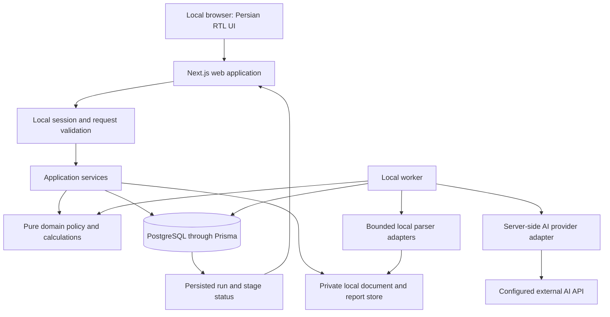

# VentureLens — Proposed Technical Specification Addendum

> **Superseded — 2026-10-21:** Use [technical-spec.md](technical-spec.md) and [darkube-deployment.md](darkube-deployment.md) for the current hosted/shared-workspace architecture. This earlier draft remains historical; its single-user authentication and local-storage recommendations do not apply to the selected release.

**Date:** 2026-10-21  
**Status:** Proposed engineering decisions for review; not an approved replacement for product policy.  
**Baseline:** `product-spec.md` v1.4 and `design-scope.md`.  
**Source starter:** `amirmhp98/mhp-nextjs-boilerplate`, commit `a6228062889af58805fba519cd2c00331808893d`.  
**Supporting evidence:** [Boilerplate investigation](boilerplate-investigation.md).

## 1. Proposed replacement for product-spec Section 19.2

> VentureLens will use the mhp-nextjs-boilerplate as its starting application foundation, with Next.js App Router, React, TypeScript, Tailwind CSS, locally owned accessible RTL components, React Hook Form, and Zod. The proposed persistence baseline is PostgreSQL through Prisma with committed migrations. PostgreSQL replaces the earlier SQLite hypothesis; the local installation and maintenance cost must be validated before adopting the distribution package.
>
> Pages read through application services. Short mutations use guarded, validated Server Actions. Document transfer and job status use guarded Node-runtime route handlers. Durable document/analysis processing runs in a local worker from the same codebase, using persisted jobs and checkpoints. Originals and retained report artifacts reside in private local storage outside public assets.
>
> Preserve the single-evaluator, local-only operating model. Replace template account management and development-only authentication bypass with a supported local application session. Keep Persian RTL, light mode, Vazirmatn, and the existing screen inventory. UI locale does not determine document currency, financial period, source language, or legal jurisdiction.
>
> Keep deterministic domain policy separate from framework, database, provider, and UI concerns. Exact parser/provider choices, runtime versions, storage protection, packaging, and migration/recovery behavior require implementation validation. The boilerplate supplies infrastructure conventions; it does not supply the document, evidence, scoring, approval, or report engine. Adoption does not weaken product requirements or authorize application development as part of this document review.

## 2. Decision register

| ID  | Proposed decision                                       | Rationale / qualification                                                           |
| --- | ------------------------------------------------------- | ----------------------------------------------------------------------------------- |
| T01 | Adopt a pinned starter commit, then own the application | Review upstream improvements individually; no automatic template merges             |
| T02 | Next.js App Router as the web/UI and request layer      | Uses the starter's implemented structure; no separate Express API required          |
| T03 | Retain Prisma/PostgreSQL                                | Least template divergence; validate local runtime/distribution overhead             |
| T04 | One local worker with DB-backed jobs                    | Provides restart/retry semantics without introducing Redis or distributed services  |
| T05 | Local application session, no user-account UI           | Preserves D13 and the design exclusion of login/multiuser screens                   |
| T06 | Private filesystem storage plus DB metadata             | Keeps large immutable originals outside public assets and relational rows           |
| T07 | Pure policy/calculation layer                           | Scoring and eligibility remain deterministic, versioned, and independently testable |
| T08 | Persian UI, explicit source metadata                    | Prevents locale-driven currency conversion or evidence rewriting                    |
| T09 | Revision-aware HTML print reporting                     | Preserves human-reviewed content and historical report labels                       |
| T10 | Product spec remains authoritative                      | Template defaults and agent conventions cannot override product decisions           |

T03 is the main infrastructure tradeoff. SQLite remains a viable alternative if a lighter local installation becomes the priority, but that path requires deliberate changes to the Prisma provider/schema, SQL migration history, database environment validation, worker locking, Compose, and real-database tests. It is not a connection-string-only substitution. Support one database for the MVP rather than maintaining two partially tested backends.

## 3. Runtime and boundaries



The browser never receives provider credentials or accesses the database directly. The worker has no public listener. The web process and worker share versioned schemas and policy code. A worker must be packaged and started explicitly; a Next.js standalone web build does not automatically include or supervise an unrelated worker entrypoint.

**Suggested organization:**

```text
src/
  app/(app)/                         product screens and shared shell
  app/api/                          guarded upload/download/status routes
  actions/                          short guarded mutations
  services/                         lifecycle and persistence orchestration
  domain/                           pure rubric, scoring, metrics, snapshot policy
  adapters/                         DB, file store, parsers, provider integrations
  worker/                           process entrypoint, claiming, recovery, stage execution
  lib/validations/                  boundary and draft-save schemas
  components/                       local UI primitives and product components
  messages/fa.ts                    product terminology and UI messages
  __tests__/                        pure policy and service tests
prisma/                             schema and committed migrations
e2e/                                product journeys with nonconfidential fixtures
```

This is a proposed extension to the starter's layering, not an inventory of existing code. Update ESLint, the scaffold, and AGENTS.md together. Web-only modules can retain `server-only`; worker-compatible DB/env factories must not depend on React's server-module resolution. Domain code imports neither Prisma nor Next.js nor UI translations. Persist machine-readable result codes and translate at presentation boundaries.

## 4. Screen and route mapping

| Existing design screen  | Suggested route                                          |
| ----------------------- | -------------------------------------------------------- |
| S1 Workspace            | `/`                                                      |
| S2 Startup              | `/startups/[startupId]`                                  |
| S3 Assessment Overview  | `/startups/[startupId]/assessments/[assessmentId]`       |
| S4 Documents & Inputs   | Same assessment prefix + `/inputs`                       |
| S5 Evidence & Conflicts | Same prefix + `/evidence`                                |
| S6 Domain Assessment    | Same prefix + `/domains/[domain]`                        |
| S7 Risks & Gaps         | Same prefix + `/risks-gaps` with selected view preserved |
| S8 Review & Report      | Same prefix + `/review`                                  |
| S9 Settings             | `/settings` with validated internal return context       |

All these pages inherit the adapted `(app)` layout. The six domain pages use one template. A report print route is another representation of S8, not a new navigation destination. Preserve assessment/revision/scenario selection and return positions as required by the design scope.

Routes with multiple IDs must validate their relationship; a valid assessment ID paired with another startup ID is not sufficient. Shared source access is checked through the owning assessment/document relationship. No `/login`, `/admin/users`, or component gallery is required in the shipped user journey.

## 5. Local access, confidentiality, and settings

- Bind direct web execution to `127.0.0.1`. In Compose, publish only `127.0.0.1:3000:3000`; leave the database unexposed unless an explicitly loopback-bound development connection is needed. Avoid template passwords.
- Design a local session bootstrap controlled by the local launcher, such as a short-lived single-use capability exchanged for an HttpOnly session cookie. An anonymous endpoint that issues a session to any request is not sufficient. Validate lifecycle, expiry, restart, token handling, and chosen HTTP/HTTPS cookie behavior before relying on it.
- Verify the configured Host and request origin where applicable, reject untrusted cross-origin mutations, and validate the session on data reads and mutations. Protect against requests to unexpected hostnames, including DNS-rebinding cases. Define handling of requests with absent Origin explicitly; absence is not authorization.
- Apply access guards to every Server Action and sensitive route handler. Proxy/layout checks are additional routing conveniences. Limit the unauthenticated health response to minimal diagnostics.
- Store evaluator display name as local attribution. Do not label it authenticated identity. Freeze attribution in approval/report revisions.
- Keep provider configuration and secrets server-side; Settings exposes readiness and safe configuration descriptions. A missing provider leaves local document preparation and saved-work review usable.
- Disable framework telemetry in all supported launch paths, not only Docker/CI. Add no application telemetry by default.
- Use allowlisted diagnostic fields: IDs, codes, stage names, timing, and usage. Exclude prompts, source bodies, provider response bodies, secrets, and confidential error text. Keep query logging off for confidential operation.
- Keep sensitive download, status, and report responses out of shared caches; use explicit private/no-store response policy where appropriate. Any persistent application cache must use complete version/scope keys and participate in purge. Do not place confidential data in build-time static output.
- Validate storage permissions and the selected at-rest protection approach before the confidential pilot. A Docker volume alone does not establish either.

This section specifies requirements for the local guard; it does not claim that the starter implements a safe bootstrap or that loopback binding alone is adequate.

## 6. Persistence and immutability contract

Map all product-spec Section 19.1 entities to explicit relations. Add implementation records for local settings/session, job attempts/leases, and file deletion progress only as needed. Account roles must not become a hidden requirement for owning assessments.

Key invariants:

1. Startup creation also creates its first draft assessment transactionally.
2. A draft has a revision/version counter. Saves are checked against that version so stale browser state cannot overwrite a later save or a locked snapshot.
3. Starting analysis atomically checks readiness and expected draft version, fixes the input/context/rubric/authorization snapshot, creates a run, and queues its first work. Failure before commit leaves the draft editable.
4. Enforce the proposed one-active-run-per-workspace limit in database-backed coordination, not only a disabled button. Also reject duplicate active runs for an assessment.
5. Snapshot membership includes document versions, content selections, manual raw/normalized inputs, factual corrections, and stage/jurisdiction/rubric context. Hash a canonical serialization of this versioned content.
6. Store stage outputs with run, snapshot, scenario, rubric, parser, prompt, schema, and provider/model versions. Unique keys prevent duplicate publication for the same completed stage attempt.
7. Successors copy selected source references and factual context into a new draft; they do not copy findings, scores, approval, or an opinion as current results.
8. Review edits create revisions. Approval references an exact eligible opinion/report revision. A concurrent substantive edit must invalidate an attempted stale approval.
9. Historical reports render from their recorded context and content. Current settings, startup profile changes, translations, or future rubric changes cannot silently rewrite old artifacts.
10. Purge is an explicit exception to immutability and records safe outcome metadata without retaining deleted confidential payloads.

Use nullable scores and explicit result states. Enforce the 1–5 range and eligibility in application policy and appropriate database constraints. Represent money/ratios as exact decimals with declared precision and units; serialize safe decimal strings/DTOs to client components instead of exposing raw Prisma objects. Date/time policy must distinguish instants from date-only values and source reporting periods.

Use real database integration tests for these invariants. Prisma mocks do not reproduce transaction isolation, foreign-key enforcement, or competing workers.

## 7. Documents, inputs, and source preservation

Uploads use a guarded Node-runtime endpoint with measured byte limits, allowed format/signature checks, safe opaque storage identifiers, and a bounded transfer strategy. Originals go outside `public/` and outside the image/build context. Persist metadata only after a coherent storage transition; reconcile abandoned temporary files after interruption.

Retain the proposed product limits pending feasibility validation: 25 MB per file, 20 files/100 MB per assessment, 200 pages/slides per file, and 20 sheets/100,000 populated cells per workbook. Add measured archive-expansion, memory, execution-time, and temporary-disk limits. These limits must apply to actual streamed/decompressed work, not just filenames and request headers.

Each parser adapter emits:

- Document/parser version and extraction status.
- Typed content units and stable source locators.
- Raw text/value and context, including table headers and units.
- Formula and cached-value distinctions for spreadsheets; no recalculation or external fetch.
- Notes and hidden-content metadata where supported.
- Explicit unreadable/unsupported units and omissions.

The input-selection service produces the allowed evidence set. Provider requests, derived summaries, citations, and coverage calculations all use this set. A file with excluded content cannot be sent whole as a fallback. Tests must verify that excluded text is absent from outbound requests and derived summaries.

Use normalization only to derive additional fields. Store original excerpts and manual text unchanged. Draft-save schemas permit missing answers and preserve invalid numeric/date text; analytical schemas separately decide which values are usable. Missing values never become zero. Store answer status, currency, unit/scale, period/calendar, source attribution, and normalization warnings explicitly.

## 8. Durable worker and AI contract

Start, retry, and cancel actions submit short database operations. They do not wait for full parsing or model analysis in an HTTP request. The worker claims work using a lease/heartbeat and supports controlled restart reconciliation. Process one assessment analysis at a time initially; local extraction concurrency is separately bounded by measured resource limits.

Persist each stage's validated output before advancing. Reuse successful stages only when all input/version dependencies match. Retry failed stages and invalidated dependents; never blend snapshots or alternative scenarios. Cancellation records intent and preserves locked input; it cannot promise remote cancellation or reverse provider charges.

Provider attempts record request identifiers where available, safe outcome codes, timing, model/prompt/schema versions, and usage/cost information when supplied. If a crash occurs after provider acceptance but before local persistence, mark the attempt uncertain and reconcile according to provider capabilities. Do not promise exactly-once billing from a local transaction or silently retry unknown paid outcomes.

The provider adapter receives only authorized selected evidence and permitted instructions. It emits structured draft outputs. Validate enums, score range, snapshot/reference ownership, locators, numerical consistency, scenario IDs, and rubric IDs. Evidence support needs more than a well-formed citation: use source comparisons, domain-specific validation/evaluation, and visible human review; unsupported outputs cannot become verified facts.

Calculate coverage, eligibility, aggregates, and derived metrics in deterministic code under the approved framework. The model cannot approve a report, alter the rubric, invoke arbitrary tools, retrieve document-supplied URLs, or invent fallback scores. Keep repair attempts, context usage, timeouts, and budgets bounded. Do not make paid calls merely to fill a readiness screen.

Progress initially uses polling of persisted stage states. Streaming is optional and must not become the only record of completion. Stable error codes carry safe recovery hints and whether another operation may incur cost; translate these at the UI boundary.

## 9. Review, reporting, and deletion

Report rendering consumes validated, reviewed records and an exact revision. Export performs no unconstrained synthesis call. Persist sufficient rendered content/artifacts and renderer context to preserve historical report versions under later application updates.

Use a dedicated light, RTL print representation with locally packaged Vazirmatn, controlled LTR citations/cell references, break-aware tables, and visible assessment/revision identifiers. Reproduce approval, provisional-evidence, and technical-incomplete labels independently. Verify Draft/Incomplete markings on every page in the supported browser; browser pagination and print behavior are acceptance items, not assumed capabilities of Tailwind or Next.js.

Draft removal deletes only that draft's reference and unshared draft-derived data. Global purge enumerates source blobs, extracted units, claims, caches, copied references, reports, and affected assessments. File and database deletion is a retryable operation with persisted progress; a database transaction alone cannot atomically erase filesystem content. Report remaining scope accurately after partial failure.

Backups and temporary files are part of the retention policy. Backups must not silently resurrect purged material during restore; define backup invalidation/erasure or an enforceable restore policy. Externally exported copies and provider-retained content remain explicitly outside a guaranteed local erasure claim.

## 10. Packaging and verification gates

Before treating the adapted starter as a validated foundation:

1. Install from the committed lockfile with a supported pinned Node/npm baseline. Confirm actual package availability and advisory status. Do not equate a lockfile with a successful clean install.
2. Run lint/RTL checks, typecheck, formatting checks, unit tests, production build, database-backed e2e, and a packaged runtime smoke test. Record actual results.
3. Exercise a real worker process without test mocks; check environment/Prisma initialization, parser dependencies, cancellation, and restart.
4. Demonstrate local access protections and loopback port bindings in development and the packaged runtime. Test direct sensitive API requests and untrusted origins/hosts.
5. Validate private file storage, selected at-rest protection, safe logs, backup/restore, migrations on existing data, and purge behavior.
6. Test all three document formats with nonconfidential fixtures, including malformed files, partial extraction, hidden content, exclusions, and source locators.
7. Add the full A01–A34 product acceptance suite, deterministic policy tests, approved AI evaluation cases, and 375/768/1280/1440px checks. Include keyboard and print/PDF verification.

CI must use synthetic/redacted fixtures. Failure traces and uploaded artifacts must not contain pilot documents. Provider integration tests requiring paid calls are explicit and budgeted; ordinary unit tests do not call a live provider.

Suggested packaged shape is web + worker + private PostgreSQL + persistent document/report storage, launched together locally. Docker is one candidate; its installer size, Windows support, storage location, upgrade behavior, and resource cost require validation. Pin the resulting supported distribution path instead of describing generic Docker support as a completed local desktop experience.

## 11. Scope and decisions still requiring validation

The chosen boilerplate is the user-requested starting point. The exact local packaging, retention/storage protection, PostgreSQL tradeoff, local session bootstrap, parser choices, provider/model, and cost budgets remain engineering/policy validation items. The existing product gates for rubric approval, jurisdiction, evidence thresholds, and AI-quality acceptance remain in force.

There is no need to add organizations, invitations, billing, account settings, runtime UI-language switching, dark mode, or a founder portal. There is also no need to reopen already-settled product decisions merely because the template's first-session instructions assume a blank product definition.

The first implementation milestone should establish an adapted, tested foundation plus one persisted Startup/draft flow. It should not be described as completing document analysis or due diligence. Subsequent milestones follow the product's evidence, processing, review, report, and confidential-pilot gates.
