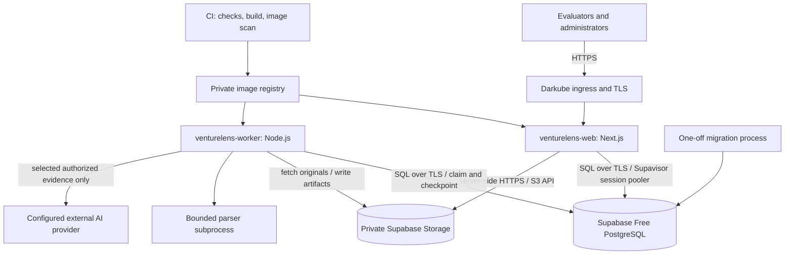

# VentureLens AI — Technical Specification

**Version:** 1.2 — user-supplied visual design reference  
**Date:** 2026-10-22  
**Target:** Dockerized web/worker deployment on Hamravesh Darkube; Supabase Free PostgreSQL and Storage; multiple authenticated evaluators in one shared workspace.  
**Status:** Engineering design baseline. Deployment-specific values and product-policy approvals identified below remain release gates; this document does not assert that software has been implemented or deployed.  
**Product baseline:** [Product specification v1.4](product-spec.md) and [design scope](design-scope.md), amended by the user's hosted/shared-workspace decisions of 2026-10-21.  
**Starter:** [mhp-nextjs-boilerplate](https://github.com/amirmhp98/mhp-nextjs-boilerplate/tree/a6228062889af58805fba519cd2c00331808893d), audited at `a6228062889af58805fba519cd2c00331808893d`.  
**Companions:** [Source investigation](boilerplate-investigation.md), [Darkube deployment and operations](darkube-deployment.md).

**Visual reference:** [design.md](../design.md), supplied by the user on 2026-10-22; adoption and extraction adjustments are defined in [design-scope.md](design-scope.md). This reference governs visual direction, while product behavior, accessibility, and architecture remain governed by their respective specifications.

## Contents

1. [Scope, authority, and decisions](#1-scope-authority-and-decisions)
2. [System architecture](#2-system-architecture)
3. [Stack and boilerplate adoption](#3-stack-and-boilerplate-adoption)
4. [Code organization and module boundaries](#4-code-organization-and-module-boundaries)
5. [Identity and shared-workspace permissions](#5-identity-and-shared-workspace-permissions)
6. [Persistence model](#6-persistence-model)
7. [Lifecycle, concurrency, and immutable history](#7-lifecycle-concurrency-and-immutable-history)
8. [Application interfaces](#8-application-interfaces)
9. [Document ingestion and extraction](#9-document-ingestion-and-extraction)
10. [Durable jobs and provider execution](#10-durable-jobs-and-provider-execution)
11. [Evidence, scoring, and AI contracts](#11-evidence-scoring-and-ai-contracts)
12. [Review, approval, and reporting](#12-review-approval-and-reporting)
13. [Frontend and localization](#13-frontend-and-localization)
14. [Security and data handling](#14-security-and-data-handling)
15. [Docker and deployment contract](#15-docker-and-deployment-contract)
16. [Configuration contract](#16-configuration-contract)
17. [Operations, retention, and recovery](#17-operations-retention-and-recovery)
18. [Quality and acceptance](#18-quality-and-acceptance)
19. [Delivery sequence and open gates](#19-delivery-sequence-and-open-gates)

## 1. Scope, authority, and decisions

### 1.1 Requirements hierarchy

The latest user decisions establish Darkube application hosting, Docker packaging, Supabase Free for database and object storage, and multiple evaluators sharing a workspace. These supersede the earlier local-only, single-evaluator, and no-login assumptions, and v1.0's Hamravesh database/storage proposal. All six-domain evidence, scoring, review, succession, and report requirements remain in effect. Supabase Auth, Realtime, and Edge Functions are not adopted by this infrastructure decision.

This document governs technical implementation. Product-spec policy explicitly labeled proposed remains proposed: this specification does not approve a scoring rubric, legal jurisdiction, evidence threshold, or provider data-processing policy on behalf of the product owner. `MUST` denotes an engineering requirement; initial capacities and operational defaults are labeled targets or defaults and require validation.

The earlier `tech-spec-boilerplate-draft.md` is superseded. The boilerplate investigation remains evidence about the inspected source, but its recommendation to remove accounts and use local filesystem storage no longer applies to the hosted product.

| Earlier baseline                        | Hosted/shared-workspace amendment                                                                               |
| --------------------------------------- | --------------------------------------------------------------------------------------------------------------- |
| D13 / §3: one evaluator, local computer | Multiple authenticated evaluators, one shared workspace                                                         |
| §16.1: loopback-only production         | HTTPS application ingress; credential-protected Supabase database over TLS; authenticated private-object access |
| §3.1: display-name attribution only     | Authenticated actor ID plus frozen display name in review/approval history                                      |
| §19.2: Vite/Node/SQLite hypothesis      | Next.js/TypeScript, PostgreSQL/Prisma, worker, private S3 storage                                               |
| No login/account screens                | Login, password-change flow, and admin account management are required                                          |
| Local originals and reports             | Durable cloud object storage; local disk is temporary processing space                                          |
| Single-user saves                       | Optimistic concurrency, permission checks, and revision-specific approval                                       |

### 1.2 Boundaries

Included: PDF/PPTX/XLSX, compact manual inputs, extraction review, source selection, evidence provenance and conflicts, six-domain analysis, deterministic score aggregation, risks/gaps, human review and approval, successor assessments, Persian reports, accounts, deployment, recovery, and deletion.

The six fixed domains are Commercial, Product, Technology, Financial, Team & Organization, and Legal Due Diligence. The overall opinion uses Invest, Invest Subject to Conditions, Do Not Invest, or Insufficient Evidence. It is a reviewed judgment within that scope, not an overall numerical score or an investor-fit/transaction-price assessment. Startup business models are exactly B2B, B2C, B2B2C, and B2G.

Excluded: public signup, organizations/tenant switching, subscriptions, founder portal, external report-sharing links, reviewer assignment workflow, enforced two-person approval, autonomous web research, financial transaction execution, full spreadsheet calculation, OCR, Office document conversion, dark mode, and runtime UI-language switching. These are not implied by cloud hosting or the boilerplate.

All active evaluators can see the shared workspace's startup documents and assessments. There are no private projects within that workspace. This visibility must be disclosed in account onboarding and upload UI. Created-by attribution does not establish exclusive ownership.

### 1.3 Architecture decisions

| ADR | Decision                                                                   | Reason / rejected alternative                                                                    |
| --- | -------------------------------------------------------------------------- | ------------------------------------------------------------------------------------------------ |
| 001 | Modular monolith, two long-lived processes: web and worker                 | Independent request/processing resource limits without microservice overhead                     |
| 002 | Next.js App Router with thin actions and route handlers                    | Reuses the starter; a separate Express backend adds an unnecessary boundary                      |
| 003 | Supabase Free PostgreSQL + Prisma; SQL migrations for advanced constraints | Transactions, relational provenance, and durable queue coordination; no Hamravesh DB instance    |
| 004 | Application-owned PostgreSQL jobs with leases and fencing                  | Atomically queue with snapshots; no Redis or generic workflow engine for the MVP                 |
| 005 | Private Supabase Storage through its S3-compatible API                     | Works across restarts and separate web/worker containers; no Hamravesh object-storage dependency |
| 006 | Retain hardened account/session authentication                             | Now matches the confirmed shared hosted workspace                                                |
| 007 | Pure deterministic policy; AI produces constrained draft judgments         | AI cannot invent eligibility, arithmetic, citations, or approval                                 |
| 008 | Immutable inputs and review/report revisions                               | Makes correction, collaboration, and historical export explicit                                  |
| 009 | Persian-only UI with independently typed source metadata                   | UI locale cannot silently change monetary units, calendars, or evidence                          |
| 010 | Immutable HTML report artifacts; browser Print-to-PDF initially            | Meets the product's permitted export path without adding a production browser service            |
| 011 | Build once, promote immutable images; explicit migration step              | Avoids migrations racing at every web/worker startup                                             |

## 2. System architecture



### 2.1 Deployment units

| Unit                     | Responsibility                                                       | Public access                              | Durable state                                                    |
| ------------------------ | -------------------------------------------------------------------- | ------------------------------------------ | ---------------------------------------------------------------- |
| `venturelens-web`        | Auth, UI, actions/API, upload/download streaming, report access      | HTTPS domain only                          | None on container disk                                           |
| `venturelens-worker`     | Extraction, staged analysis, report artifact creation, purge/cleanup | No public domain                           | Jobs/checkpoints in DB; blobs in S3                              |
| Migration image/process  | Apply committed schema/data migrations                               | None                                       | PostgreSQL changes                                               |
| Supabase Free PostgreSQL | Application data, sessions, leases, audit metadata                   | Credential-protected external TLS endpoint | Database plus application-managed independent exports            |
| Supabase Storage         | Originals, extraction payloads, versioned report HTML/assets         | HTTPS API; no public bucket                | Immutable keys plus controlled purge and independent blob backup |

Darkube documents Docker-image applications, command/argument overrides, HTTP readiness probes, and separate background-worker deployment. It hosts the application processes, while Supabase hosts persistence in its selected region. Connectivity crosses provider boundaries; a shared private cluster/network must not be assumed. [Docker settings](https://docs.hamravesh.com/products/darkube/create/docker-image/settings/general), [worker deployment](https://docs.hamravesh.com/products/darkube/getting-started).

Use Supabase Storage's S3-compatible API behind the existing storage adapter. Generated S3 keys are server-only, project-wide credentials that bypass Storage RLS; they are not bucket-scoped credentials. Authorization remains in VentureLens services and guarded file routes. Never send these keys to browsers or parser children. [Supabase S3 authentication](https://supabase.com/docs/guides/storage/s3/authentication).

### 2.2 Initial capacity envelope

**Engineering planning target, not measured performance:** 25 enabled accounts, 10 concurrently active browser sessions, one active AI assessment run per workspace, one parser subprocess per worker. Use 10,000 synthetic startups/assessments as a local/CI pagination test, not a capacity promise for Supabase Free. Hosted record/document counts are constrained by measured database, storage, and transfer usage.

Start with one web replica and one worker replica. Deployments may temporarily overlap replicas, so DB-backed locking and rate limits are mandatory from day one. Horizontal scale is allowed only after connection budgets, file-stream load, image-version skew, and worker claim tests pass. No high-availability claim is made for this initial topology.

### 2.3 Supabase Free operating envelope

Verified on 2026-10-21: Free lists 500 MB database size, 1 GB file storage, 5 GB egress and a separate 5 GB cached-egress allowance, shared compute, two active projects, and possible pausing after one inactive week. These are provider limits, not guaranteed usable application capacity. Recheck the account's quota scope and dashboard usage before release; do not combine cached and uncached allowances into one interchangeable budget. [Supabase pricing](https://supabase.com/pricing).

Engineering defaults: warn at 70% of each applicable quota, plan capacity action at 85%, and conservatively stop new storage-heavy uploads/runs before 95%, accounting for in-flight reservations and derivative headroom. Keep saved-work reads, safe cleanup, and operator recovery available when possible. Never delete historical evidence automatically to stay free, and never upgrade or enable paid add-ons without the owner's decision. Provider enforcement can occur independently of these application thresholds.

Preserve the 25 MB original-file limit and 100 MB assessment limit. Ten maximum-size assessment sets would consume roughly the whole nominal object allowance before derivatives/reports, so that per-assessment ceiling is not an available workspace quota. Count originals, quarantine, extraction chunks, reports, and abandoned uploads in capacity planning. Keep large payloads out of database rows; retain essential provenance but prune expired sessions/throttles and nonessential terminal-job diagnostics under the retention policy.

Supabase Free permits a maximum 50 MB object upload setting. Set the originals bucket to 25,000,000 bytes and store larger extraction/report datasets as indexed chunks capped initially at 20 MB each, with per-chunk and manifest hashes; reject unbounded derived output. Chunking is also subject to total workspace quota. [Storage file limits](https://supabase.com/docs/guides/storage/uploads/file-limits).

Budget database responses, document downloads, worker reads, and backup exports as network usage; backend proxying does not remove Supabase egress. Avoid repeated full-object reads and large polling responses. A paused/restricted project produces a clear unavailable state; stop claims/dispatch, preserve in-memory edits, and require operator recovery. Background polling is not an availability guarantee or a keep-alive workaround. [Egress accounting](https://supabase.com/docs/guides/platform/manage-your-usage/egress).

## 3. Stack and boilerplate adoption

### 3.1 Version policy

The reviewed lockfile records Next.js 16.3.5, React 19.3.0, TypeScript 6.0.3, Tailwind 4.3.3, Prisma/client 6.19.3, Zod 4.6.5, Vitest 5.0.0, and Playwright 1.63.0. These are the audited baseline, not a claim of current security support. Before implementation acceptance: perform a clean install, compatibility checks, license/advisory review, and patch within the supported dependency lines; record exact resolved versions in the lockfile and release manifest. [Pinned starter lockfile](https://github.com/amirmhp98/mhp-nextjs-boilerplate/blob/a6228062889af58805fba519cd2c00331808893d/package-lock.json).

Use **Node.js 24 LTS**, with exact patch and Docker digest pinned at foundation validation. Do not retain `lts/*` or a floating `node:lts-slim` production reference. Node's current release table lists 24 as LTS. Record the actual PostgreSQL major provisioned by Supabase, verify Prisma compatibility, and match local/CI to it; PostgreSQL 17 is a preference, not a promise of provider version selection. [Node release policy](https://nodejs.org/en/about/previous-releases).

### 3.2 Reuse, adapt, and build

| Starter asset                                       | Treatment                                                                                                                                           |
| --------------------------------------------------- | --------------------------------------------------------------------------------------------------------------------------------------------------- |
| Next App Router, server/client separation           | Keep; authenticated pages are request-time rendered                                                                                                 |
| Services/actions/Zod pattern                        | Keep; add pure domain and worker-safe adapters                                                                                                      |
| Prisma/migrations                                   | Keep tooling; extend schema and use PostgreSQL integrity constraints                                                                                |
| Cookie authentication and Users module              | Keep; harden sessions, passwords, persistent throttling, revocation, and final-admin protection                                                     |
| UI primitives, form fields, messages, RTL utilities | Keep; add evidence viewer, financial fields, conflict comparison, review controls                                                                   |
| Dark default, theme switch, Yekan Bakh              | Replace with the light visual direction in `design.md`; DPSans/DPSansEn when available with appropriate rights, locally packaged Vazirmatn fallback |
| Generic error envelope                              | Extend with stable code, retry semantics, request ID, and revision conflict details                                                                 |
| Module generator                                    | Fix route-group destination; remove generic destructive deletion as a domain default                                                                |
| Logger                                              | Replace arbitrary error-object logging with safe structured projections                                                                             |
| Health endpoint                                     | Split process liveness, app readiness, and authenticated dependency status                                                                          |
| Dockerfile                                          | Adapt into explicit web, worker, migration targets with matching release ID                                                                         |
| Compose                                             | Local development/integration only; not the Darkube deployment format                                                                               |
| README/AGENTS/PRD/ADRs                              | Rewrite product context; link this specification and current product rules                                                                          |

New dependencies are purpose-limited: S3 client SDK, bounded multipart streaming parser, PDF.js, ExcelJS, bounded ZIP/XML readers for OOXML, decimal arithmetic, and worker build tooling. Pin versions only after the parser/security spike; do not install unspecified `@latest` packages in production builds. A vector database, Redis, agent framework, chart library, and OCR service are not required.

Align `@types/node` with the selected Node 24 runtime; the starter's Node 26 type declarations must not authorize APIs absent from production. Preserve upstream MIT and applicable vendored notices. Review dependency and redistributed font/asset licenses, including the exact Vazirmatn package, and record them in the release inventory.

## 4. Code organization and module boundaries

```text
src/
  app/(auth)/login/                 login and required password change
  app/(app)/                       product shell, assessment tabs, settings, admin/users
  app/api/                         guarded HTTP transfer/status/health interfaces
  actions/                         short mutations and authentication wrappers
  services/                        application transactions and use cases
  domain/
    assessment/ evidence/ scoring/ conflicts/ review/ reporting/
  adapters/
    database/ storage/ parsers/ ai/
  worker/                          executable entrypoint, scheduler, stage handlers
  lib/                             shared utilities; web-specific auth wrappers
  lib/validations/                  command/query and draft-value schemas
  components/ui/                   owned primitive wrappers
  components/features/             reusable product-specific UI
  messages/fa.ts                    reviewed Persian product copy
  __tests__/                       unit and domain suites
prisma/                            schema and migrations
tests/integration/                 real Postgres/S3/process tests
tests/fixtures/                    synthetic parser/AI cases with expected outputs
e2e/                               browser journeys
docs/decisions/                    implementation ADRs
deploy/                            future Docker/launch/release assets
```

Dependency direction: UI → actions or DTOs; pages → services; actions/routes → access policy + services; services → domain + adapters; worker → services/domain/adapters. Domain code MUST NOT import Next.js, React, Prisma, environment globals, or translation messages. Adapters return typed records/errors, not UI components.

Separate worker-safe environment/database factories from Next's `server-only` wrappers. A direct Node worker must start without mocked imports. The generator and ESLint rules must enforce the new directories, including imports into client-marked route files; filename-based exemptions alone are insufficient. Use DTO projections to avoid leaking password/session/provider fields to client components.

## 5. Identity and shared-workspace permissions

### 5.1 Role matrix

Use the starter's `ADMIN` and `USER` enum initially. Present `USER` as **Evaluator**. Every account belongs to the single workspace; there is no organization selector or cross-workspace sharing API.

Keep the starter-derived User/Session model. Application accounts are not Supabase Auth users; a VentureLens cookie is not a Supabase JWT. No browser-side Supabase database/storage SDK or public signup is needed. Any future authentication migration requires a separate decision and migration plan.

| Operation                                                      | Evaluator                                         | Admin                                                      |
| -------------------------------------------------------------- | ------------------------------------------------- | ---------------------------------------------------------- |
| View all workspace startups, sources, assessments, reports     | Yes                                               | Yes                                                        |
| Create/edit drafts, upload, review extraction, archive/restore | Yes                                               | Yes                                                        |
| Start/cancel/retry analysis; give sharing authorization        | Yes, explicit confirmation and current permission | Yes                                                        |
| Review findings, edit opinion, approve exact revision          | Yes                                               | Yes                                                        |
| Create successors, export historical reports                   | Yes                                               | Yes                                                        |
| Remove a source reference from an editable draft               | Yes                                               | Yes                                                        |
| Global purge affecting other assessments/reports               | No; show admin-required explanation               | Yes; reauthentication and scope confirmation               |
| Change own password/display name                               | Yes                                               | Yes                                                        |
| Create/deactivate/reset users; change global configuration     | No                                                | Yes                                                        |
| Publish approved rubric/provider policy version                | No                                                | Admin operation backed by recorded product-policy approval |

This is an explicit engineering default: evaluators collaborate with equal assessment permissions and may approve their own work. No separate reviewer role or mandatory assignment is introduced. Audit records identify the actual actor, including cancellation of another evaluator's run. Shared-workspace UI names the current editor of the most recent saved revision, not a fictitious live presence indicator.

### 5.2 Authentication and session contract

- No public signup, default production password, or automatic seed on app startup. Bootstrap the first admin through a one-off controlled command with secret input, then remove the bootstrap secret. Do not put passwords in process arguments or logs.
- Retain cryptographically random 32-byte session tokens; store SHA-256 hashes only. Use a production `__Host-` cookie name, `Secure`, `HttpOnly`, `SameSite=Lax`, `Path=/`, and no Domain attribute. Origin/CSRF checks remain required.
- Initial policy: 12-hour absolute session lifetime, 60-minute idle timeout, recent authentication within 10 minutes for account security changes and purge. These are configurable security defaults. Throttle persisted last-seen writes without extending absolute expiry.
- Retain bcrypt at cost 12 initially. Passwords: minimum 15 characters and maximum 72 UTF-8 bytes; reject over-limit passwords rather than silently truncating. Do not Persian-normalize or trim password values. Benchmark hashing under the web resource limit.
- Login failure messages do not disclose account existence. Persist throttling in PostgreSQL by normalized account identifier and separately by trusted source IP hash; start with five failures/15 minutes per account and 30/15 minutes per IP, with bounded record retention. In-memory throttling alone is prohibited.
- Only trust forwarding headers after validating the Darkube ingress chain; arbitrary `X-Forwarded-For` supplied by a client is not a rate-limit identity.
- Rotate sessions at login, password changes/reset, and privilege changes. `authVersion` on User plus transactional session revocation prevents old sessions surviving partial password-reset failure. Serialize session issuance with deactivation/reset or validate the observed auth version before committing a new session.
- Guard every action, sensitive API route, and page data load. Recheck active status/role inside critical mutation transactions; do not rely on a hidden button, layout, or proxy cookie-presence check.
- Admins cannot remove their own administrative access through the ordinary UI. Serialize admin changes against the workspace row and prevent removing the final active administrator, including concurrent requests.
- Admin reset produces a temporary credential through an approved secure channel, revokes sessions, and forces change before business access. Operator recovery is an audited one-off command; no email/SMS system is implied.
- MFA is an optional future enhancement unless the confidentiality review requires it for the chosen exposure. Hamravesh control-plane accounts and CI credentials must be restricted independently of application roles.

### 5.3 Authorization context

Services receive a server-derived actor `{userId, workspaceId, role, authVersion}`. Client-supplied actor IDs never establish authority. Queries are scoped to the workspace and validate parent-child relationships. Background jobs retain requesting actor, authorization record, and immutable execution context; workers recheck deactivation, cancellation, scope, and purge status before paid requests and output publication. Disabling an account pauses its not-yet-dispatched paid work until another evaluator explicitly resumes under their own authorization.

## 6. Persistence model

### 6.1 Storage rules

Use PostgreSQL for transactional records, searchable evidence metadata, and bounded JSON payloads. Use S3 for immutable original bytes, larger extraction payloads, and report artifacts. Store object keys, byte lengths, SHA-256, media type, format/version, and retention state in DB. Never use original filenames as object keys.

Supabase Storage does not support S3 object versioning. `DocumentVersion`, `ExtractionRevision`, and `ReportVersion` are application-level versions with distinct immutable object keys/manifests; they must not depend on S3 VersionId or delete-marker recovery. Independent backups provide recovery from deleted bytes. [S3 compatibility](https://supabase.com/docs/guides/storage/s3/compatibility).

Identifiers are opaque CUIDs consistent with the starter. Store instants as `timestamptz` in UTC. Business dates/periods use explicit calendar/date-only metadata; they are not automatically converted through JavaScript Date. Financial normalized amounts use `numeric(38,12)` with overflow/precision checks and preserved raw strings. Percentages declare ratio versus percent representation; no JS floating-point arithmetic for financial or score calculations. Scores use fixed decimals, nullable when unassessable.

### 6.2 Entity inventory

| Entity                                               | Essential fields / relations                                                                                        | Key constraints                                                                          |
| ---------------------------------------------------- | ------------------------------------------------------------------------------------------------------------------- | ---------------------------------------------------------------------------------------- |
| Workspace                                            | singleton ID, name, configVersion, activeRunId, deletionEpoch                                                       | One workspace in MVP; row used for global coordination                                   |
| User / Session                                       | workspaceId, normalized username, role, passwordHash, active, authVersion; tokenHash, expiry, lastSeen              | Unique normalized username; token hash unique; no hard-deleting attribution users        |
| LoginAttempt                                         | key hash, window, count, blockedUntil                                                                               | Atomic increments; TTL cleanup                                                           |
| WorkspaceConfigVersion                               | jurisdiction, provider profile, active framework, policy hashes, authoredBy                                         | Immutable versions; no secrets in JSON                                                   |
| Startup                                              | workspaceId, name, city, stage, businessModel, profile, archivedAt, version                                         | Name required; business-model enum exactly four product options                          |
| Assessment                                           | startupId, predecessorId, context, lifecycle, draftVersion, snapshotId, currentReviewRevisionId                     | Predecessor same startup/workspace; no cycles; optimistic version                        |
| Upload                                               | assessmentId, actorId, idempotency key, expected draft version, reserved bytes, temporary object key, state, expiry | Atomic quota reservation; finalized once; expired reservations reconciled                |
| DocumentVersion                                      | workspaceId, source blob, SHA-256, original metadata, byte count, status, deletionEpoch                             | Immutable original; duplicate detection is workspace-scoped                              |
| ExtractionRevision                                   | documentVersionId, parser/version/config, output blob, omissions, status                                            | Results never overwritten after snapshot use                                             |
| SourceUnit                                           | extractionRevisionId, unit key/type, locator, raw content reference, hidden/readability flags                       | Unit key unique within extraction; locators typed by format                              |
| AssessmentDocument                                   | assessmentId, documentVersionId, extractionRevisionId, selection manifest, revision                                 | Independent selection per draft/assessment; explicit shared references                   |
| ManualAnswer                                         | assessmentId, question/schema version, raw value, normalized typed value, answer state, validation issues, author   | Raw invalid text can persist; analytical value nullable                                  |
| FactClaim                                            | assessment/snapshot, metric/subject, raw/normalized values, unit/period/scope, origin, correction lineage           | Corrections append lineage; no automatic truth priority for manual input                 |
| Evidence                                             | source unit or manual answer, locator/context, origin/review/corroboration/interpretation dimensions                | Source belongs to the declared input set                                                 |
| InputSnapshot                                        | assessmentId, canonical manifest, SHA-256, context/framework, lock time, schemaVersion                              | One initial input lock per assessment; immutable except explicit purge                   |
| SnapshotDocument / SnapshotAnswer / SnapshotEvidence | snapshotId, immutable versions, allowed units and records                                                           | Composite uniqueness; never point only to mutable draft rows                             |
| DataAuthorization                                    | actorId, snapshot hash, selected scope hash, provider/config-policy hash, timestamp                                 | No implicit authorization from upload or another unrelated run                           |
| FrameworkVersion / Criterion / EvidenceRequirement   | stable IDs, stage applicability, anchors, essential flags, supported jurisdictions, hashes                          | Approved immutable versions; all 1–5 anchors required before scoring                     |
| EvidenceCriterionLink                                | snapshot/run, criterion/requirement, evidence, support/contradiction, scenario                                      | No duplicate satisfaction count; linked records share scope                              |
| Conflict / Scenario                                  | claim alternatives, affected criteria, coherent scenario manifest, disposition                                      | Preserve alternatives; no silent preferred claim                                         |
| AnalysisRun                                          | assessment/snapshot/framework, requester, provider profile, status, idempotency, generation                         | At most one active run per assessment; workspace active-run slot                         |
| AnalysisStage / Job                                  | run, stage/scenario/dependencies, status, attempt, availableAt, leaseOwner, leaseUntil, fence                       | Unique logical stage; indexed due-job lookup                                             |
| ProviderAttempt                                      | stage, immutable input hash, dispatch state, request ID, usage/reservation, error code                              | Unknown remote outcome is explicit; request body stored only under sensitive-data policy |
| BudgetReservation                                    | workspace/run/providerAttempt, currency, reserved/actual amount, state                                              | Atomic reservation; unknown outcomes retain reservation                                  |
| CriterionAssessment / DomainResult                   | run, criterion/domain, scenario, applicability/eligibility, nullable score, coverage counts, evidence               | Unique run/scenario/criterion; score range check; no missing-as-zero                     |
| Finding / Risk / Gap                                 | run/scenario, evidence/criterion links, type/severity, disposition                                                  | Original AI result retained; edits through review revisions                              |
| ReviewRevision / ReviewChange                        | assessment, parent revision, actor, immutable patch/result, materialContentHash                                     | Monotonic revision; original AI output linkage                                           |
| OverallOpinion                                       | review revision, verdict, reasons, conditions, scenario implications, limitations, provisional                      | Synthesis dependency hash matches current reviewed inputs                                |
| Approval                                             | opinion/review hash, actor ID/display name, acknowledgements, time                                                  | Unique exact approved revision; immutable historical record                              |
| ReportVersion                                        | snapshot/run/review/approval IDs, template/version, labels, HTML/assets manifest/hash, status                       | Immutable artifact; no reinterpretation using current defaults                           |
| AuditEvent                                           | actor/system identity, event, entity/revision IDs, timestamp, safe metadata                                         | No document bodies/passwords/prompts; subject data included in purge policy              |
| DeletionRequest / DeletionItem                       | scope fingerprint, admin, affected refs/keys, phase, outcomes, attempts                                             | Idempotent resumable purge; minimal surviving tombstones                                 |
| IdempotencyRecord                                    | actor/workspace/operation/key, payload hash, result reference, expiry                                               | Same key with different payload rejected                                                 |

Prisma expresses ordinary relations; custom SQL migrations provide partial unique indexes, score checks, and constraints not representable in the selected Prisma version. Use composite scope relationships or equivalent transactional verification to prevent a citation/review row from linking to an unrelated run or snapshot. Index all foreign keys and common filters: `(workspaceId, archivedAt, updatedAt, id)`, `(startupId, createdAt, id)`, `(runId, status)`, `(status, availableAt, priority, id)`, and token/expiry lookups.

### 6.3 History and large payloads

Store structured AI outputs under a schema version and content hash; sensitive raw provider responses are retained only if required for review/debugging and then participate in access control and purge. Persist normalized validated results as the application source of truth. JSONB is not a substitute for relational ownership, revision IDs, or queryable statuses.

Frozen manifests include exact extraction revision and content-unit IDs. A future parser upgrade cannot change a historical citation. Originals may be deduplicated by workspace SHA-256, but copies preserve separate AssessmentDocument selections. File count/byte quotas count the documents selected into the assessment, even if underlying storage is deduplicated.

## 7. Lifecycle, concurrency, and immutable history

### 7.1 Independent state axes

| Axis                 | States / meaning                                                                                                            |
| -------------------- | --------------------------------------------------------------------------------------------------------------------------- |
| Assessment lifecycle | Draft → Analyzing → Ready for Review → In Review → Approved; failed/cancelled execution → Analysis Incomplete               |
| Execution            | Queued, Running, Succeeded, Partially Failed, Failed, Cancelled; attempts additionally support Unknown outcome              |
| Review               | Draft, Needs reapproval, Approved                                                                                           |
| Evidence limitation  | Provisional with reasons; independent of technical success and approval                                                     |
| Domain presentation  | Not analyzed, In progress, Not Assessable, Not Applicable, Applicability needs review, Scored; scenario-dependent qualifier |
| Visibility           | Active or archived; archive is not deletion or completion                                                                   |

Cancellation never unlocks inputs. An empty/unusable input set can finish with gaps and Insufficient Evidence without a paid call. A technical failure must not be relabeled Not Assessable. Dashboard completed count means current approved opinion, including explicitly provisional approvals.

### 7.2 Transaction contracts

**Create startup:** persist startup and first draft in one transaction, keyed by idempotency token. Only name is required; forms preserve the exact allowed business-model choices.

**Save draft:** compare `expectedDraftVersion`, ensure Draft/no snapshot, validate structural schema, preserve raw optional/invalid answers, write changes and audit, increment version. Return `409 REVISION_CONFLICT` with safe current-version metadata on mismatch. The UI preserves unsaved values and offers compare/reload; no automatic last-writer-wins overwrite.

**Start analysis:** authenticate → verify expected version and selected extraction readiness → determine the execution path and validate its versioned framework/policy → for any planned external processing, validate provider/budget and explicit sharing authorization → lock workspace and assessment rows in a fixed order → recheck preconditions and no active run → create immutable snapshot and membership → create run/stages/jobs → record authorization or the explicit no-transmission path → lock assessment/increment version → commit. No provider HTTP call occurs inside this transaction. Failure before commit leaves Draft editable. A retry with the same idempotency key returns the existing run. An empty/unusable input set can take a deterministic gaps-only path without a provider credential or paid reservation; no missing rubric anchors are invented. Any later paid processing still requires its own valid authorization and budget checks.

**Copy/successor:** lock/check source visibility and purge state, copy document references/selections and factual inputs/context into a new draft, attach predecessor, use the currently approved framework with disclosed differences, and return the exact field/context for correction. No findings/approval become active on the copy. This operation does not call AI.

**Review edit:** compare expected review revision, preserve source AI result, append a new immutable revision with attribution/reason, compute whether opinion dependencies changed, and invalidate current approval only when a substantive edit is saved. Opening/cancelling an editor changes nothing. Independent edits may be merged only after an explicit comparison; never silently merge conflicting score/verdict edits.

**Approve:** lock current review/opinion, validate exact expected hashes, technical completion, current synthesis/edited-opinion validity, required rationale, active actor, and acknowledgements keyed to material content. Insert approval and current pointer atomically. A concurrent substantive edit causes stale approval rejection. Missing domain scores and unresolved conflicts are not blanket blockers.

**Purge:** mark affected sources inaccessible, increment deletion epochs, cancel/stop affected work, and create deletion items in one transaction; execute external deletions outside it. Old worker fences/epochs cannot publish new output after purge begins. Completion reflects actual removed scope, not just a queued job.

All competing operations use bounded retries for serialization/deadlock errors and deterministic lock ordering. External calls, object transfers, and long calculations MUST NOT hold DB transactions open.

## 8. Application interfaces

### 8.1 Boundary conventions

Short UI mutations use Server Actions as thin adapters. Upload/download, polling, and health use Node-runtime route handlers. No public integration API is promised. Both paths call the same services, access checks, validation, idempotency, and audit logic.

```ts
type CommandResult<T> =
  | { ok: true; data: T; requestId: string; revision?: number }
  | {
      ok: false;
      error: {
        code: string;
        messageKey: string;
        fieldErrors?: Record<string, string[]>;
        retry: 'none' | 'safe' | 'explicit-paid-confirmation';
        currentRevision?: number;
      };
      requestId: string;
    };
```

HTTP mapping: 400 malformed input, 401 no valid session, 403 insufficient role, 404 absent/inaccessible resource, 409 state/version/idempotency conflict, 413 byte limit, 415 unsupported type, 422 analytically unusable command data, 429 rate/budget throttle, 503 unavailable dependency. Missing answers in a draft-save request are not 422 errors. Unexpected failures return safe codes, never stack traces/provider bodies.

### 8.2 Commands

| Command                                                  | Required preconditions / result                                                      |
| -------------------------------------------------------- | ------------------------------------------------------------------------------------ |
| createStartup                                            | Evaluator; idempotency key → startup + draft                                         |
| saveStartup / setArchive                                 | Expected profile version → updated profile; history untouched                        |
| saveDraftAnswers / updateContext / updateSelection       | Draft + expected version → saved raw values/selection and new version                |
| removeDraftDocument                                      | Draft + expected version → detach reference, no shared-source purge                  |
| startAnalysis                                            | Expected version, authorization, budget acknowledgement, idempotency → run ID/status |
| cancelRun                                                | Active run, current actor, explicit action → persisted cancel request                |
| retryStage / resumeRun                                   | Same snapshot and valid dependencies; potential cost acknowledged → attempt/job      |
| createSuccessor                                          | Source reference + idempotency → new draft, no paid run                              |
| saveReviewChange / resolveConflict                       | Expected revision, rationale, evidence in locked snapshot → new revision             |
| synthesizeOpinion                                        | Current reviewed dependency hash + cost acknowledgement → synthesis job              |
| approveOpinion                                           | Exact review/opinion hashes and acknowledgements → immutable approval                |
| createReportVersion                                      | Exact readable revision; idempotency → report preparation job/artifact               |
| previewPurge / confirmPurge                              | Admin; current scope hash; recent authentication → resumable deletion request        |
| createUser / resetPassword / changeRole / deactivateUser | Admin; final-admin/actor safeguards → audited account state                          |

### 8.3 HTTP routes

| Route                               | Contract                                                                                                                             |
| ----------------------------------- | ------------------------------------------------------------------------------------------------------------------------------------ |
| `POST /api/assessments/:id/uploads` | CSRF/session-protected bounded multipart stream; upload key and expected draft version; returns 202 with document/extraction job IDs |
| `GET /api/documents/:id/content`    | Authorized streaming download; safe filename; range support for PDFs; private/no-store; correct type/nosniff                         |
| `GET /api/documents/:id/extraction` | Paginated typed units and omissions; no entire 100k-cell response                                                                    |
| `GET /api/assessments/:id/status`   | Versioned lifecycle/stages, safe error/recovery, worker delay; polling with jitter                                                   |
| `GET /api/assessments/:id/evidence` | Cursor pagination and allowlisted domain/criterion/scenario filters                                                                  |
| `GET /api/reports/:id/content`      | Authorized immutable report HTML/assets; correct historical labels; no arbitrary object key parameter                                |
| `GET /api/deletions/:id/status`     | Admin-only actual completed/remaining scope                                                                                          |
| `GET /api/health/live`              | Process responds; no DB/provider dependency; no secrets                                                                              |
| `GET /api/health/ready`             | Web initialized and schema-compatible DB query succeeds; 200/503                                                                     |
| `GET /api/system/status`            | Authenticated storage/worker/provider configuration readiness; no paid provider call                                                 |

Pagination: default 25, maximum 100; stable cursor `(createdAt,id)` or declared indexed sort. Validate filters/enums and maximum query length. No arbitrary SQL order fragments. Actions return IDs/DTOs and trigger targeted revalidation; status polling does not refetch entire evidence collections.

Commands that can create duplicates require a UUID client idempotency key. Persist `(workspace, actor, operation, key)` and request hash; same key/different payload is a conflict. Keep financial/analysis identity in permanent run/attempt records even after short-lived HTTP idempotency entries expire. Do not claim replay safety after key expiry without the service's state/uniqueness guards.

## 9. Document ingestion and extraction

### 9.1 Upload sequence

1. Show that originals will be stored in the selected Supabase region, processed through Darkube, and visible to workspace evaluators before upload. AI transmission remains a later, separately authorized operation.
2. Authenticate and validate CSRF/origin, media-type declaration, draft/version, filename metadata, storage quota, and proposed assessment limits.
3. Reserve upload capacity transactionally so concurrent users cannot exceed document/byte limits. Only one file per transfer; maximum two simultaneous uploads per browser initially.
4. Stream through a byte counter and SHA-256 into a private opaque quarantine object. Abort on excess bytes, disconnect, timeout, or storage failure. Do not buffer the complete request with `request.formData()` for large files.
5. Validate signature and OOXML package identity, finalize immutable storage metadata, recheck draft/version under lock, attach to draft, queue local extraction, and commit. If analysis locked the draft meanwhile, return a conflict and reconcile/delete the orphan object; never attach it to a frozen snapshot.
6. Worker validates content/resource bounds, parses in an isolated subprocess, persists an ExtractionRevision and locators, then exposes Ready/Partially Extracted or actionable failure. Invalid/spoofed originals remain quarantined/inaccessible until cleanup, not evidence.

The S3 write and DB commit are not one atomic transaction. Use reserved Upload records, temporary/final opaque keys, idempotent finalization, and an orphan reconciler. Unfinished uploads expire after 24 hours by default. Never infer completeness solely from the object being present.

### 9.2 Limits

Define MB as decimal bytes in UI and API: 25 MB = 25,000,000 bytes. Initial product limits remain subject to parser feasibility approval.

| Limit                                   | Initial bound                                                                                        |
| --------------------------------------- | ---------------------------------------------------------------------------------------------------- |
| Original file / selected assessment set | 25 MB / 20 files and 100 MB                                                                          |
| PDF/PPTX                                | 200 pages/slides per file                                                                            |
| XLSX                                    | 20 worksheets, 100,000 populated cells                                                               |
| OOXML expanded data                     | 250 MB total; 50 MB per entry; 10,000 entries; 100:1 expansion ratio ceiling                         |
| Parser process                          | 120-second wall timeout; one process; memory budget calibrated within a 2 GiB worker limit           |
| Temporary disk                          | 1 GiB planned worker scratch allowance; fail safely before exhaustion                                |
| HTTP upload                             | 180-second total timeout; ingress body allowance at least 30 MB for one file plus multipart overhead |

Archive limits are engineering defaults to measure on representative documents. Count actual streamed expansion, not only ZIP metadata. Reject unsafe paths, duplicate/ambiguous archive entries, external relationships for retrieval, recursive archives, XML entity expansion/DOCTYPE, macros, active content, and encrypted/corrupt files. A .pptx or .xlsx extension alone does not prove format. Do not claim these parser restrictions provide full malware detection.

### 9.3 Parser adapters

| Format | Implementation direction                                                                         | Evidence contract and boundary                                                                                                                                           |
| ------ | ------------------------------------------------------------------------------------------------ | ------------------------------------------------------------------------------------------------------------------------------------------------------------------------ |
| PDF    | `pdfjs-dist` server text extraction and browser viewer from the same pinned line                 | Page, text-span offsets, coordinates/context; machine-readable text and explicitly supported table geometry; flag ambiguous reading order and image-only/scan pages      |
| PPTX   | Bounded ZIP reader (`yauzl`) + namespace-aware OOXML parser                                      | Follow presentation relationships for actual slide order; retain shape IDs, table row/column, notes relation/paragraph; no guessed slide numbering from filenames        |
| XLSX   | Bounded OOXML preflight + `exceljs`; raw XML sidecar for original numeric tokens where necessary | Worksheet identity/name, cell/range, type/style, raw stored value, formula and cached result separately, merged ranges, hidden sheets/rows/columns, workbook date system |

PDF.js exposes page/text APIs; it is not a general guarantee of table reconstruction. ExcelJS documents formula/result representation and hidden worksheets and does not calculate formula results. ZIP size-validation support is useful but application-wide expansion/time limits remain our responsibility. [PDF.js API](https://mozilla.github.io/pdf.js/api/draft/api.js.html), [ExcelJS documentation](https://raw.githubusercontent.com/exceljs/exceljs/master/README.md), [yauzl documentation](https://github.com/thejoshwolfe/yauzl).

For XLSX, retain original XML numeric representation when conversion through JavaScript Number would lose precision. Explicitly handle 1900/1904 date systems and the Excel serial-60 anomaly; ambiguous dates remain review items. Shared/array formulas preserve master/range relationships; missing or stale caches never trigger recalculation. External hyperlinks are text metadata, not network requests.

Parser subprocesses receive only the input path and bounded output location, a minimal environment without DB/S3/AI secrets, and no intended outbound network access. A child process alone is not a security sandbox: verify available OS/network isolation in the packaged runtime. Worker memory limits and parent timeouts bound damage; robust native isolation is a pilot gate for untrusted files.

### 9.4 Canonical extraction and selection

Every unit includes `documentVersionId`, `extractionRevisionId`, stable `unitId`, typed locator, raw text/value, contextual headers/units, hidden/readable flags, and omission reasons. Empty extraction is not proof that a page contains no information. Preserve references to original bytes for user inspection.

Selection uses supported units: file, PDF page, PPTX slide, XLSX worksheet initially. Fine-grained selections may be added only when derivatives can be isolated correctly. Included hidden content is conspicuously labeled. Unreadable and excluded are separate states.

An immutable **transmission manifest** materializes only selected units and required selected context. Derived summaries, claims, scenario inputs, caches, and citation checks all carry this allowed-unit lineage. Never send a full original containing excluded content. If changing selection makes a derived claim unsupported, invalidate that draft-derived claim; after lock require a successor.

Source navigation uses PDF page/coordinates where reliable, PPTX slide/text/shape references, and a paginated spreadsheet grid. Office preview fidelity is not promised; provide original download and accurate extracted locator. Do not execute macros or render untrusted embedded HTML/SVG as active markup.

## 10. Durable jobs and provider execution

### 10.1 Scheduling model

Use a small PostgreSQL job table inside the application schema. Claim due work in a short transaction with `FOR UPDATE SKIP LOCKED`, write owner/lease/fence, then commit before processing. This pattern is appropriate for queue consumers; it does not make arbitrary analytical reads consistent. [PostgreSQL locking documentation](https://www.postgresql.org/docs/17/sql-select.html).

Defaults: claim poll 2 seconds with jitter while work is active, backing off to 30 seconds after repeated empty polls; heartbeat active leases every 10 seconds, lease 90 seconds. Initial dispatch after idle may therefore take up to 30 seconds; acknowledge enqueue immediately and show Queued accurately. Use database time. A heartbeat extends only the matching owner/fence. Every output commit checks the current fence, cancellation, deletion epoch, and expected stage dependencies. Expired workers cannot publish stale results. Keep work idempotent; a lease alone cannot prevent an old in-flight remote request from completing.

Jobs include extraction, analysis stages, opinion synthesis, report generation, purge, and housekeeping. One worker process may poll multiple queues but allows only the declared concurrency. Prioritize cancellation/purge checks and interactive recovery. The DB workspace active-run slot enforces one active logical assessment analysis; a running stage does not consume a database connection for its entire execution.

Also enforce one dispatched paid stage at a time per workspace across analysis and stand-alone opinion synthesis jobs. A separate transactional dispatch permit and budget reservation prevent a synthesis job from bypassing the analysis concurrency limit during replica overlap. Releasing a permit after an ambiguous outcome does not release its reserved cost or assert that the external request has stopped; disclose that uncertainty before further authorized dispatch.

Use Supavisor **session mode on port 5432** initially for the long-lived web/worker containers and IPv4-compatible migration connectivity. Copy hosts/usernames from the project dashboard; do not derive them from a region string. Direct PostgreSQL is an alternative only after Darkube IPv6 reachability is verified. Runtime and migration credentials remain distinct. Start Prisma pools at two connections per process, budget rollout overlap and backup sessions, and measure pool saturation before increasing. [Supabase connection modes](https://supabase.com/docs/guides/database/connecting-to-postgres).

The migration launcher supplies its privileged URL to Prisma 6 only for migration execution; runtime never receives that credential. Do not copy newer Prisma configuration examples into the pinned version without compatibility checks. A later switch to transaction mode requires prepared-statement/session-state compatibility tests; migrations must retain session/direct mode. Queue correctness uses short row-lock transactions regardless of connection mode. [Supabase Prisma guidance](https://supabase.com/docs/guides/database/prisma).

### 10.2 Stage graph

```text
Local extraction/review readiness
  → Freeze selected input + context + authorization
  → Normalize attributed claims and reconcile units/periods
  → Identify conflicts and coherent scenario alternatives
  → Map evidence to approved rubric requirements
  → Determine applicability/assessability
  → Analyze supported criteria and scenarios
  → Validate citations, numerical values, and output schema
  → Calculate deterministic coverage/domain aggregates
  → Synthesize draft opinion from validated domain results
  → Ready for human review
```

These are logical checkpoints, not necessarily one provider call each. Persist stage dependency hashes, validated outputs, omitted sections, timings, and usage. Progress reports named actual stages and completed/total known units; never invented percentages.

### 10.3 Failure and paid-call semantics

Create a ProviderAttempt and budget reservation before dispatch. Attempt states: Prepared, Dispatching, Succeeded, Rejected, FailedBeforeDispatch, Unknown, CancelledBeforeDispatch. Persist the provider's request ID when available. A network timeout or crash after dispatch may mean the provider processed/billed the request; local uniqueness does not prove exactly-once external execution.

- Retry up to two times for definitely safe transient failures, using bounded exponential backoff/jitter and provider Retry-After where valid.
- After an ambiguous dispatched attempt, keep budget reserved and mark Unknown. Reconcile via a documented provider status/idempotency mechanism if supported; otherwise require explicit paid retry confirmation. Do not automatically replay unknown calls.
- Repair invalid structured outputs at most once by default, within the same run budget; record the additional call. Reject invalid output rather than manufacture fallback data.
- Initial provider timeout is 60 seconds; run active-processing budget 10 minutes, configurable after measurement. Queue waiting is separate. File extraction has its own timeout.
- Cancellation stops future dispatch, attempts abort on current I/O, and preserves completed stages. It cannot promise provider-side cancellation/deletion or refunds.
- After pod termination, safe local stages can resume from committed checkpoints. Unknown paid outcomes remain visible. User refresh never starts a new run.
- Release the workspace active-run slot when execution stops or finishes; any unresolved remote outcome/budget reservation remains recorded and disclosed before subsequent paid work.

### 10.4 Cost contract

Require a configured per-run and workspace-period spending cap before enabling paid analysis. Store currency, pricing version, reservation, observed usage, and reconciliation state. No fixed currency amount is invented in this document; the pilot owner supplies it at gate G5.

Reserve an upper bound from supported token/pricing limits, including repair/retry allowance, before dispatch. If the adapter cannot establish an enforceable upper bound, disable paid execution until a provider-side cap or another approved bound is configured. A UI estimate is not a hard cap. Unknown charges retain reservations; retry confirmation does not override the overall cap without an explicit admin budget change. Distinguish missing usage from zero cost.

### 10.5 Provider adapter

Define `capabilities`, `validateConfiguration`, `estimateUpperBound`, `analyze`, `cancelIfSupported`, and `reconcileIfSupported`. No specific model is frozen without an evaluation. Base URL/model/account policy are admin-configured allowlisted settings; document text and ordinary evaluator requests cannot set arbitrary endpoints. Pin prompt/output-schema versions and retain provider model identifiers reported by the service.

The web application must remain usable without an AI key. Only the worker receives provider credentials. Account/region eligibility, network egress from the selected Darkube cluster, confidentiality terms, retention, and structured-output behavior are deployment gates; a working OpenAI-compatible HTTP format alone proves none of them.

## 11. Evidence, scoring, and AI contracts

### 11.1 Canonical facts and provenance

Uploaded documents, extracted text, and evaluator statements are untrusted data. None can change the system policy, request tool execution, retrieve URLs, mark approval, or reveal secrets. The model has no unrestricted tool/browser access. Source content is separated from developer instructions, and the output is accepted only through a closed schema and application validation.

Every material claim carries subject/metric, original wording, normalized value where usable, currency/unit/scale, period/as-of date, entity scope, actual/forecast distinction, and source references. Preserve separate evidence dimensions: origin, extraction review, corroboration, interpretation, and human review disposition. Accepting a finding does not independently verify its factual truth. Repeated copies of one source do not constitute independent corroboration.

Manual corrections preserve old values and attribution. A manually entered assertion cannot satisfy stronger evidence requirements solely because an evaluator typed it. Derived metrics include formula ID/version, exact inputs, units, applicability, rounding, and resulting value. Invalid numerical data remains visible but excluded from calculations.

### 11.2 Framework version contract

An approved FrameworkVersion contains stable domains/criteria, stage/context applicability predicates, justified Not Applicable conditions, evidence quality/freshness requirements, essential flags, criterion assessability rules, all five score anchors, scenario rules, aggregation policy, supported legal jurisdictions, and reviewed examples. Store content hash, approver, effective status, and version. Immutable after publication; changes produce a new version.

The proposed 24-criterion catalog in product-spec §9 is the starting catalog, not a complete approved rubric. Scoring is disabled for unapproved/incomplete frameworks. Evaluation may still surface evidence and gaps, but must not invent missing anchors. Stage Unknown or unsupported jurisdiction withholds affected scores/conclusions only. Persian locale and startup city do not establish legal jurisdiction.

### 11.3 Calculation contract

For domain `d` and scenario `s`, let `R` be applicable evidence requirements and `S` those sufficiently satisfied. Only justified Not Applicable requirements leave the denominator; unresolved applicability remains visible and cannot inflate coverage.

```text
coverage(d,s) = 100 × count(S) / count(R), if count(R) > 0
overall coverage = 100 × sum satisfied counts / sum applicable counts
eligible(d,s) = approved coverage threshold met
                AND every essential criterion is assessable
                AND approved minimum assessable-criterion count met
domain score = mean(assessable applicable criterion scores), only if eligible
```

The current proposed threshold is 60%, all essential criteria assessable, and at least half the applicable scored criteria assessable. Keep these in approved versioned policy; do not convert the proposal into a hardcoded approved rule. With odd criterion counts, “at least half” means `ceil(n/2)`. Compare exact coverage counts before display rounding: `59.99%` must not pass a `60%` threshold because the UI rounds.

Store criterion anchor scores as integers 1–5 unless an approved rubric explicitly supports another granularity. Equal-weight domain mean rounds to one decimal using a declared decimal half-up policy. No score for no applicable criteria; no percentage for a zero denominator. Preserve available criterion findings when domain eligibility fails. Do not compute an overall investment score or average scenario scores.

Questions Answered uses the manual-form schema's applicability/usable-answer denominator. Evidence coverage uses rubric requirements. Performance score and qualitative confidence are separate. Display missing/unknown/not applicable/zero distinctly. Confidence never overrides eligibility and is not an investment-success probability.

### 11.4 Conflicts and scenarios

First reconcile units, periods, definitions, entity scope, and actual versus forecast. Record reconciliations; unresolved material discrepancies become conflicts. Preserve all alternatives and their evidence quality. Each scenario references a coherent selection of claims without silently promoting a weak claim into verified evidence.

Retain the proposed bound of three alternatives per conflict and five material conflict groups, pending policy approval. Do not automatically generate a Cartesian product. Linked conflicts require coherent joint scenarios; if the bounded representation is inadequate, retain the conflict and withhold affected conclusions with a clear reason. Unaffected findings remain shared. No default winning alternative or averaged compromise.

Resolution from existing locked evidence is a review interpretation with rationale and revision; new facts or changes to an extracted value require a successor. Scenario computations that depend on an interpretation change are explicitly invalidated/recomputed without overwriting original results. Approval remains blocked only while necessary technical results/synthesis are stale, not merely because a conflict is unresolved.

### 11.5 Structured output and validation

AI output schema includes `schemaVersion`, run/snapshot/framework IDs, stage/scenario IDs, criterion IDs, claim/finding type, evidence references, proposed score/anchor explanation, limitations, and gaps. The adapter—not the model—attaches authoritative request identity and version context. Never trust model-echoed IDs without equality and membership checks.

Validation layers:

1. JSON/Zod shape, allowed enums, bounded string/list sizes, finite numbers, score range.
2. IDs belong to the run/snapshot/scenario/framework; every cited unit is included and not purged.
3. Excerpts/locators exist and match source content with documented normalization tolerance; no fabricated locations.
4. Financial numbers, units, periods, and calculations agree with typed evidence or become explicit discrepancies.
5. Eligibility and aggregation recomputed in code; unsupported verification labels rejected.
6. Semantic source support assessed through constrained evidence review, evaluation cases, and human review. Exact quote matching proves existence, not entailment; do not label automatic checks as a proof of truth.
7. Final opinion references validated current findings and scenarios, never a stale review dependency hash.

Chunk by source units with context and stable IDs. Record coverage of all selected units; do not silently discard material because a model context limit is reached. Aggregate chunk outputs with lineage, deduplicate claims, and surface omissions. A budget/context failure yields partial/incomplete status and a recovery action. Cache keys include input/scope, stage/scenario, framework, prompt/schema/parser, provider/model, and relevant reviewed-content hash. Cached artifacts obey the same access/purge policy.

## 12. Review, approval, and reporting

### 12.1 Collaborative review

ReviewRevision is the shared assessment review history. Track accepted/rejected/edited findings, justified eligible score edits, risk/gap dispositions, conflict resolutions, overall opinion edits, and material acknowledgements. Retain original model output and actor/reason for changes. Risk acceptance does not remove the risk; gap resolution requires qualifying evidence. New evidence after lock routes to successor creation.

Every editable screen includes a version token. Autosave is debounced, shows actual pending/saved/failed state, and preserves unsaved text after conflict/session expiry. Reauthentication resumes context but cannot automatically replay paid or destructive commands. Do not claim browser-local sensitive draft persistence unless encryption/retention is designed; in-memory preservation is the initial behavior.

Opinion synthesis jobs bind to an exact review hash. If another evaluator edits while synthesis runs, save the result as an outdated candidate, not the current approvable opinion. Human-edited opinions must likewise declare their reviewed dependencies. Required acknowledgements use material-content hashes so an unchanged acknowledgement persists while a changed critical risk requires a new acknowledgement.

### 12.2 Approval checklist

Approval requires: complete valid technical outcomes; current reviewed-opinion dependencies; explicit verdict-change rationale where needed; acknowledgement of material limitations, critical risks, and unresolved scenarios; active authenticated approver with name; no pending saves or failed required validations. One evaluator may both analyze and approve.

Approval does not require every domain to have a score or every gap to be resolved. A complete sparse assessment may be approved with Provisional labels. Analysis Incomplete cannot be approved under the current proposed product policy. Saving a substantive edit creates Needs reapproval; historical approvals remain attached to their old revisions. Audit timestamps are server-generated.

### 12.3 Immutable report contract

Report preparation creates an immutable render manifest from exact snapshot/run/review/opinion/approval IDs. Persist the Persian rendered HTML, stylesheet/assets/font references or embedded assets, template version, content hash, labels, and generation timestamp in private object storage. Downloads never re-render old reports using current startup fields or rubric messages.

Use the existing sixteen-section report content: cover, startup context, opinion, evidence sufficiency/limitations, six domains, risks, conflicts/scenarios, gaps/questions, next actions, citations, and approval attribution. Include stage/jurisdiction/rubric context and summarize exclusions without reproducing excluded content.

Report labels have independent axes: Draft/Approved, Incomplete if technical work is unfinished, Provisional if evidence limitations apply. Draft/Incomplete must appear on every printed page; list unfinished sections and use Not analyzed or Opinion unavailable—analysis incomplete where appropriate. Record a new ReportVersion after recovery; old incomplete artifacts retain their identity.

The MVP export path is an authenticated print view with browser Print-to-PDF. Archived HTML content is canonical; browser-generated PDF pagination/bytes may vary and the downloaded PDF is not automatically stored in S3. The UI must not claim otherwise. If exact archived PDF bytes become required, add a controlled server-rendering worker stage through a separate ADR and test its sandbox/font/network restrictions.

Use the locally bundled font selected under the design-reference policy, light background, fixed print status footer/header, sensible page breaks, repeatable table headings, non-color status text, and LTR citation fragments. Validate every-page labels on long Persian reports in the designated Chromium print engine. If fixed-print CSS fails that acceptance test, fix the renderer before release; do not substitute a cover-only incomplete label. Original source URLs are authenticated local application links; exported reports include human-readable locators and explain that recipients need separate authorized source access.

## 13. Frontend and localization

### 13.1 Routes and new account surfaces

| Screen                  | Route / surface                                                    |
| ----------------------- | ------------------------------------------------------------------ |
| S1 Workspace            | `/`                                                                |
| S2 Startup              | `/startups/[startupId]`                                            |
| S3 Assessment overview  | `/startups/[startupId]/assessments/[assessmentId]`                 |
| S4 Documents & Inputs   | Assessment prefix + `/inputs`                                      |
| S5 Evidence & Conflicts | Prefix + `/evidence`                                               |
| S6 Domain assessment    | Prefix + `/domains/[domain]`, one reusable template                |
| S7 Risks & Gaps         | Prefix + `/risks-gaps`, selected subview preserved                 |
| S8 Review & Report      | Prefix + `/review`; immutable report `/reports/[reportId]/print`   |
| S9 Settings             | `/settings`, role-aware workspace/personal sections                |
| Added access surface    | `/login`, forced-password-change form, session-expired return path |
| Added admin surface     | `/admin/users`, reusing starter dialogs with pagination/search     |

Assessment tabs retain startup/assessment/revision/scenario context. Settings return URLs must be validated internal paths. All IDs in nested routes are relationship-checked. No workspace switcher, invitation wizard, extra progress page, or founder account flow is introduced.

### 13.2 Interaction rules

Server components handle initial guarded reads; client islands handle forms, table filters, source viewers, and status polling. Use targeted polling every two seconds while active, backing off when hidden/idle; indicate stale status after connection loss. Avoid embedding whole documents/extraction datasets into initial React props.

Retain typed `t()`/`tp()` messages and logical RTL utilities. Product errors say what failed, what remains saved, and the recovery. Use a typed metric input with raw/parsed states rather than a generic numeric field that erases malformed input. Preserve Persian/Arabic/Latin digits in raw values and normalize into derived values only.

UI/report language is Persian, direction RTL, display calendar Persian with explicit labels, timezone Asia/Tehran for UI instants. Source English text, cell references, URLs, currencies, and original reporting calendars remain independent. Use `<Ltr>` for technical fragments. Funding stages and business models match the product specification; no automatically added SaaS/Marketplace category.

Use [design.md](../design.md) for visual direction: primary blue `#0095DA`, orange accent `#FF4F00`, canvas `#F1F1F1`, white surfaces, dark gray text, predominantly square corners with selective 4px rounding, and the reference spacing/elevation approach. Apply only its light theme. Prefer DPSans/DPSansEn if suitable font assets are available; otherwise use locally packaged Vazirmatn. Preserve VentureLens branding and analytical content. Normalize extraction anomalies rather than shipping invisible text or missing navigation, and define accessible semantic status and interaction states where the reference is incomplete. Document adaptations in `design-scope.md` and implementation tokens. Verify at 375/768/1024/1280/1440px, keyboard navigation, focus recovery from dialogs, accessible names, live status announcements, non-color distinctions, and contained horizontal scrolling for evidence grids. Component primitives do not constitute an accessibility pass by themselves.

## 14. Security and data handling

### 14.1 Trust boundaries

| Boundary                      | Required control                                                                                                        |
| ----------------------------- | ----------------------------------------------------------------------------------------------------------------------- |
| Internet → ingress/web        | TLS, canonical hostname, request size/time limits, rate limits, authenticated routes                                    |
| Browser → mutations           | Session, same-origin/CSRF checks, schema validation, expected revision, actor-derived permissions                       |
| Web/worker → database         | Cross-provider TLS with certificate verification, least-privilege runtime roles, bounded pools, separate migration role |
| Web/worker → Supabase Storage | HTTPS verification, private buckets, server-only project-wide S3 keys, application authorization, opaque keys           |
| Original → parser             | Signature/package checks, resource bounds, isolated process, no macros/external retrieval                               |
| Evidence → AI                 | Explicit provider/scope authorization, minimized selected payload, constrained outputs                                  |
| AI/source → rendered UI       | React text escaping; no arbitrary HTML or executable Markdown; strict URL schemes                                       |
| Admin → purge/config/accounts | Current role, recent authentication, revision/scope confirmation, audit                                                 |
| CI/operator → production      | Restricted control-plane access, protected deployment credentials, immutable images, change record                      |

Set CSP compatible with the tested Next.js runtime, frame-ancestors denial, nosniff, appropriate referrer/permissions policies, and HTTPS-only cookies/HSTS after TLS validation. Remove the starter's unnecessary inline theme script. If a PDF preview needs framing, define a narrow same-origin viewer policy instead of globally weakening framing protection. Content downloads default to attachment; inline PDF is a controlled viewer-specific path.

Prevent SSRF by prohibiting document/model-triggered requests and allowlisting administrator-configured provider/storage endpoints. Verify resolved network destinations and redirects where applicable; disable redirects to arbitrary/private targets for provider integrations. Uploads cannot set storage endpoints. Parser and HTML-report assets never fetch embedded remote resources.

### 14.2 Confidentiality model

Disclose two distinct events: cloud storage in the shared workspace on upload, and selected-content transmission to the AI provider on explicit start/synthesis. Host region, backup location, operator access, storage encryption, provider data-use/retention, and deletion limits must be documented for the selected account before confidential pilot use. Do not assume Persian deployment implies a particular legal jurisdiction or permitted AI account geography.

Require verified encryption at rest for DB, objects, and backups through the contracted provider configuration; otherwise implement and review an application encryption/key-management design before accepting confidential data. Do not infer customer-managed KMS/SSE capabilities from S3 compatibility. TLS peer verification is mandatory for Supabase DB/storage and AI connections; the former private-network DB exception no longer applies to this cross-provider topology.

Place Prisma-owned tables in a dedicated `venturelens` schema excluded from Supabase Data API exposure. Revoke schema/table/function/default grants from `PUBLIC`, `anon`, and `authenticated`; grant only the required runtime access and separate migration ownership. Do not migrate, reset, or introspect-and-rewrite Supabase-managed `auth`/`storage` schemas as application schema. Keep Storage buckets private with no anonymous/authenticated policies granting access; generated S3 keys bypass RLS, so server checks remain mandatory. Test direct REST/GraphQL/Storage access as well as VentureLens routes. Disable unused Data API exposure where supported without breaking Storage. [Supabase API security](https://supabase.com/docs/guides/api/securing-your-api).

Cache authenticated content only within safe request/client-session scopes by default; set sensitive route responses private/no-store and prohibit CDN caching. Source/model payloads must not enter build-time static output, public assets, analytics, traces, error-report screenshots, or routine logs. Disable Next telemetry in all build/run environments.

Store audit metadata needed for accountability, but an immutable audit log is not permission to retain purged confidential text. Display-name changes never rewrite historical approval attribution. User deactivation preserves historical actor identity; user erasure, if required later, must preserve accountability under an approved policy rather than cascaded deletion of assessments.

## 15. Docker and deployment contract

### 15.1 Image outputs

Produce three OCI images/targets from the same commit and lockfile:

| Target   | Entrypoint                                      | Included assets                                                                           | Excluded                                                      |
| -------- | ----------------------------------------------- | ----------------------------------------------------------------------------------------- | ------------------------------------------------------------- |
| Web      | `node server.js` from Next standalone output    | `.next/standalone`, `.next/static`, public nonconfidential assets, Prisma runtime         | parser toolchain, AI credentials, migration execution at boot |
| Worker   | `node dist/worker/main.js`                      | Compiled worker/shared modules, runtime dependencies, Prisma client/engine, parser assets | Next dev server, frontend build tooling                       |
| Migrator | version-matched `prisma migrate deploy` wrapper | Prisma CLI dependency closure, schema, migrations, migration launcher                     | long-lived listener, bootstrap default credentials            |

Build worker TypeScript with explicit alias resolution and runtime asset copying; do not assume Next output tracing bundles it. Align Linux architecture/OpenSSL/Prisma engines with the deployment target. Use a pinned glibc-based Node 24 slim image initially to minimize native dependency differences. Final runtime runs as a dedicated non-root UID, uses an exec-form entrypoint, receives SIGTERM, and has only declared scratch/cache write paths.

Use multi-stage builds, `npm ci`, committed lockfiles, pinned base digest, explicit Prisma generation, and a build without production DB/S3/provider access. Split build-time versus runtime env validation to allow compilation without real secrets; never connect to production during build. Runtime fails closed for missing DB/auth/storage config; AI may remain unconfigured while preparation is available.

`.dockerignore` excludes `.env*`, credentials, `.git`, `.research`, development artifacts, test outputs/traces, real uploaded files, local volumes, and backups. Include fixtures only in test stages. No runtime dependency downloads, Prisma engine downloads, or `npx @latest` execution during startup. Disable default alternate binary mirrors unless approved and integrity-verified.

### 15.2 Next.js operational details

Use `output: 'standalone'`, Node runtime, `HOSTNAME=0.0.0.0`, `PORT=3000` inside Darkube. Local development may publish loopback-only ports, but a deployed container must listen on the interface reached by ingress. Confidential pages render dynamically with no shared response caching; original documents never use public image optimization/CDN paths.

Deploy the same built web artifact across replicas. Coordinate build IDs and action encryption behavior; refreshing stale clients after a release must preserve unsaved data and cannot replay mutations automatically. Next documents that public env values are baked into the build and that a supplied Server Action encryption key is also embedded in its server build output. Treat that output as sensitive and use a private registry. Do not put DB/storage/provider secrets in `NEXT_PUBLIC_*` or Docker build args. [Next self-hosting guidance](https://nextjs.org/docs/app/guides/self-hosting).

Initially use a short controlled maintenance deployment for schema-affecting releases: pause new paid work, drain/checkpoint worker, apply a backward-compatible migration once, deploy matched web/worker images, validate, resume. Rolling deployment is allowed after version-skew/action tests and schema compatibility gates pass. Container restarts never automatically run migrations or create admins.

### 15.3 Darkube mapping

Deploy web and worker as separate Darkube apps. Connect them to Supabase over verified outbound TLS; no Hamravesh database or object-storage service is provisioned. Configure web port/readiness and HTTPS custom domain. Worker has no public domain; if a port is required for platform probes, expose only a private diagnostic listener with no business API. Verify Darkube-to-Supabase DNS, egress, latency, and account/region eligibility in staging.

Use private S3 storage as the durable blob layer. No production correctness depends on a web/worker volume being shared or surviving replacement. Scratch space is bounded and disposable. Private image-registry integration must be arranged before production; Hamravesh's Docker-image guide says custom private registry access may require support configuration. Do not publish the application image publicly as a workaround. [Darkube image source](https://docs.hamravesh.com/products/darkube/create/docker-image/intro/).

The companion [deployment runbook](darkube-deployment.md) defines release inputs, console settings, migration execution, smoke checks, rollback, and verified-versus-unverified platform capabilities. No Kubernetes/Helm/custom-YAML feature is assumed merely because Darkube runs on Kubernetes.

## 16. Configuration contract

Validate role-specific environment values at process startup. Parse booleans/enums/numeric bounds explicitly; ensure DB URLs use PostgreSQL schemes and external endpoints use allowed HTTPS hosts. Never log full env dumps. Persist nonsecret policy/config versions with assessments; secret rotation must not silently change frozen policy.

| Variable / configuration                                                    | Scope                  | Secret            | Contract                                                                                             |
| --------------------------------------------------------------------------- | ---------------------- | ----------------- | ---------------------------------------------------------------------------------------------------- |
| `NODE_ENV`, `APP_ROLE`, `PORT`, `HOSTNAME`                                  | Runtime                | No                | production; web/worker/migrate role; fixed internal port                                             |
| `APP_ORIGIN`                                                                | Web                    | No                | Exact HTTPS canonical origin; validated redirects/CSRF                                               |
| `RELEASE_ID`, `SCHEMA_COMPAT_MIN/MAX`                                       | All                    | No                | Commit/image release and supported DB migration range                                                |
| `DATABASE_URL`                                                              | Web/worker             | Yes               | Supavisor session URL, runtime role, `venturelens` schema, two-connection initial pool, verified TLS |
| `MIGRATION_DATABASE_URL`                                                    | Migrator only          | Yes               | Separate DDL role; session-mode or verified IPv6 direct URL; no transaction-mode migration           |
| `S3_ENDPOINT`, `S3_REGION`, `S3_BUCKET`, `S3_FORCE_PATH_STYLE`              | Web/worker             | Endpoint metadata | Values from provisioned storage, tested path-style behavior                                          |
| `S3_ACCESS_KEY_ID`, `S3_SECRET_ACCESS_KEY`                                  | Web/worker             | Yes               | Supabase project-wide server S3 credentials, bypass RLS; rotation procedure                          |
| `S3_ARTIFACT_BUCKET`, `ARTIFACT_CHUNK_MAX_BYTES`                            | Web/worker             | No                | Private artifacts bucket; initial chunk cap 20000000; originals use `S3_BUCKET`                      |
| `SUPABASE_PROJECT_REF`, `DB_SCHEMA`                                         | Deployment/runtime     | No                | Project identity; `venturelens`; no public SDK credentials required                                  |
| `AI_BASE_URL`, `AI_MODEL`, `AI_PROFILE_VERSION`                             | Worker                 | Metadata          | Allowlisted adapter profile; immutable run identity                                                  |
| `AI_API_KEY`                                                                | Worker only            | Yes               | Never in web/browser/build                                                                           |
| `AI_TIMEOUT_MS`, `RUN_BUDGET_MS`, `AI_REPAIR_LIMIT`                         | Worker                 | No                | Defaults 60000 / 600000 / 1; validated upper bounds                                                  |
| `MAX_RUN_COST`, `WORKSPACE_PERIOD_BUDGET`, `BUDGET_CURRENCY`                | Worker/services        | No                | Explicitly configured before paid enablement; stored version                                         |
| `SESSION_ABSOLUTE_SECONDS`, `SESSION_IDLE_SECONDS`                          | Web                    | No                | Initial 43200 / 3600                                                                                 |
| `AUTH_RATE_LIMIT_PEPPER`                                                    | Web                    | Yes               | HMAC IP/identifier keys; rotation resets only throttle hashes                                        |
| `MAX_FILE_BYTES`, `MAX_ASSESSMENT_BYTES`, `MAX_DOCUMENTS`                   | Web/worker             | No                | 25000000 / 100000000 / 20 unless approved version changes                                            |
| `PARSER_TIMEOUT_MS`, `TMP_DIR`, `TMP_BUDGET_BYTES`                          | Worker                 | No                | Bounded process and cleanup paths                                                                    |
| `JOB_LEASE_SECONDS`, `JOB_HEARTBEAT_SECONDS`, `POLL_MS`, `IDLE_POLL_MAX_MS` | Worker                 | No                | Initial 90 / 10 / 2000 / 30000; heartbeat < lease                                                    |
| `LOG_LEVEL`, `NEXT_TELEMETRY_DISABLED`                                      | All                    | No                | info or stricter; 1; no sensitive query logging                                                      |
| `BOOTSTRAP_ADMIN_*`                                                         | One-off bootstrap only | Yes               | Temporary; absent from long-lived applications                                                       |

Framework, parser, schema, prompt, report-template, provider-policy, and pricing versions are recorded artifacts, not arbitrary environment strings with no retained definition. Deployment secrets are injected by the protected platform configuration; CI deployment credentials are separate from application credentials. Do not assume environment masking/encryption from a UI label—verify operator access and secret exposure behavior.

## 17. Operations, retention, and recovery

### 17.1 Health and observability

Liveness checks only whether the process can respond. Web readiness checks initialization and a short schema-compatible DB query. AI/S3 outages appear in authenticated dependency status and operation-specific errors, without taking down saved-work review unnecessarily. Worker readiness covers scheduler health/compatible DB; a missing AI key disables AI jobs but allows extraction/report/purge jobs.

Initial operational targets: ordinary list/save requests p95 <2 seconds excluding uploads/provider waits; visible enqueue feedback within two seconds; status feedback within one polling interval plus network time. Reference analysis targets five minutes for the product's reference document set, with a ten-minute budget, measured from dispatch and separately reporting queue wait. Supabase Free may pause and supplies no availability commitment for this design; measure uptime but do not promise 99.5% end-to-end availability. Pilot recovery targets change to DB and blobs RPO ≤24 hours with daily independent backups, and RTO ≤one business day subject to provider accessibility and a successful drill. No PITR or 15-minute recovery point is assumed.

Structured logs contain request/run/stage IDs, release, safe error code, latency, and usage. Metrics: request rate/errors/latency, DB pool saturation, upload failures/bytes, queue age, worker heartbeat/lease expiry, parser timeouts/memory, provider latency/errors/unknown outcomes, budget reservations, report failures, purge backlog, backup age, and storage growth. No payloads/prompts/excerpts in labels.

Alert on sustained web errors, missing worker heartbeat >60 seconds while expected active, oldest runnable job >2 minutes, unknown paid attempt, failed/overdue backup, failed/pending purge beyond target, DB capacity, storage/temp limits, and Supabase usage thresholds or project pause/restriction. Configure thresholds with pilot measurements; alerts are operator-facing, not automatic destructive remediation.

### 17.2 Retention and deletion

Business assessments remain until explicitly purged, subject to owner-approved retention policy. Defaults: abandoned uploads/temp data 24 hours; routine safe application logs 14 days; configurable backup retention, proposed 30 days for daily backups; security/audit retention requires owner approval. CI uses synthetic fixtures so uploaded test traces do not become another copy of startup documents.

Global purge is admin-only and requires a fresh preview listing every shared source, derivative, assessment/report impact, object version, cache, and known backup boundary. Scope changes invalidate confirmation. Ordinary draft removal only detaches the current reference and safely garbage-collects unreferenced draft derivatives.

Purge immediately revokes application access and prevents new provider dispatch/publication for affected input. It then deletes selected operational objects/versions, DB content and derived excerpts, caches, and retained report copies. Track item-level outcomes and retry. An already in-flight provider request cannot be recalled; report this boundary. Never mark erasure complete just because a bucket delete or S3 delete request was accepted.

Independent backups and any provider-retained copies may retain deleted data until expiry even though this plan has no customer PITR feature. Record `operationally removed` separately from `backup retention pending` and `provider deletion unknown`. Maintain a minimal independent purge journal outside the Supabase project being restored so restoring an older database cannot resurrect access. On restore, replay tombstones and remove resurrected content before any application traffic. If immediate backup erasure is a policy requirement, the chosen provider/backup design must support it or confidential onboarding is blocked until redesigned.

Journal durability is part of purge completion: immediately revoke access in the operational DB, then durably record the minimal independent tombstone before reporting recoverable completion. If journal persistence fails, keep the purge pending and alert; a restoration with a missing/untrusted journal remains isolated. Ordinary application credentials must not be able to rewrite historical recovery tombstones.

### 17.3 Backup and disaster recovery

Supabase Free requires application-operated logical database exports and independent object backup; scheduled daily backups/PITR are not included assumptions. Supabase recommends off-site exports for Free, and database backups do not contain Storage object bytes. [Supabase backup guidance](https://supabase.com/docs/guides/platform/backups).

Schedule a daily consistent database export plus incremental backup of immutable blob keys to an encrypted operator-controlled destination outside the production Supabase project. Retain a proposed 30-day recovery history, subject to the approved retention policy and actual independent destination capacity. Supply backup/restore tooling with the matching PostgreSQL version and explicit application schema/data/role-grant coverage; recreate provider-managed services through supported procedures and restore blob bytes through Storage APIs. Do not assume a default CLI dump includes application data or every required role/configuration.

Backup automation and the independent purge journal are pilot requirements, not included Supabase Free services. Select an existing secure destination where available; any new paid backup service needs an explicit cost decision. Measure full-dump transfer size and count daily exports plus incremental objects against the free egress budget. If reliable daily recovery and normal usage cannot fit, pause expansion and choose an upgrade or a deliberately revised recovery policy; do not silently skip backups. Provider pause/access problems can exceed the target RTO.

Because DB and S3 snapshots are separate, produce a recovery manifest tying a DB recovery point to all required immutable object keys/hashes. A backup is usable only when referenced objects are present and verified. Preserve necessary encryption credentials under a tested independent recovery procedure; backups without recoverable keys are not a recovery plan.

Restore into an isolated namespace with workers/egress disabled: restore DB and required objects → apply purge journal → reconcile missing/orphan objects → revoke restored sessions and reconcile unknown provider attempts → verify schema/release compatibility and sample report hashes → start read-only checks → change production connection/config under a recorded cutover → resume jobs explicitly. Do not automatically replay historical queued paid work after restore. Test before pilot and quarterly thereafter.

Isolation means disabled public application access and AI dispatch, while allowing controlled operator access to the destination Supabase project and backup source. A fresh project or compatible local recovery environment is required; local DB recovery alone does not validate cloud Storage restoration. Respect Free's project allowance when scheduling the drill.

### 17.4 Failure behavior

| Failure                                        | Required behavior                                                                                                                 |
| ---------------------------------------------- | --------------------------------------------------------------------------------------------------------------------------------- |
| Web restart/rollout                            | Saved state survives; requests retry only with appropriate idempotency; stale clients refresh safely                              |
| Worker killed during parsing                   | Lease expires; bounded local job retries; temp cleanup; no fictitious completion                                                  |
| Worker killed after AI dispatch                | Unknown paid outcome, retained reservation, reconciliation/explicit retry                                                         |
| DB unavailable / Supabase paused or restricted | Fail writes clearly; no acknowledged save until commit; worker stops claiming/dispatch; operator checks project status and quotas |
| S3 unavailable                                 | Preserve draft text/results in DB; block transfer/report operations with retry; no successful upload claim                        |
| AI unavailable                                 | Local/cloud preparation and history remain usable; no synthetic analysis output                                                   |
| Simultaneous edit/approval                     | One version wins transactionally; stale operation rejected with preserved user work                                               |
| Purge during processing                        | Epoch/fence prevents publication; active request limitation disclosed                                                             |
| Failed migration                               | Stop rollout; current compatible app retained or maintenance mode; no automatic reset/down migration                              |

## 18. Quality and acceptance

### 18.1 Test layers

- **Pure domain:** eligibility boundaries, zero-denominator behavior, decimal math/rounding, stage/jurisdiction applicability, duplicate evidence, conflict scenarios, invalidation, approved-policy fixtures.
- **Service/unit:** command validation and error mapping, adapter failures, DTO projection, permission decisions. Prisma mocks are appropriate here but insufficient for integrity.
- **Real PostgreSQL integration:** migrations, constraints, competing draft saves, atomic start, idempotency, final-admin protection, session revocation race, job claiming/fencing, workspace concurrency, stale approval, purge epochs.
- **Storage/process integration:** private S3 permissions, aborted upload cleanup, hashes/ranges, object/DB reconciliation, worker bootstrap without Next mocks, parser subprocess timeout/memory/isolation, shutdown/restart.
- **Parser fixtures:** Persian/English/mixed PDF, supported tables, RTL reading order, scanned/image-only pages, PPTX notes/tables/order, hidden and merged XLSX cells, 1900/1904 dates, formula caches, number precision, encrypted/spoofed/zip-bomb files, omitted content.
- **Browser:** multiuser sessions and stale edits, role-aware controls, each of A01–A34, keyboard/accessibility, responsive widths, evidence navigation, print long reports and per-page labels.
- **AI evaluation:** at least 12 expert-reviewed cases from product §20.2; repeated representative runs; rubric/abstention/citation/numeric/scenario consistency. Structural JSON validity is not quality acceptance.
- **Deployment/security:** clean locked build, image/SBOM/advisory review, TLS/CSRF/IDOR checks, private endpoints, no runtime credentials in images or secrets in browser bundles/logs, release/restore drills on the actual Darkube environment. The framework's embedded server-action key is an explicitly classified private build artifact as described in §15.2, not a permission to embed application service credentials.

### 18.2 Traceability to product acceptance

| Product cases           | Implementation coverage                                                               |
| ----------------------- | ------------------------------------------------------------------------------------- |
| A01, A04                | Startup transaction; raw optional/manual inputs; versioned saves                      |
| A02, A03, A24           | Three independent parser paths, partial/unsupported content, critical-value review    |
| A05, A19                | Provider authorization, secret isolation, untrusted-input boundaries                  |
| A06–A09                 | Sparse/empty input, stage rubric, eligibility thresholds, evidence quality/duplicates |
| A10, A17, A27, A33      | Scenario graph, justified applicability, no silent conflict winner, review revisions  |
| A11–A13, A28, A29       | Provisional opinion, current human approval, immutable report labels                  |
| A14, A15, A25, A26, A32 | Frozen context, successors, no inherited approval/findings, idempotent copying        |
| A16, A22, A34           | Durable jobs, bounded costs/resources, unknown outcomes, incomplete export/recovery   |
| A18                     | Evidence-dependent gap resolution and visible risk acceptance                         |
| A20, A30                | Shared-source purge preview, partial failure, retry and restore tombstones            |
| A21                     | RTL, keyboard, target widths, contained evidence scrolling                            |
| A23, A31                | Readiness versus coverage; allowed-unit selection and excluded derivatives            |

Add hosted/shared-workspace cases:

| ID  | Required scenario                                                                                                                                                      |
| --- | ---------------------------------------------------------------------------------------------------------------------------------------------------------------------- |
| H01 | Anonymous access to every sensitive page/action/API is denied; no public bucket data                                                                                   |
| H02 | Evaluator cannot administer users/configuration or globally purge; API enforces role                                                                                   |
| H03 | Two evaluators save the same draft: no lost acknowledged update                                                                                                        |
| H04 | Concurrent run requests across users: one active workspace analysis and one cost reservation per logical attempt                                                       |
| H05 | An approval races a substantive review edit: stale approval cannot become current                                                                                      |
| H06 | Password reset/deactivation races login: no valid session with obsolete auth version                                                                                   |
| H07 | Two admins attempt final-admin removal: at least one active admin remains                                                                                              |
| H08 | Rollout creates overlapping workers: fencing prevents duplicate local publication; ambiguous remote calls are visible                                                  |
| H09 | Source purge races AI/report completion: no inaccessible source content reappears in newly published artifacts                                                         |
| H10 | Restore a backup predating purge: purge journal applied before traffic/jobs resume                                                                                     |
| H11 | 25 MB upload crosses actual Darkube ingress; oversized/interrupted transfer fails safely                                                                               |
| H12 | Web and worker replacements preserve DB/object history without container filesystem state                                                                              |
| H13 | Provider/storage network failure from chosen cluster: recovery and data-sharing claims stay accurate                                                                   |
| H14 | Stale browser build/session expires during editing: unsaved text remains; paid/purge actions are not auto-replayed                                                     |
| H15 | Supabase Data API and direct Storage requests cannot bypass app authentication; project-wide S3 keys remain server-only                                                |
| H16 | Pause/network failure/quota exhaustion produces explicit recovery states; safe work survives; no automatic upgrade or historical deletion                              |
| H17 | Session-pooler migration/runtime access, limited connection pools, chunked artifacts, and daily off-project DB/blob restore pass against actual Supabase configuration |

### 18.3 Release gates

Zero blocking failures: fabricated citations, unauthorized cross-role/resource access, leaked secrets/confidential content, missing-as-poor scoring, silent unit substitutions, lost acknowledged saves under normal operation, mixed snapshot/scenario output, stale approval, or false successful purge. Disaster RPO is a separate declared recovery limit.

Keep starter lint/RTL/typecheck/format/build gates and meaningful unit coverage. Require explicit tests for every critical invariant instead of claiming safety from aggregate coverage percentages. CI e2e uses a production build, real Postgres, and an S3-compatible test service; the starter's dev-server browser test is not the only deployment verification. Scan the final web/worker/migrator images and preserve digest/test results in the release record.

## 19. Delivery sequence and open gates

### 19.1 Milestones

| Milestone                    | Deliverable                                                                                                        | Exit condition                                                                |
| ---------------------------- | ------------------------------------------------------------------------------------------------------------------ | ----------------------------------------------------------------------------- |
| M0 Foundation                | Adopt pinned starter; docs/ADRs; hardened accounts; light RTL UI following `design.md`; web/worker/migrator images | Clean production build and nonconfidential Darkube smoke, session/role tests  |
| M1 Persistence/collaboration | Startup/draft/context, shared access, revision checks, private upload storage                                      | A01/A04 and H01–H07 relevant cases; no lost edits                             |
| M2 Extraction/evidence       | PDF/PPTX/XLSX, locators, omissions, hidden content, selections                                                     | Independent format fixtures and outbound-exclusion tests pass                 |
| M3 Policy/jobs               | Approved rubric, immutable snapshots, durable stage graph, deterministic calculations                              | Threshold/scenario/concurrency/restart tests; provider-independent core works |
| M4 AI integration            | Bounded provider attempts, budget ledger, output validation, opinion draft                                         | Reviewed AI evaluation set and ambiguous-failure handling pass                |
| M5 Review/report/purge       | Revisioned human review, approval, successors, print artifacts, deletion                                           | A12–A20/A25–A34 relevant cases, H09/H10, Persian print                        |
| M6 Pilot readiness           | Hardening, restore drill, observability, actual plan/resource measurement                                          | All release gates and applicable A/H cases; owner policy approval             |

Parser feasibility and cloud foundation can proceed while the product owner finalizes rubric anchors. Scoring implementation must not bypass that approval. No timeline is promised before engineering estimates and representative extraction/provider measurements.

### 19.2 Explicit unresolved decisions

| Gate                           | Required value / evidence                                                                                                                      | Owner                             | Blocks                      |
| ------------------------------ | ---------------------------------------------------------------------------------------------------------------------------------------------- | --------------------------------- | --------------------------- |
| G1 Product policy              | Approved anchors, essential evidence, thresholds, scenario/opinion rules, legal jurisdiction                                                   | Product owner + domain reviewer   | Validated scoring/opinions  |
| G2 Hosting accounts            | Darkube cluster/domain/registry/worker/ingress/isolation; Supabase project/region/Free quotas; cross-provider TLS/connectivity                 | Deployment engineer/providers     | Production deployment       |
| G3 Data protection             | Host/provider regions and retention, at-rest guarantees, backups/purge policy, admin access                                                    | Product owner + security/operator | Confidential files          |
| G4 Parser feasibility          | Pinned libraries, format/RTL/numeric fixtures, limits and isolation evidence                                                                   | Engineering                       | Claimed format support      |
| G5 AI provider                 | Eligible account/model, regional access, confidentiality terms, capabilities, prices/budgets                                                   | Product owner + engineering       | Paid/confidential analysis  |
| G6 Runtime/dependency baseline | Exact Node/image digests, package audit, actual Supabase Postgres major, Prisma/session-pooler compatibility                                   | Engineering                       | Release artifact acceptance |
| G7 Operations                  | Free-tier usage budget, independent backup destination/schedule, tested daily RPO/restore, purge journal, pause/upgrade procedure and operator | Operator + owner                  | Pilot sign-off              |
| G8 Quality                     | Approved 12-case reference judgments, variance/accuracy targets, print/accessibility evidence                                                  | Product owner + QA                | Pilot sign-off              |

This is a concrete implementation specification with bounded validation gates. Unverified platform features, unapproved scoring policy, and unmeasured performance must remain visible rather than being converted into guarantees by documentation.
